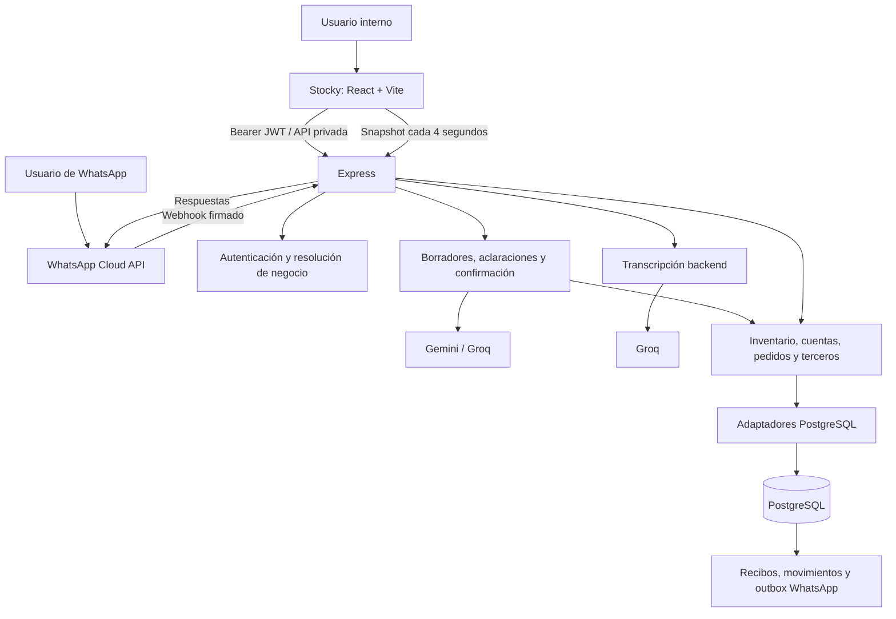
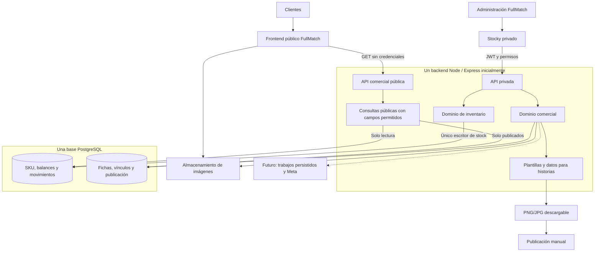

# Auditoría de Stocky y arquitectura comercial para FullMatch Casacas

**Fecha:** 20 de octubre de 2026.  
**Repositorio auditado:** ERPVoice, commit `4dc5d9b`.  
**Modalidad:** investigación de código, consultas de solo lectura a PostgreSQL y ejecución de pruebas existentes seleccionadas. **Durante la auditoría no se modificaron archivos, datos, configuración ni se ejecutaron migraciones.** Este documento conserva los resultados de esa auditoría; no representa una implementación.

## 1. Resumen ejecutivo

**Recomiendo la alternativa C: una aplicación pública desacoplada, con frontend propio para FullMatch, conectada a una API comercial específica incorporada al backend actual de Stocky.**

Inicialmente mantendría:

- Un único backend Node/Express.
- Una única base PostgreSQL.
- Stocky como autoridad exclusiva sobre SKU, existencias y movimientos.
- Un módulo comercial separado para fotografías, fichas, visibilidad y plantillas.
- Dos aplicaciones frontend: administración privada y catálogo público.
- Generación de historias descargables antes de automatizar Instagram.

**No hace falta desarrollar otro motor de inventario, otra base de stock ni un conjunto de microservicios.**

Stocky tiene una base técnica aprovechable: operaciones transaccionales, recibos idempotentes, validación de identidad, revisiones, aislamiento por negocio y pruebas de dominio y seguridad. La principal brecha es comercial: faltan el producto comercial persistente, las fotografías, la publicación y una API pública segura.

### Hallazgos determinantes

1. **`products` representa SKU individuales.** Cada fila contiene talle, cantidad disponible, cantidad reservada y precio.
2. **El agrupamiento de talles existe como cálculo de interfaz**, basado en tipo/modelo; no constituye una entidad comercial estable.
3. **Las familias configurables son esquemas de atributos**, no fichas comerciales de una camiseta.
4. **La API actual es privada y operativa.** `/api/state` devuelve conjuntamente productos, clientes, proveedores, pedidos e historial.
5. **No encontré implementación de catálogo público, fotografías de productos, promociones, checkout ni publicación en Instagram.**
6. **Empretienda permite importación masiva por Excel**, pero no pude verificar una API pública oficial que resuelva sincronización automática de catálogo, stock y ventas.
7. **La publicación de historias mediante Meta es técnicamente posible bajo condiciones de cuenta y permisos**, pero no está implementada ni verificada para la cuenta de FullMatch.

### Comprobación de la base configurada

La conexión directa permitió verificar PostgreSQL **17.6**, usando transacciones de solo lectura y sin pasar por el inicializador de Stocky.

En el perfil identificado como FullMatch encontré:

- **50 SKU:** 31 activos y 19 inactivos.
- Los 50 tienen precio distinto de cero.
- **Los 50 tienen moneda `XXX`, sin moneda comercial definida.**
- Ninguno tiene atributos tipados cargados.
- Ninguno tiene una familia asignada.
- Ningún SKU activo tenía disponibilidad cero al momento de la consulta.

En toda la base configurada había 72 SKU pertenecientes a seis ámbitos de negocio. No detecté identidades duplicadas según la función actual del dominio, cantidades/precios negativos ni números fuera del rango seguro de JavaScript.

**Estos resultados verifican datos persistidos, pero no prueban que el stock coincida con las existencias físicas ni que esta base sea exactamente la utilizada por el despliegue público.**

---

## 2. Arquitectura AS-IS

### Stack y organización

El proyecto es una aplicación con frontend y backend en el mismo repositorio:

- **Frontend:** React 18, TypeScript, Vite 6, Tailwind CSS 3 e iconos Phosphor.
- **Backend:** Node.js, JavaScript con módulos ESM y Express 5.
- **Persistencia:** PostgreSQL mediante `pg`; configuración compatible con Supabase.
- **Estado frontend:** Context y reducer de React; hidratación desde snapshots del backend.
- **IA:** cliente HTTP compatible con OpenAI para Gemini y fallback Groq.
- **Transcripción:** servicio backend hacia Groq, con modelo Whisper configurable.
- **Mensajería:** WhatsApp Cloud API de Meta.
- **Autenticación:** desafío por WhatsApp y JWT propio HS256.
- **Pruebas:** `node:test`, assertions e integración de navegador con Playwright.
- **Desarrollo:** Vite, nodemon, scripts de coordinación y ngrok.

Las versiones declaradas y scripts están en [package.json](C:/Users/lucas/Documents/GitHub/ERPVoice/package.json). No hay ORM: el esquema y la persistencia se implementan con SQL explícito.

La estructura principal es:

- `src/components`: panel, chat, login y onboarding.
- `src/services`: contratos y llamadas HTTP.
- `src/store`: estado de sesión y snapshots.
- `src/domain`: tipos y lógica de consulta/presentación.
- `server`: HTTP, dominios, persistencia, interpretación y mensajería.
- `scripts`: migraciones, pruebas, fixtures y evaluaciones.

### Diagrama AS-IS

### Patrones y responsabilidades

Hay una separación real entre:

1. Interpretación de lenguaje natural.
2. Preparación y revisión de propuestas.
3. Validación de dominio.
4. Ejecución y persistencia transaccional.
5. Presentación de resultados.

`AppStore` hidrata el estado persistido y mantiene mensajes; no constituye otro ejecutor de inventario. Esto se comprueba en [AppStore.tsx](C:/Users/lucas/Documents/GitHub/ERPVoice/src/store/AppStore.tsx:13).

El backend orquesta operaciones de distintos dominios dentro de una misma transacción mediante `executeUniversalPlanInTransaction`, en [universalPostgres.js](C:/Users/lucas/Documents/GitHub/ERPVoice/server/universalPostgres.js:19).

### Frontend privado

El acceso a la aplicación pasa por `AppGate`: sesión, invitación, onboarding y finalmente panel. No encontré una ruta pública comercial equivalente a una ficha de producto. Véase [App.tsx](C:/Users/lucas/Documents/GitHub/ERPVoice/src/App.tsx:32).

El panel consulta `/api/state` cada cuatro segundos mediante [useMetaEventSync.ts](C:/Users/lucas/Documents/GitHub/ERPVoice/src/hooks/useMetaEventSync.ts:22). Este mecanismo sirve para el panel actual, pero no conviene replicarlo para cada visitante del catálogo.

### Infraestructura y entornos

**Verificado en el código:**

- Desarrollo local con frontend y backend separados.
- Proxy `/api` configurado en [vite.config.ts](C:/Users/lucas/Documents/GitHub/ERPVoice/vite.config.ts:7).
- Backend escuchando en `0.0.0.0` y puerto configurable.
- URL de frontend Vercel incorporada a CORS y enlaces de la aplicación.
- Lectura de variables de commit de Render para `/api/health`.
- Scripts de demostración y pruebas con API simulada/PostgreSQL temporal.

**No verificado:**

- Proveedor y plan efectivos del backend desplegado.
- Commit actualmente publicado.
- Separación real entre producción y staging.
- Backups operativos y restauración probada.
- Alertas, disponibilidad histórica y límites contratados.

No encontré manifiestos de despliegue como `render.yaml`, `vercel.json`, Dockerfile o workflows de CI en el árbol inspeccionado. Las referencias a proveedores **no demuestran por sí mismas una configuración productiva concreta**.

Existe un archivo SQLite versionado, pero [database.js](C:/Users/lucas/Documents/GitHub/ERPVoice/server/database.js:1) exporta PostgreSQL. No encontré evidencia de SQLite como persistencia del camino HTTP actual.

---

## 3. Inventario de funcionalidades

### Implementado y reutilizable

**Alta de SKU y variantes.**  
Las rutas `POST /api/products` y `POST /api/products/model` ejecutan altas mediante el núcleo de inventario. Exigen identificadores de operación y admiten variantes, existencias iniciales, atributos, unidad y moneda.

**Edición de productos y precios.**  
`PUT /api/products/:id` requiere operación, revisión esperada y motivo. Permite modificar metadatos, precio, moneda y cantidades bajo controles del dominio. Véase [index.js](C:/Users/lucas/Documents/GitHub/ERPVoice/server/index.js:615).

**Ingresos, ventas, reservas y ajustes.**  
El núcleo contempla `stock.receive`, `stock.sell`, `stock.reserve`, `stock.withdraw` y `stock.adjust`. Hay validaciones de cantidad, unidad, disponibilidad e identidad.

**Bajas individuales y masivas.**  
La baja es lógica: `sku.deactivate` conserva cantidades e historial y rechaza SKU con reservas. La interfaz exige una selección revisada. No equivale a ocultar temporalmente un producto comercial.

**Lenguaje natural y audio.**  
El audio se transcribe en el backend; el intérprete propone consultas u operaciones. Los borradores admiten revisión, aclaración, confirmación y cancelación.

**Consultas de stock.**  
Existen consultas privadas estructuradas y mediante conversación, además de búsqueda y agrupación en el panel.

**Administración operativa.**  
Productos, clientes, proveedores, cuentas, pedidos, ventas e integrantes del negocio.

**Recuperación de operaciones.**  
Los intentos y recibos permiten recuperar resultados sin volver a ejecutar una mutación.

### Reutilizable con adaptación

- Formularios y flujos de edición: como base para administración comercial.
- Identificadores de SKU: para vincular variantes comerciales.
- Precio por SKU: después de aclarar moneda y unidad monetaria.
- Atributos tipados: para características físicas estables.
- Revisión e idempotencia: para edición comercial y generación por lotes.
- Infraestructura PostgreSQL y autenticación: para mantener un solo sistema administrativo.

### Ausente en los caminos inspeccionados

- Producto comercial persistente con ID propio.
- Fotografías de productos y almacenamiento de medios.
- Descripciones comerciales, portada y orden de galería.
- Slugs y fichas públicas compartibles.
- Estado de publicación independiente del estado del inventario.
- Filtros comerciales por club, selección, temporada y versión.
- Promociones y precios promocionales con vigencia.
- Plantillas y exportación de historias.
- Publicación/programación de Instagram.
- Conector con Empretienda.
- Carrito, checkout, pagos y pedidos de comercio electrónico.

**Los pedidos actuales no son un checkout.** Su modelo y efectos se orientan a solicitudes y consecución de mercadería. Marcar un pedido como conseguido puede ingresar stock; reutilizarlo directamente como orden de compra online introduciría una confusión de dominio.

---

## 4. Diagnóstico de base de datos y APIs

### 4.1 Esquema verificado

El esquema base está definido en [postgresDatabase.js](C:/Users/lucas/Documents/GitHub/ERPVoice/server/postgresDatabase.js:338), complementado por módulos de inventario, cuentas, pedidos, familias y conversaciones.

Las entidades principales son:

- **`products`:** cada SKU y sus balances actuales.
- **`inventory_operations`:** plan, actor, hash y resultado de cada operación.
- **`inventory_movements`:** deltas de disponible y reservado.
- **`inventory_selections`:** selecciones revisables para operaciones masivas.
- **`product_family_schemas`:** esquemas de atributos versionados.
- **`clients`, `proveedores`, `pedidos`:** gestión operativa.
- **`account_operations`, `account_movements`:** cuentas corrientes.
- **`transactions`:** historial de acciones y texto de origen.
- **`universal_operations`, `universal_drafts` y comandos:** conversación y ejecución.
- **`meta_message_claims`, `meta_reply_outbox`, `meta_events`:** recepción, recuperación y respuestas de WhatsApp.
- **`auth_users`, desafíos, miembros e invitaciones:** acceso y pertenencia a negocios.

También existen tablas históricas, incluida `twilio_events`.

### 4.2 Producto comercial, SKU y disponibilidad

**Actualmente no están modelados como tres entidades independientes.**

**SKU:** sí existe, identificado por `products.id`.

**Disponibilidad:** existe como balances dentro del mismo SKU:

- `stock_available`.
- `stock_reserved`.

**Producto comercial:** no existe como agregado persistente con identidad propia.

La interfaz agrupa SKU mediante `buildProductGroups`, utilizando `productType` y `productModel`, o el nombre como alternativa. Véase [ProductsAbmPanel.tsx](C:/Users/lucas/Documents/GitHub/ERPVoice/src/components/dashboard/ProductsAbmPanel.tsx:108).

Esto permite mostrar talles juntos, pero presenta limitaciones:

- Renombrar metadatos puede cambiar la agrupación.
- No hay un ID estable al cual asignar una galería.
- No asegura distinguir temporadas o versiones si no están incorporadas consistentemente.
- No proporciona una identidad estable para enlaces compartidos.
- La clave visual no considera todos los atributos que sí intervienen en la identidad del SKU.

Por tanto, **no usaría esa agrupación como clave del catálogo**.

### 4.3 Identidad y unicidad

La identidad del dominio considera nombre, tipo, modelo, talle/atributos, unidad y familia cuando corresponde. La función relevante es `productIdentity`, en [inventoryOperations.js](C:/Users/lucas/Documents/GitHub/ERPVoice/server/inventoryOperations.js:184).

Aspectos positivos:

- Normalización conservadora.
- Conflictos explícitos entre `size` y `attributes.size`.
- Rechazo de identidades duplicadas.
- Identificadores opacos generados para altas.
- Comprobación de revisiones y fingerprints.

**Límite importante:** la base consultada tiene una clave primaria por `id` y un índice por `owner_phone`, pero **no un índice único de identidad comercial/semántica**.

La unicidad depende del ejecutor y sus bloqueos. Es válida para los caminos actuales controlados, pero otro escritor SQL podría saltársela.

### 4.4 Stock, transacciones e idempotencia

`executeInventoryPlanInTransaction`:

1. Valida el plan y su ámbito.
2. Toma un bloqueo transaccional por operación.
3. Consulta recibos anteriores.
4. Rechaza reutilizar el ID con otro contenido.
5. Bloquea productos y carga los SKU del negocio.
6. Calcula efectos.
7. Guarda productos, recibo y movimientos.

La implementación está en [inventoryPostgres.js](C:/Users/lucas/Documents/GitHub/ERPVoice/server/inventoryPostgres.js:62).

Las actualizaciones verifican la revisión esperada al persistir. Un lote con stock insuficiente falla sin aplicar parcialmente sus acciones.

**Semántica que debe respetar el catálogo:** reservar disminuye `stockAvailable` y aumenta `stockReserved`. Por ello:

> La cantidad disponible para ofrecer ya es `stockAvailable`; no corresponde restarle nuevamente `stockReserved`.

El cálculo está en [inventoryOperations.js](C:/Users/lucas/Documents/GitHub/ERPVoice/server/inventoryOperations.js:292).

No encontré un ciclo completo de reservas de ecommerce con vencimiento, liberación y confirmación de pago. La existencia de `stock.reserve` no resuelve por sí sola ese problema.

### 4.5 Precios y monedas

El sistema diferencia precio del catálogo y precio opcional de una venta. Esa separación es aprovechable.

Sin embargo:

- Los precios se almacenan como enteros `BIGINT`.
- El dominio limita los valores al rango seguro de JavaScript.
- Se acepta una moneda de tres letras.
- El valor por defecto es `XXX`.
- La validación sintáctica no garantiza que el código corresponda a una moneda admitida por el negocio.
- No encontré un contrato explícito y uniforme de unidad mayor frente a centavos.

**Para FullMatch, todos los SKU consultados tienen `XXX`.** No se debe asumir ARS, UYU ni dividir/multiplicar por 100 sin confirmación.

Antes de publicar, hay que definir moneda y escala y revisar una muestra contra los precios utilizados comercialmente.

No encontré un campo separado de costo de compra en `products`. Tampoco corresponde publicar automáticamente todo campo denominado `price` sin validar su significado comercial.

### 4.6 Relaciones e integridad

Verifiqué restricciones para recibos y movimientos, pero no una red completa de claves foráneas entre las entidades del negocio.

En particular:

- `inventory_movements` referencia su operación.
- La referencia a familia controla que ID y versión estén conjuntamente presentes.
- Esa comprobación no equivale a una FK hacia el esquema de familia.
- Las referencias de pedidos a cliente, proveedor y producto dependen principalmente de validaciones de aplicación.
- No encontré restricciones SQL generales que impidan balances negativos en `products`.

El ejecutor compensa parte de esto, pero **integridad de aplicación y restricciones de base deberían complementarse** al evolucionar el sistema.

### 4.7 APIs existentes

Los grupos principales son:

- **Sesión y negocio:** `/api/auth/*`, `/api/business-profile`, `/api/team/*`.
- **Snapshot privado:** `GET /api/state`.
- **Productos:** `POST /api/products`, `POST/PUT /api/products/model`, `PUT/DELETE /api/products/:id`, baja por lote.
- **Inventario:** operaciones, selecciones y familias bajo `/api/inventory/*`.
- **Operaciones universales:** `POST /api/operations`.
- **Borradores:** preparación, consulta, respuestas, confirmación y cancelación bajo `/api/operation-drafts`.
- **Cuentas:** `/api/accounts/operations`.
- **Clientes, proveedores y pedidos:** rutas privadas específicas.
- **Audio:** `POST /api/voice/transcribe`.
- **WhatsApp:** `GET/POST /api/meta-webhook`.
- **Salud:** `GET /api/health`.

`POST /api/state/apply` y `POST /api/voice/parse` están retirados y responden 410 tras autenticación.

No encontré una API pública de lectura de productos, un contrato comercial versionado ni documentación OpenAPI.

**Conclusión:** existe una API interna reutilizable como infraestructura, pero el catálogo necesita un contrato nuevo y acotado.

---

## 5. Limitaciones y riesgos técnicos actuales

### 5.1 Exposición accidental de información interna — prioridad alta

`queryAllState` devuelve productos, clientes, proveedores, pedidos y transacciones, incluido texto de origen. Véase [postgresDatabase.js](C:/Users/lucas/Documents/GitHub/ERPVoice/server/postgresDatabase.js:661).

**No debe publicarse `/api/state`, ni enviarse su resultado al navegador público para filtrarlo allí.** El filtrado debe ocurrir antes de construir la respuesta.

### 5.2 El aislamiento depende del backend — prioridad alta

La base consultada tiene RLS habilitado y sin políticas de acceso en las tablas revisadas. Los roles `anon` y `authenticated` no tienen permiso SELECT sobre las tablas operativas actuales.

Pero **el rol de la conexión configurada tiene `BYPASSRLS`**.

Por tanto:

- RLS protege frente a determinados accesos directos.
- No sustituye el filtrado por negocio en las consultas del backend.
- Una consulta mal delimitada ejecutada por ese rol podría acceder a otros negocios.

Encontré además permisos SELECT históricos para `twilio_events` en `anon` y `authenticated`. Actualmente RLS está habilitado y no hay políticas, por lo que esos permisos **no prueban una exposición efectiva**; sí son una inconsistencia que conviene revisar.

### 5.3 Autenticación y permisos

Aspectos favorables:

- JWT con algoritmo, emisor, expiración y firma comprobados.
- Comparación de firmas en tiempo constante.
- Secreto de producción con longitud mínima.
- Firma HMAC del cuerpo original para webhooks.
- Resolución del negocio desde la identidad autenticada.

Referencias: [auth.js](C:/Users/lucas/Documents/GitHub/ERPVoice/server/auth.js:27), [metaWebhookSecurity.js](C:/Users/lucas/Documents/GitHub/ERPVoice/server/metaWebhookSecurity.js:9) y [index.js](C:/Users/lucas/Documents/GitHub/ERPVoice/server/index.js:219).

Limitaciones:

- Los JWT se guardan en `localStorage`: una vulnerabilidad XSS podría extraerlos.
- La sesión tiene una duración por defecto extensa, sin un mecanismo general de revocación observado.
- El contexto del panel asigna una lista amplia de permisos; no encontré perfiles comerciales granulares.
- CORS tiene una lista fija de orígenes. No constituye una barrera de autorización.
- El bypass de desarrollo depende de detectar correctamente producción o deshabilitarlo explícitamente.

El catálogo público no debe recibir JWT administrativos. También conviene alojar administración y catálogo en orígenes diferentes.

### 5.4 Concurrencia y crecimiento

El ejecutor toma `LOCK TABLE products IN SHARE ROW EXCLUSIVE MODE` y carga los productos del negocio con `FOR UPDATE`.

Es una protección conservadora, pero **serializa escritores sobre toda la tabla, incluso entre negocios**. No representa un problema urgente para el volumen observado; sí limita la concurrencia futura.

No lo cambiaría como condición para lanzar un catálogo de lectura. Primero mediría tiempos de espera y carga.

### 5.5 Inicialización del esquema durante el uso

`ensureReady` llama a `initializeDatabase`, que ejecuta DDL y normalizaciones. Incluso una lectura de snapshot pasa antes por ese inicializador.

Referencias: [postgresDatabase.js](C:/Users/lucas/Documents/GitHub/ERPVoice/server/postgresDatabase.js:142) y [getStateSnapshotStrict](C:/Users/lucas/Documents/GitHub/ERPVoice/server/postgresDatabase.js:2309).

Esto explica por qué **no utilicé las funciones de acceso de Stocky para auditar la base**: una operación aparentemente de lectura podía inicializar cambios.

Antes de exponer nuevas rutas públicas, separaría la preparación del esquema del manejo de solicitudes y reduciría permisos del usuario de ejecución.

### 5.6 Transporte y disponibilidad

La configuración PostgreSQL utiliza TLS con `rejectUnauthorized: false` cuando activa SSL. Esto cifra la conexión, pero no valida adecuadamente el certificado del servidor. Debe revisarse contra la configuración admitida por el proveedor.

`/api/health` devuelve información de configuración y commit, pero no comprueba la disponibilidad efectiva de PostgreSQL y mantiene una respuesta positiva aunque algunos indicadores no estén listos. **No es una prueba completa de readiness.**

### 5.7 Mantenibilidad

Hay módulos de dominio bien separados, pero persiste concentración de responsabilidades:

- `postgresDatabase.js`: aproximadamente 3.500 líneas.
- `metaWebhookProcessor.js`: aproximadamente 2.800.
- `ProductsAbmPanel.tsx`: aproximadamente 1.180.

También quedan parsers y compatibilidades históricas. La ruta actual de WhatsApp dirige el procesamiento hacia operaciones universales; no corresponde considerar cada parser antiguo como una funcionalidad activa independiente.

Evitaría sumar toda la lógica comercial dentro de esos archivos. Bastan módulos delimitados; no hace falta una reescritura general.

### 5.8 Pruebas y verificación realizada

Ejecuté once scripts existentes seleccionados sobre:

- Identidad y operaciones de inventario.
- Altas, ventas, ajustes y bajas.
- Familias.
- Autenticación.
- Firmas de webhooks.
- Transcripción.
- Privacidad de logs del cliente LLM.

**Todos finalizaron correctamente.**

También inspeccioné pruebas de navegador y de integración PostgreSQL existentes. No ejecuté builds, pruebas que escriben fixtures de base, evaluaciones con proveedores reales ni la suite completa.

Esto no constituye una certificación de seguridad, una prueba del despliegue ni una verificación de cobertura total.

### 5.9 Diferencias entre documentación y código

[REQUIREMENTS.md](C:/Users/lucas/Documents/GitHub/ERPVoice/REQUIREMENTS.md) describe comportamientos históricos:

- Presenta `/api/state/apply` como disponible.
- Afirma creación automática al no encontrar un producto.
- Enumera una versión de Vite distinta de la declarada actualmente.

El código y el README más reciente muestran el retiro del escritor anterior y la revisión universal.

También hay comentarios históricos en el ejecutor sobre convivencia con un escritor legado. **La documentación debe leerse como contexto, no como prueba de comportamiento.**

---

## 6. Comparación de alternativas arquitectónicas

### A. Plataforma completamente independiente

Necesitaría otra base comercial, integración con Stocky, mapeo de identidades, reintentos y conciliación.

Puede separar bien cargas y despliegues, pero introduce dos representaciones del catálogo y, si copia cantidades, una proyección de stock potencialmente atrasada.

Una implementación confiable requeriría:

- Stocky como autoridad de inventario.
- Eventos persistidos o lectura incremental.
- Receptores idempotentes.
- Versiones para rechazar eventos atrasados.
- Conciliación periódica.
- Validación contra Stocky al reservar o vender.

**La descarto para el inicio:** añade trabajo distribuido sin una necesidad de escala que lo justifique.

### B. Módulo comercial integrado completamente en Stocky

Es la opción con mayor reutilización inmediata y un solo despliegue frontend.

Su riesgo principal es extender una aplicación privada, actualmente organizada alrededor del login y de snapshots operativos, hasta convertirla también en una web pública.

Puede hacerse correctamente con contratos y rutas separados. No obstante, compartir navegación, estado global y ciclo de despliegue aumenta el riesgo de acoplar dos experiencias muy distintas.

**Es la segunda mejor alternativa.** Resultaría razonable si la prioridad absoluta fuera mantener una sola aplicación visual.

### C. Frontend público separado y backend de Stocky ampliado

Permite una experiencia comercial propia y reutiliza el inventario existente.

La variante que recomiendo:

- Frontend independiente.
- API comercial explícita.
- Módulo comercial en el mismo backend.
- Misma base, con tablas comerciales separadas.
- Sin stock duplicado.
- Sin BFF adicional inicialmente.

**Es el mejor equilibrio para FullMatch.**

La separación del frontend no aísla por sí sola el proceso backend. La seguridad depende de la API, los permisos y el acceso a datos.

### D. Empretienda automatizada desde Stocky

Aporta tienda, cobros y envíos ya resueltos. Su obstáculo es la integración verificable.

La importación Excel permite reducir trabajo manual, pero no garantiza actualización continua ni resolver ventas concurrentes en distintos canales.

**No la elegiría como solución principal al objetivo de cargar una vez y reflejar stock real.** Podría conservarse temporalmente con conciliación explícita.

### E. Plataforma de ecommerce con API documentada

Tiendanube es una alternativa concreta para una fase en la que checkout, pagos y envíos tengan prioridad. Su documentación oficial incluye integración ERP, inventario y webhooks de pedidos. [Guía oficial de webhooks](https://tiendanube.dev/apps/erp-guide/orders/webhooks).

Aun así, un conector no elimina la necesidad de mapear variantes y resolver eventos duplicados, cancelaciones y stock compartido.

**No migraría ahora únicamente para resolver catálogo e historias.** La reconsideraría antes de desarrollar una tienda transaccional propia.

### Matriz ponderada

Escala favorable: **5 significa menor esfuerzo/costo/complejidad o mayor capacidad**, según el criterio.

Las puntuaciones son juicio arquitectónico para este proyecto, no mediciones de proveedores. D evalúa una integración respaldada por las capacidades verificadas; E considera una plataforma con API más su conector.

| Criterio | Peso | A | B | C | D | E |
|---|---:|---:|---:|---:|---:|---:|
| Esfuerzo inicial | 12% | 1 | 4 | 4 | 3 | 2 |
| Reutilización | 8% | 2 | 5 | 5 | 2 | 3 |
| Costo mensual | 10% | 2 | 5 | 5 | 4 | 3 |
| Mantenimiento | 12% | 1 | 4 | 4 | 2 | 3 |
| Simplicidad de integración | 8% | 1 | 5 | 4 | 1 | 2 |
| Seguridad | 12% | 3 | 3 | 4 | 3 | 4 |
| Consistencia de inventario | 14% | 2 | 5 | 5 | 1 | 3 |
| Escalabilidad | 5% | 4 | 3 | 4 | 3 | 4 |
| Flexibilidad de diseño | 5% | 5 | 4 | 5 | 3 | 3 |
| Independencia de proveedores | 4% | 5 | 5 | 5 | 1 | 2 |
| Facilidad de despliegue | 4% | 2 | 5 | 4 | 4 | 3 |
| Tiempo hasta MVP | 6% | 1 | 4 | 4 | 3 | 2 |
| **Resultado / 5** | **100%** | **2,11** | **4,31** | **4,41** | **2,42** | **2,87** |

La cercanía entre B y C es deliberada: **ambas son viables**. La elección de C se fundamenta en separar la experiencia comercial sin pagar el costo de otro inventario.

La diferencia de seguridad supone implementar C con proyección pública y acceso de lectura restringido. B podría alcanzar garantías equivalentes si incorpora esas mismas fronteras.

### Justificación económica

No pude verificar las facturas o planes actuales. Por eso distingo precios publicados y presupuestos orientativos.

**Referencias verificadas:**

- Empretienda publica **ARS 10.490 mensuales**, sin comisión propia por venta. Las pasarelas tienen condiciones independientes. [Precio oficial](https://empretienda.com/).
- Supabase Pro parte de **USD 25 mensuales**; incluye capacidades de almacenamiento y backups sujetas a sus límites. El plan gratuito no incluye backups automáticos. [Precios oficiales](https://supabase.com/pricing).
- Render permite sitios estáticos gratuitos sujetos a cuotas; sus servicios gratuitos tienen limitaciones y no deben tomarse como garantía productiva. [Documentación oficial](https://render.com/docs/free).
- Vercel Hobby restringe el uso a proyectos personales no comerciales. No corresponde presupuestar una tienda sobre ese plan. [Condiciones del plan](https://vercel.com/docs/plans/hobby).

**Estimaciones de planificación, no cotizaciones:**

- **B/C:** incremento inicial de aproximadamente USD 0–20/mes si se aprovecha capacidad ya contratada; excluye eventuales cambios obligatorios de plan.
- **A:** aproximadamente USD 15–60/mes adicionales para otro backend, persistencia y sincronización.
- **D:** suscripción de Empretienda más trabajo de exportación/conciliación.
- **E:** suscripción, posibles cargos de plataforma y operación del conector; pendiente de cotización según país y plan.

Para C con una base productiva paga, presupuestaría provisionalmente **USD 35–60/mes totales** para base, backend pequeño, hosting del catálogo y medios de poco volumen. No incluye dominio, impuestos, IA existente ni automatización de publicaciones.

La variable dominante será el tiempo de desarrollo y mantenimiento. Debe medirse también el tiempo que hoy consume actualizar cada canal.

---

## 7. Arquitectura TO-BE recomendada

### Componentes

**1. Stocky privado**

Conserva:

- SKU e identidades.
- Balances y movimientos.
- Ingresos, ventas, reservas y ajustes.
- Cuentas, clientes, proveedores y pedidos operativos.
- Audio, interpretación, revisión y confirmación.

**2. Módulo comercial en el backend**

Añade:

- Productos comerciales y vínculos a SKU.
- Fotografías y descripciones.
- Visibilidad y destacados.
- Reglas comerciales simples.
- Proyección pública.
- Datos para generar historias.

**3. Catálogo FullMatch**

Aplicación pública con identidad visual propia:

- Listado, filtros y búsqueda.
- Fichas y enlaces estables.
- Talles disponibles.
- Precio y moneda.
- WhatsApp.
- Metadatos para compartir.

**4. Almacenamiento de imágenes**

Usaría almacenamiento de objetos, inicialmente el disponible en el proveedor actual si resulta conveniente. Las imágenes no deben depender del filesystem efímero del backend.

### Diagrama TO-BE

### APIs frente a base compartida

**Recomendación:**

- El navegador público consume HTTP.
- El navegador nunca accede a las tablas operativas.
- El módulo comercial puede consultar la misma base desde el backend.
- El módulo comercial no escribe balances de inventario.
- Cualquier futura reserva o venta utiliza el núcleo de Stocky.

Compartir base **dentro del backend propietario** permite consultas consistentes sin sincronización distribuida.

Permitir que otra aplicación tenga acceso general a las tablas produciría un contrato implícito con el esquema, mayor exposición y migraciones coordinadas. Si más adelante se separa el servicio comercial, preferiría una API explícita de Stocky antes que darle acceso amplio a sus tablas.

### Protección de la lectura pública

Incorporaría:

- Rutas públicas separadas de las operativas.
- Respuestas construidas mediante lista explícita de campos.
- Resolución del comercio por slug público, sin usar teléfonos en URLs.
- Consultas limitadas a productos publicados del comercio solicitado.
- Pool/rol de lectura restringido a una proyección comercial revisada.
- Límites de paginación, filtros y frecuencia.
- Errores sanitizados.
- Ningún token administrativo en el bundle público.

La vista o proyección de base debe revisarse junto con sus permisos y comportamiento de RLS. No basta con llamarla “pública”.

### Despliegues

Mantendría un repositorio con dos entradas o aplicaciones frontend y módulos backend delimitados. No hace falta dividir repositorios.

- Catálogo: despliegue independiente en CDN/hosting apto para uso comercial.
- Administración: despliegue privado existente.
- API: proceso actual con rutas separadas.
- PostgreSQL: instancia actual.
- Medios: almacenamiento de objetos.

Separaría otro backend únicamente ante necesidades comprobadas de carga, seguridad operativa o disponibilidad.

### Caché y actualización

Para el primer MVP:

- Consultas comerciales pequeñas y paginadas.
- Disponibilidad consultada en vivo, sin caché compartida inicialmente.
- Fotografías con URLs versionadas.
- Contenido comercial cacheable cuando exista invalidación confiable.
- Refresco al volver a la pestaña y antes de preparar una consulta de compra.

Si después se cachea disponibilidad, hay que acordar una tolerancia explícita de atraso y agregar invalidación/reconciliación. Ningún TTL equivale a consistencia instantánea.

Una futura compra debe validar y reservar contra Stocky aunque el catálogo haya mostrado stock segundos antes.

---

## 8. Modelo de datos y contratos necesarios

Todo lo siguiente es **propuesta conceptual**, no esquema implementado.

### Producto comercial

Una entidad `CommercialProduct` con:

- ID estable y comercio.
- Slug.
- Título y descripción.
- Club o selección.
- Temporada.
- Edición: titular, suplente, tercera, etc.
- Versión: jugador, hincha u otras acordadas.
- Estado editorial: borrador, publicado, oculto o archivado.
- Fecha de publicación y destacado.
- Revisión comercial.

Ejemplo: **Barcelona titular 2025, versión jugador**.

### Vínculo con variantes

Una relación explícita entre producto comercial y SKU:

- Comercio.
- Producto comercial.
- SKU de Stocky.
- Orden de variante.
- Eventual visibilidad de variante.
- Identificador público opaco, si se desea separar la identidad externa.

Ejemplo: la ficha anterior se vincula a los SKU M, L y XL.

Reglas:

- El SKU debe pertenecer al mismo negocio.
- Un SKU no debe aparecer accidentalmente en dos fichas activas equivalentes.
- Un cambio de nombre no rompe la asociación.
- Publicar una ficha no reactiva SKU dados de baja.
- Ocultar una ficha no modifica stock.

### Fotografías

Una entidad `ProductImage` con:

- Producto comercial.
- Clave del objeto almacenado.
- Tipo, dimensiones y tamaño.
- Texto alternativo.
- Orden y portada.
- Revisión o hash.
- Recorte/punto focal para las plantillas.

La carga debe validar formato y tamaño, corregir orientación y evitar publicar metadatos privados. Los originales y las derivadas deben tener una política de respaldo.

### Precios

Para el MVP usaría **el precio del SKU como única fuente del precio base**, una vez normalizadas moneda y escala.

La ficha puede mostrar:

- Un precio único si coinciden las variantes.
- “Desde…” si difieren.
- El precio concreto al elegir talle.

Las promociones posteriores pueden pertenecer al dominio comercial y producir un precio efectivo derivado. No mantendría dos campos de precio base editables en lugares distintos.

### Atributos físicos y comerciales

Los atributos tipados existentes sirven para identidad física. No pondría allí:

- Fotografía.
- Texto promocional.
- Orden de exhibición.
- Etiqueta de campaña.
- Estado editorial.

En el código actual los atributos participan en la identidad del SKU. Usarlos para información editorial podría provocar cambios de identidad y conflictos innecesarios.

### Contratos públicos propuestos

- `GET /api/public/v1/stores/{slug}/products`
- `GET /api/public/v1/stores/{slug}/products/{productSlug}`
- `GET /api/public/v1/stores/{slug}/filters`

El listado devolvería tarjetas y paginación; la ficha, variantes y galería.

Campos permitidos:

- Identidad pública.
- Título y atributos comerciales.
- Fotografías.
- Precio con moneda y escala explícitas.
- Talles y disponibilidad.
- URL y contacto.
- Fecha/revisión de la representación.

Excluiría clientes, proveedores, saldos, reservas individualizadas, teléfonos internos, texto de operaciones, recibos privados y costos futuros.

### Contratos privados propuestos

- Crear/editar ficha comercial.
- Vincular/desvincular SKU.
- Subir y ordenar fotografías.
- Publicar/ocultar.
- Preparar una historia.
- Generar un lote.

Las mutaciones deben mantener revisiones, permisos e idempotencia. Un visitante no debe poder convertir un contrato público de lectura en un `OperationPlan`.

### Comportamiento ante cambios

- **Ingreso de una camiseta:** Stocky actualiza el SKU. Si ya está vinculado, la disponibilidad cambia; si es nuevo, queda pendiente de completar/publicar.
- **Cambio de precio:** la API deriva el precio del SKU actualizado.
- **Nuevo talle:** se vincula a la ficha existente después de verificar identidad.
- **Venta de la última unidad:** deja de aparecer como disponible; la ficha puede conservarse como agotada.
- **Baja de variante:** se excluye de las opciones comprables sin borrar historia.
- **Nueva fotografía:** cambia la referencia/versionado de la imagen.
- **Ocultar producto:** deja de devolverse públicamente sin tocar balances.

---

## 9. Evaluación del generador de historias de Instagram

### Alcance recomendado

Desde la ficha privada, “Generar historia” debería:

1. Recuperar ficha, foto, precio y disponibilidad.
2. Tomar un snapshot consistente.
3. Permitir elegir plantilla y recorte.
4. Mostrar una previsualización.
5. Exportar **1080 × 1920**.
6. Advertir si los datos cambiaron antes de exportar.

Empezaría con tres plantillas: **nuevo ingreso, stock disponible y última unidad**. Después agregaría promoción y minimalista.

“Última unidad” debe calcularse sobre variantes activas y disponibles, con una regla clara de si se refiere a un talle o a toda la ficha.

### Comparación técnica

**Canvas en el frontend**

- Buena calidad a resolución fija.
- Sin costo de cómputo adicional en el servidor.
- Adecuado para pocas plantillas y exportación individual.
- Requiere resolver fuentes, medición de texto, recortes y CORS.
- Los lotes grandes pueden consumir mucha memoria en celulares.

`toBlob` permite exportar imágenes y exige que el canvas no esté contaminado por recursos de otro origen sin permisos. [Documentación de Canvas](https://developer.mozilla.org/en-US/docs/Web/API/HTMLCanvasElement/toBlob).

**Renderizado directo en backend, por ejemplo SVG y rasterización**

- Resultado uniforme.
- Apropiado para lotes y automatización.
- Mayor control del uso de memoria y colas.
- Añade dependencias y mantenimiento de tipografía/composición.
- Exige escape estricto de datos y control de recursos externos.

**HTML/CSS a imagen en backend**

- Muy flexible para diseño y tipografía.
- Permite reutilizar conocimientos frontend.
- Consume más memoria y CPU por navegador.
- Requiere controlar versión de navegador, fuentes, red y concurrencia.

Playwright soporta capturas completas, de elementos y en memoria. Ya existe como dependencia de desarrollo, pero eso **no significa que esté preparado como servicio productivo de renderizado**. [Documentación oficial](https://playwright.dev/docs/screenshots).

**Captura de DOM en el navegador**

- Prototipado rápido.
- Mayor riesgo de diferencias entre navegadores y soporte incompleto de CSS.
- Menor previsibilidad para diseños exigentes.

### Elección

Para el volumen inicial usaría **Canvas frontend con una definición de plantilla y datos independiente de la interfaz**.

Esto reduce infraestructura y permite validar si la herramienta ahorra tiempo. Para lotes importantes o publicación automática, trasladaría el renderizado a un trabajo backend con concurrencia limitada.

Exportaría PNG y JPG; la adaptación al formato admitido por una futura API debe verificarse por separado. No usaría generación de imágenes con IA para reconstruir fotografías de camisetas: las plantillas deben conservar el producto real.

### Generar, compartir, publicar y programar

Son capacidades distintas:

- **Generar:** producir un archivo; no necesita permisos de Instagram.
- **Compartir manualmente:** descargar o abrir la hoja de compartir, cuando el dispositivo lo permita. No garantiza abrir directamente el compositor de historias.
- **Publicar por API:** requiere cuenta elegible, autorización y permisos.
- **Programar:** requiere confirmar una capacidad oficial o mantener trabajos propios que publiquen al llegar la hora.

La colección oficial de Meta confirma publicación para cuentas profesionales y señala que **Stories está disponible para cuentas Business en el flujo con Facebook Login**. Ese flujo requiere una página vinculada y permisos como `instagram_content_publish`. También documenta el flujo Instagram Login con `instagram_business_basic` e `instagram_business_content_publish`. [Colección oficial de Meta](https://www.postman.com/meta/instagram/documentation/6yqw8pt/instagram-api).

**No asumiría que todas las combinaciones de cuenta, login y formato tienen las mismas capacidades.**

Las páginas completas de publicación de Meta no pudieron recuperarse durante la consulta. Por eso no doy por confirmados límites numéricos, formatos detallados, stickers, música ni un parámetro nativo de programación.

Antes de automatizar habría que verificar en la cuenta real:

- Tipo de cuenta y flujo de login.
- Permisos y nivel de acceso aplicable.
- Revisión/verificación que corresponda.
- Formato y acceso al archivo.
- Cuotas vigentes.
- Renovación y revocación de tokens.
- Publicación de prueba y recuperación ante errores.

**Arquitectura prevista si se habilita:** trabajos persistidos, token protegido en servidor, revisión de stock/precio antes de publicar y conciliación del resultado remoto para evitar duplicados. Un simple `setTimeout` o el outbox de respuestas de WhatsApp no alcanza.

La automatización de Instagram debe permanecer **fuera del MVP obligatorio**.

---

## 10. Evaluación de Empretienda y otras plataformas existentes

### Empretienda: capacidades verificadas

La documentación oficial confirma agregar y editar productos mediante Excel. [Ayuda oficial](https://empretienda.helpjuice.com/es_AR/productos/agregar-y-editar-productos-de-forma-masiva).

Su guía publicada describe:

- Hasta 3.000 filas por importación.
- Apagar la tienda durante el procedimiento.
- Revisión y confirmación manual.
- IDs distintos para producto y variante.
- Hasta tres atributos en la planilla.
- Stock vacío interpretado como ilimitado; cero como agotado.
- Imágenes de productos nuevos cargadas posteriormente desde el panel.

Estas condiciones deben contrastarse con el panel actual, porque la guía puede evolucionar. [Guía oficial de importación](https://recursos.empretienda.com/importacion-masiva.pdf).

### Qué permite resolver

Una exportación desde Stocky podría evitar volver a escribir nombres, talles, cantidades y precios. Necesitaría conservar los identificadores externos para actualizar registros existentes.

Pero no resuelve por sí sola:

- Actualización inmediata de la última unidad.
- Fotografías centralizadas.
- Descuento automático en Stocky por ventas de Empretienda.
- Cancelaciones y devoluciones.
- Concurrencia entre ventas por WhatsApp y tienda.

**No pude verificar una API pública oficial ni webhooks de stock/pedidos accesibles para este caso.** La existencia de un dominio llamado `api.empretienda.com` no demuestra un contrato de integración disponible.

Tampoco verifiqué autorización contractual para automatizar su panel. No basaría la arquitectura en endpoints privados o un robot de navegador sin documentación y permiso del proveedor.

### Decisión sobre la tienda existente

No daría de baja Empretienda antes de comprobar el valor del nuevo catálogo.

Durante la transición hay que elegir una política concreta:

- Conciliación manual explícita de ambos canales.
- Cupos separados de stock.
- O concentración de la venta de unidades escasas en un canal.

Dejar dos canales descontando la misma última unidad sin coordinación mantiene el riesgo actual.

### Tiendanube y otras opciones

Tiendanube tiene documentación oficial de integración ERP y eventos de pedidos, por lo que merece evaluación si el siguiente objetivo pasa a ser cobrar y despachar automáticamente.

No garantiza consistencia fuerte entre su checkout y Stocky: habría que definir autoridad de reservas, compensaciones y conciliación.

No abriría ahora un proyecto de selección entre múltiples motores como WooCommerce, Shopify u otros sin una necesidad transaccional definida. Eso ampliaría el alcance y desplazaría el problema inmediato: **inventario único, fotos y contenido reutilizable**.

---

## 11. Roadmap de implementación

Las estimaciones siguientes son de trabajo efectivo de una persona con asistencia de IA. No son compromisos de calendario y excluyen fotografía, esperas de proveedores y decisiones comerciales.

### Etapa 0 — Preparación y validación de datos

**Alcance**

- Confirmar base, despliegue y plan productivo.
- Identificar los SKU comercializables de FullMatch.
- Definir moneda y escala de precios.
- Revisar agrupaciones de producto, temporada y versión.
- Definir contacto comercial.
- Comprobar backup/restauración.
- Diseñar la frontera pública de lectura.

**Dependencias:** acceso operativo y decisiones del negocio.  
**Dificultad:** media. **Estimación:** 3–6 jornadas.  
**Riesgos:** agrupar camisetas distintas o interpretar mal precios.

**Aceptación:** muestra validada de fichas/SKU, precio inequívoco y ninguna lectura pública capaz de devolver datos privados.

**Beneficio:** evita construir el catálogo sobre identidades o importes incorrectos.

### MVP 1 — Catálogo con administración comercial mínima

**Alcance**

- Producto comercial y vínculos a SKU.
- Carga básica de fotografías.
- Título, temporada, versión y club/selección.
- Publicar y ocultar.
- API pública limitada.
- Listado, búsqueda, filtros y ficha.
- Talles, precio y disponibilidad.
- WhatsApp y enlaces compartibles.
- Metadatos básicos por producto.

**Dependencias:** etapa 0, modelo comercial y almacenamiento de medios.  
**Dificultad:** media/alta. **Estimación:** 10–18 jornadas.  
**Riesgos:** calidad de fotos, categorización y comportamiento de enlaces al compartir.

**Aceptación**

- Se consulta sin login y funciona en celular.
- Cada variante remite a un SKU real.
- Un ingreso o venta se refleja en la siguiente consulta.
- Un SKU inactivo no se ofrece.
- Ocultar no altera inventario.
- Respuestas públicas sin datos operativos.
- Fotografías y precios se cargan una sola vez.

**Beneficio:** catálogo útil y eliminación de la segunda carga manual.

**Cambio respecto del roadmap original:** fotografías y administración mínima deben estar aquí, porque son dependencias del catálogo.

### MVP 2 — Historias y trabajo por lotes pequeños

**Alcance**

- Tres plantillas iniciales.
- Previsualización y recorte.
- Exportación PNG/JPG 1080 × 1920.
- Precio, talles y disponibilidad automáticos.
- Selección de varios productos y generación secuencial.
- Aviso de datos modificados.

**Dependencias:** fichas y fotografías del MVP 1.  
**Dificultad:** media. **Estimación:** 5–9 jornadas.  
**Riesgos:** textos largos, fuentes, CORS y memoria móvil.

**Aceptación**

- Archivos con tamaño correcto y textos legibles.
- Sin cortes de precio, nombre o talles.
- Resultado probado en los celulares utilizados.
- “Última unidad” calculada correctamente.
- Sin copiar manualmente datos de Stocky.
- Un lote fallido puede repetirse sin perder la selección.

**Beneficio:** ahorro directo de tiempo para mantener Instagram activo.

### MVP 3 — Automatizaciones selectivas

**Alcance**

- Novedades y promociones simples.
- Plantillas adicionales.
- Generación backend si el volumen lo requiere.
- Prueba de viabilidad con Meta.
- Publicación o programación solo tras validar permisos y operación.
- Registro de intentos, resultados y errores.

**Dependencias:** uso real del MVP 2 y elegibilidad de Meta.  
**Dificultad:** media/alta. **Estimación:** 5–12 jornadas para automatizaciones internas; Meta puede añadir trabajo y esperas externas no estimables todavía.

**Riesgos:** tokens revocados, resultados inciertos, stock agotado antes de publicar.

**Aceptación:** trabajos recuperables, sin duplicados, datos revalidados y fallos visibles. Si Meta no resulta viable, la descarga sigue resolviendo el flujo.

**Beneficio:** automatizar lo que haya demostrado repetición y valor.

### MVP 4 — Decisión sobre tienda transaccional

**Alcance previo:** decidir entre conector a ecommerce existente o checkout propio.

Si se desarrolla checkout:

- Pedidos comerciales independientes de `pedidos`.
- Reserva con vencimiento.
- Confirmación y liberación.
- Webhooks de pago idempotentes.
- Cancelaciones, devoluciones y conciliación.
- Clientes, entrega y estados de venta.

**Dependencias:** política de stock por canal, proveedor de pagos y operación de envíos.  
**Dificultad:** alta. **Estimación preliminar:** 20–40 jornadas para una solución propia acotada, a recalcular con requisitos.

**Riesgos:** sobreventa, cobro sin stock, eventos repetidos y diferencias de conciliación.

**Aceptación:** no cobrar una unidad no asignada; no descontar dos veces; recuperación verificable de fallos entre pago e inventario.

**Beneficio:** autoservicio de compra cuando el volumen justifique su costo.

### Alcance que mantendría fuera del inicio

Carrito, checkout, cuentas de clientes, fidelización, multiempresa comercial completa, editor visual libre y publicación automática obligatoria.

El éxito inicial debe medirse por **minutos ahorrados por ingreso, productos publicados y consultas comerciales generadas**, además de corrección técnica.

---

## 12. Decisiones técnicas pendientes

1. **Producción real.** Confirmar qué base y commit usa el servicio publicado.
2. **Moneda y escala.** Resolver los 50 SKU de FullMatch con `XXX`.
3. **Identidad comercial.** Acordar qué distingue dos fichas: temporada, edición, versión, personalización y otras características.
4. **Normalización inicial.** Revisar datos existentes sin inferencias silenciosas.
5. **Fotografías.** Ubicación actual, derechos de uso, calidad y almacenamiento elegido.
6. **WhatsApp comercial.** Confirmar número de atención y relación con el bot interno. Un cliente no debería entrar por error al flujo administrativo.
7. **Agotados.** Mantener ficha compartible como agotada u ocultarla del listado.
8. **Disponibilidad.** Definir si mostrar cantidad exacta o estados; acordar tolerancia de actualización.
9. **Permisos.** Determinar quién puede editar fotos/precios/publicación sin acceso a cuentas o ajustes.
10. **Hosting.** Revisar capacidad contratada y condiciones de uso comercial.
11. **Empretienda.** Confirmar con soporte si ofrece integración autorizada y obtener documentación concreta antes de comprometer desarrollo.
12. **Instagram.** Verificar cuenta, permisos, formato y publicación real.
13. **Pedidos futuros.** Decidir el motor de ecommerce antes de extender el modelo operativo actual.
14. **Multiempresa.** Preservar ámbito por negocio y claves compuestas, sin construir ahora facturación SaaS, dominios múltiples o administración global.

La base ya contiene varios negocios; por eso el aislamiento debe mantenerse desde el primer cambio. Esto no obliga a convertir el catálogo en una plataforma SaaS.

---

## 13. Recomendación final justificada

**Conviene crear una aplicación pública desacoplada que consuma una API comercial específica de Stocky: alternativa C, con backend y base compartidos inicialmente.**

El camino recomendado es:

1. Validar moneda, precios e identidades de FullMatch.
2. Incorporar producto comercial, fotografías y publicación como un dominio separado.
3. Vincular cada talle al SKU existente.
4. Construir respuestas públicas que solo contengan información comercial.
5. Lanzar un frontend propio con catálogo y WhatsApp.
6. Añadir historias descargables.
7. Evaluar automatización de Meta y checkout a partir del uso real.

Descarto otra plataforma completamente independiente porque duplicaría integración y mantenimiento. No elegiría Empretienda como eje de automatización sin una API oficial verificable. El módulo completamente integrado en Stocky es viable, pero ofrece menos separación de experiencia y despliegue para un ahorro inicial moderado.

**Stocky ya tiene suficiente núcleo de inventario para reutilizarlo. La inversión debe concentrarse en completar el modelo comercial y construir una frontera pública segura, manteniendo una única autoridad sobre las existencias.**
