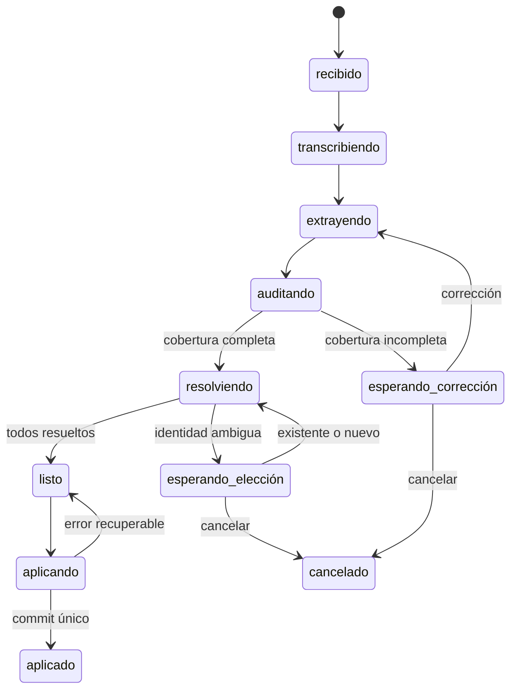

# Plan de reingeniería: ingresos por voz con revisión semántica y lotes persistentes

## Objetivo

Procesar un mensaje de audio o texto como un lote de operaciones verificable. Primero se reconstruye todo lo que dijo la persona; después se compara cada producto con el inventario. Solo se modifica stock cuando la lista está completa y cada ítem quedó resuelto como producto existente o nuevo. Las dudas se contestan en mensajes posteriores sin volver a interpretar el audio.

El diseño de identidad de producto será genérico para cualquier rubro. La primera implementación se enfocará en ingresos de stock por WhatsApp; ventas, reservas, pedidos y el panel podrán reutilizar el mismo motor por etapas.

## Diagnóstico del código actual

- server/metaWebhookProcessor.js envía el inventario al modelo en el mismo prompt que extrae las acciones. El modelo puede contaminar la extracción con nombres existentes y omitir productos mencionados.
- server/voiceCatalogContext.js puntúa coincidencias por palabras compartidas. Varios productos de distinto equipo, marca o variante pueden quedar empatados; las sugerencias de acciones diferentes se agregan en una lista sin identificar la frase original.
- server/index.js aplica las acciones inmediatamente cuando no hay productMatch. No persiste un lote pendiente ni puede continuar tras una respuesta como “es nuevo”.
- server/postgresDatabase.js: ensureProduct vuelve a resolver el producto por nombre y tokens al guardar. Una decisión semántica “crear nuevo” no quedaría garantizada si el guardado eligiera un SKU parecido.
- El webhook comprueba el ID del evento después de procesarlo y guarda el evento después de aplicar la mutación. Dos entregas concurrentes del mismo mensaje podrían intentar aplicar el lote dos veces.
- applyActionsToDatabase ya agrupa las escrituras en una transacción; esa base sirve, pero debe recibir una resolución explícita por ítem y compartir la transacción con la transición del lote a aplicado.

## Invariantes de producto

1. Ninguna acción sin una frase de origen verificable puede modificar datos.
2. La extracción no ve el catálogo. El catálogo se usa solo en la resolución posterior.
3. Una diferencia explícita de marca, modelo, año, presentación, variante o medida impide declarar “es el mismo SKU”. Esas dimensiones son configurables por rubro, no reglas sobre camisetas.
4. Un ítem puede quedar resuelto como existente, nuevo o ambiguo. “Ambiguo” nunca se convierte automáticamente en existente.
5. “Nuevo” debe forzar creación de un SKU; “existente” debe llevar un ID de producto de ese negocio. La capa de persistencia no vuelve a inferir esta decisión.
6. Si un ítem está sin resolver o la cobertura del mensaje no fue validada, no se aplica ninguna mutación del lote.
7. Cada lote se aplica como máximo una vez, incluso con reintentos, mensajes repetidos, caídas del proceso o dos respuestas casi simultáneas.
8. Los nombres, precios y cantidades que se muestran antes de guardar son exactamente los que se intentarán persistir.

## Máquina de estados del lote

- recibido → transcribiendo → extrayendo → auditando → resolviendo.
- auditando → esperando_corrección: falta una mención, apareció un ítem sin respaldo, o no se pudo comprobar un atributo global. La persona puede corregir un ítem o reenviar el lote.
- resolviendo → esperando_elección: hay una equivalencia real dudosa. La pregunta identifica un solo ítem del dictado y ofrece candidatos concretos más “crear nuevo”.
- esperando_elección → resolviendo: la respuesta asigna un producto existente o uno nuevo; se evalúa la siguiente duda sin reinterpretar el mensaje original.
- resolviendo → listo: cobertura completa y todos los ítems resueltos.
- listo → aplicando → aplicado: transacción única de inventario y estado.
- Cualquier estado previo a aplicado → cancelado o vencido según acción explícita o política de expiración.
- Los errores transitorios conservan el estado y permiten reintento; los errores de validación vuelven a esperando_corrección. Un error tras aplicar stock no reinicia el lote.

Estados terminales: aplicado, cancelado, vencido. El estado fallido solo es terminal si no se puede recuperar; los errores transitorios conservan un código y un próximo intento.

Cada ítem tiene estado propio: extraído, verificado, existente, nuevo o ambiguo. La máquina del lote gobierna el avance, mientras el verificador semántico decide el estado de cada ítem.

## Contrato de datos

Agregar una tabla de lotes con ID estable, negocio, remitente, canal, ID del mensaje de origen, estado, versión, texto/transcripción inmutables, categoría del negocio, snapshot o versión del catálogo, ítem pendiente, plazos, marcas de tiempo, último error y resultado aplicado. Restricciones únicas: mensaje de origen por canal y un lote activo por remitente y negocio, salvo que el producto admita explícitamente varios en paralelo.

Agregar ítems de lote con ID y orden estables, fragmento literal y posiciones en el texto, acción normalizada, origen de cantidad/precio/atributos globales, estado de resolución, candidatos con ID, ID elegido, decisión “nuevo”, explicación de la decisión, versión y mensaje que aportó la aclaración. Conservar tanto la extracción inicial como las correcciones posteriores para auditoría.

Agregar registro de mensajes entrantes y salientes con clave única por evento o transición. Los salientes funcionan como outbox: el cambio de estado se confirma en base de datos antes del envío, y el envío fallido se reintenta sin repetir stock.

Extender las transacciones de inventario con batch_id e item_id únicos. La decisión final de un ingreso será una unión explícita: usar product_id existente o crear un producto nuevo con identidad y atributos validados.

## Etapa 1: extracción independiente del catálogo

1. Transcribir y guardar el audio una sola vez por ID de Meta. No volver a transcribir al recibir aclaraciones.
2. Enviar al extractor únicamente el texto actual, la categoría del negocio y el contexto conversacional necesario para referencias explícitas. No incluir nombres de inventario.
3. Pedir JSON validado con una acción por producto: tipo, nombre propuesto, cantidad, precio, atributos libres por rubro y cita literal del mensaje con posición. Indicar qué valores vienen de una frase global (“todas valen 65.000”) y cuál es la excepción.
4. Rechazar acciones con cita inexistente, cantidad inválida o campos obligatorios ausentes. No completar silenciosamente datos inventados.
5. Ejecutar una auditoría de cobertura sobre el texto y la lista extraída, separada de la resolución de inventario. Debe detectar omisiones, duplicados y atributos atribuidos al ítem equivocado. Si hay duda, guardar borrador y pedir corrección; nunca usar el conteo de palabras de un rubro como único criterio.
6. Mantener un parser local de respaldo solo para casos cuya cobertura pueda verificarse. Si falla el modelo o no hay clave, un lote largo queda pendiente de corrección en vez de aplicarse parcialmente.

## Etapa 2: resolución semántica por ítem

1. Obtener candidatos de alta cobertura del catálogo del mismo negocio. La búsqueda por texto y, si aporta valor, embeddings sirven para recuperar candidatos; no deciden identidad.
2. Pasar al comparador la frase literal, la acción normalizada y un grupo acotado de candidatos con sus IDs y atributos. La salida estructurada es: mismo producto, producto nuevo o ambiguo, con IDs permitidos y justificación breve.
3. Aplicar controles programáticos genéricos: ningún ID fuera del catálogo; ninguna equivalencia ante atributos explícitos incompatibles; ningún candidato de otro negocio; mismo talle/medida solo cuando fue dicho o confirmado.
4. Si la identidad normalizada coincide de forma única, puede resolverse sin otra llamada al modelo. Si hay ambigüedad real, el modelo ayuda a formular la pregunta, pero el servidor construye las opciones solo con IDs válidos.
5. Si la persona elige “nuevo” y la identidad propuesta es indistinguible de un SKU ya existente, pedir el atributo o nombre que lo diferencie antes de crearlo.
6. Volver a consultar y validar el catálogo antes de aplicar: un producto pudo cambiar mientras el lote esperaba respuesta.

## Etapa 3: diálogo de aclaración

La pregunta debe referirse a la mención original y a una sola decisión. Ejemplo genérico: “Dijiste: ‘taladro Bosch 18V’, 2 unidades. ¿Es Taladro Bosch 18V 10 mm, Taladro Bosch 18V 13 mm, o lo cargo como producto nuevo? Respondé 1, 2 o nuevo.”

- Si el dictado ya distingue inequívocamente un producto nuevo, no se pregunta por productos parecidos.
- Una respuesta con nombre, número, “nuevo”, corrección de atributo o “cancelar” se interpreta contra el lote activo, no como una nueva venta o carga.
- Si la respuesta no identifica una opción, se repite la pregunta del ítem; no se elige por probabilidad.
- Se conserva la lista completa mientras se resuelven las dudas una por una. Al aplicar, la respuesta final resume las resoluciones y cambios realizados, sin pedir una confirmación adicional.
- Un nuevo pedido claramente independiente puede cancelar o suspender el lote pendiente según una política explícita; nunca fusionarlo silenciosamente.

## Etapa 4: aplicación atómica e idempotente

Refactorizar applyActionsToDatabase para ejecutar el lote resuelto y la transición listo → aplicado dentro de una sola transacción PostgreSQL. Bloquear la fila del lote durante esa transición. Si ya está aplicado, devolver el resultado guardado sin volver a mutar.

Para un ítem existente, actualizar exactamente el product_id elegido. Para uno nuevo, crear un SKU con identidad validada y luego actualizarlo. Eliminar la búsqueda difusa de ensureProduct de este camino, aunque pueda quedar temporalmente para otros flujos. Guardar la relación batch_id/item_id en la transacción de inventario.

El webhook debe registrar o reclamar el ID entrante antes de llamar al modelo. El ACK HTTP de Meta puede seguir siendo inmediato, pero el procesamiento y la respuesta se recuperan desde el estado persistido. Tras el commit, enviar la confirmación mediante outbox; si falla WhatsApp, reintentar solo el envío.

## Integración en el repositorio

- Crear un motor de lotes independiente de WhatsApp para extracción, auditoría, resolución, transiciones y generación de preguntas. Evitar que server/metaWebhookProcessor.js siga concentrando todas estas responsabilidades.
- Adaptar server/index.js para reclamar el mensaje entrante, cargar el lote activo, ejecutar una transición y enviar la respuesta desde outbox.
- Añadir migraciones en server/postgresDatabase.js y scripts/migrate-postgres.js, con claves únicas e índices por negocio, remitente y estado.
- Cambiar el contrato de escritura en server/postgresDatabase.js para product_id existente o creación nueva explícita, y para batch_id idempotente.
- Mantener los endpoints actuales del panel inicialmente. Después, conectar /api/voice/parse y /api/state/apply al mismo motor o definir con claridad que el panel confirma manualmente antes de aplicar.
- Incorporar una marca de origen y versión de parser/modelo a cada decisión para investigar incidentes sin depender de logs sueltos.

## Pruebas y criterios de aceptación

Crear un conjunto de casos etiquetados con mensajes reales anonimizados y casos sintéticos de varios rubros. Incluir el audio de este incidente como regresión: Argentina tercera 2025 debe figurar en el borrador, Chelsea no debe figurar, las once menciones distintas deben estar explicadas o señalarse la duda, y no deben ofrecerse candidatos de otros equipos para una variante explícita.

Cubrir también: nombres equivalentes con orden distinto, producto nuevo muy parecido a uno existente, variantes sin especificar, cantidades repetidas, precio global con excepción, corrección del usuario, respuesta “nuevo”, cancelación, vencimiento, cambio del catálogo mientras se espera y fallos de proveedor LLM o transcripción.

Pruebas de integración con PostgreSQL: duplicado del mismo webhook, dos respuestas simultáneas, caída antes/después del commit, reintento de respuesta WhatsApp, aislamiento entre negocios y ausencia de mutaciones mientras hay dudas.

Puertas de salida: ninguna mutación al SKU equivocado en el conjunto de regresión; ningún lote parcial marcado como aplicado; cobertura trazable de todos los ítems; exactamente una aplicación bajo reintentos; y cada pregunta ligada a una frase original y opciones de catálogo válidas. Medir además tasa de preguntas innecesarias, correcciones posteriores, latencia por etapa y costo de modelo.

## Secuencia de entrega

1. Preparar corpus etiquetado y trazas del flujo actual; fijar las métricas de referencia.
2. Implementar migraciones, modelo de lote, transiciones válidas y aplicación idempotente, todavía sin cambiar la experiencia pública.
3. Separar extracción de catálogo y agregar auditoría de cobertura con pruebas de distintos rubros.
4. Añadir recuperación de candidatos, resolución semántica y controles de identidad explícita.
5. Implementar diálogo pendiente, respuestas “existente/nuevo”, correcciones, cancelación y outbox.
6. Ejecutar el nuevo motor en modo sombra: comparar sus decisiones con el flujo actual sin permitirle escribir stock.
7. Habilitarlo para ingresos de stock en pocos negocios o remitentes, vigilar errores y ajustar umbrales de abstención.
8. Ampliar el despliegue. Migrar otros intents y el panel solo después de estabilizar ingresos de stock.

La activación se controla con una bandera por negocio. El rollback desactiva nuevas entradas al motor; los lotes ya pendientes conservan su versión de esquema y pueden terminarse o cancelarse de forma segura. No se reinterpretan mensajes ya aplicados.

## Decisiones para la implementación

- El lote es atómico: ninguna parte se aplica hasta que todas las dudas estén resueltas.
- Las preguntas son por ítem, con candidatos existentes y opción explícita de crear nuevo.
- La similitud semántica propone candidatos; la identidad final requiere controles sobre atributos expresamente dichos.
- Una decisión “nuevo” atraviesa hasta la base de datos como operación explícita, sin pasar otra vez por el matcher difuso.
- Los estados y las preguntas se persisten; no dependen de memoria del proceso ni de reconstruir el audio desde el historial reciente.
- La primera entrega funcional cubre add_stock por WhatsApp con un motor y esquema reutilizables para otros canales e intents.

## Estado de implementación antes de producción

- Implementados extracción independiente, auditoría separada y resolución semántica en un motor genérico fuera del webhook.
- Persistidos ítems, evidencias literales y posiciones, datos iniciales y correcciones, candidatos estables y trazas por etapa.
- Implementados aclaraciones por ítem, respuestas naturales, corrección de atributos, diferenciación de nuevos productos, cancelación y vencimiento.
- Aplicación de inventario y outbox en una transacción; control de versiones, validación del catálogo, replay por mensaje y recuperación automática del trabajo entrante y transcripción.
- Modos por negocio y comparación persistente en sombra. La migración CLI comparte esquema con el servidor.
- Verificación automatizada con corpus de varios rubros y PostgreSQL local real. El panel conserva su confirmación manual explícita; otros intents conservan su intérprete y reciben idempotencia para los reintentos.
- La validación del proveedor real y el despliegue se ejecutarán en la prueba de producción acordada. Este workspace no tiene credenciales de LLM configuradas; no se presenta la simulación como una evaluación real.

Comandos, invariantes y procedimiento de producción: [VOICE_STOCK_BATCHES.md](VOICE_STOCK_BATCHES.md).
