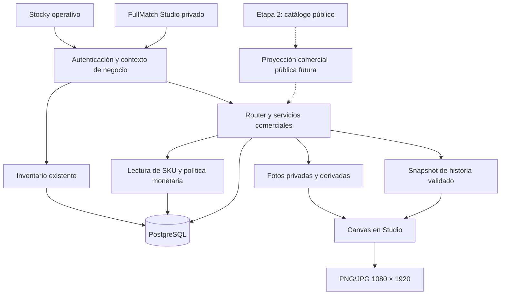
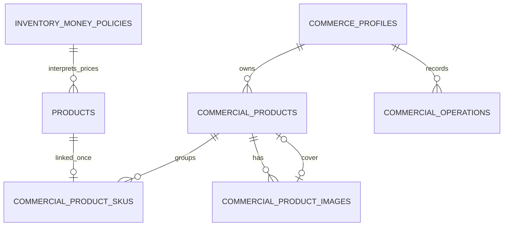

# FullMatch Studio: plan técnico de Etapa 0 y primera versión comercial

**Fecha:** 20 de octubre de 2026.  
**Estado:** diseño para revisión; no implementado.  
**Alcance de este trabajo:** documentación. No se crean tablas, endpoints, aplicaciones, dependencias ni migraciones ejecutables; no se modifican datos ni los flujos actuales de Stocky.

## 1. Decisión y orden de entrega

Se adopta la secuencia propuesta por el negocio:

1. **Etapa 0:** validar datos, identidad, moneda, infraestructura y contratos; preparar el modelo comercial.
2. **Etapa 1:** FullMatch Studio privado, fichas comerciales, fotografías y generador individual de historias.
3. **Etapa 2:** catálogo público sobre las mismas fichas, imágenes, vínculos y consultas de disponibilidad.
4. **Etapa 3:** generación por lotes, biblioteca de archivos y automatizaciones justificadas por el uso.
5. **Etapa 4:** pedidos comerciales y pagos, solo si hacen falta.

La primera entrega útil será **crear una ficha una vez y generar una historia en menos de un minuto desde un producto ya preparado**. No requiere tener una tienda pública.

### Arquitectura elegida

- Un repositorio y un backend Node/Express.
- Una base PostgreSQL y un único motor de stock: Stocky.
- **Una aplicación privada FullMatch Studio con entrada visual propia**, sin montar el dashboard ni el estado global de Stocky.
- Reutilización del servicio de autenticación de Stocky, con autorización comercial en el backend.
- Almacenamiento privado de fotografías; Canvas en el navegador para las historias.
- Ningún servicio adicional de renderizado, Redis, broker, microservicio o nueva base de stock para esta versión.

La entrada propia de Studio sigue el documento funcional aportado. Reutilizar backend y autenticación no exige reutilizar la navegación operativa de Stocky.

### Documentos y autoridad de las decisiones

- [Auditoría de Stocky](C:/Users/lucas/Documents/GitHub/ERPVoice/AUDITORIA_STOCKY_FULLMATCH.md): evidencia técnica y resultados de lectura del 20/10/2026, commit `4dc5d9b`.
- [Diseño funcional aportado](C:/Users/lucas/Documents/FULLMATCH_STUDIO_DISENO_FUNCIONAL.md): referencia de producto, pantallas, paleta y controles del generador. Sus cifras, SKU, productos y composiciones son ilustrativos.
- La solicitud actual autoriza **planificar, todavía sin implementar**. Las sugerencias de implementación dentro del documento adjunto se interpretan como material de diseño, no como autorización para ejecutarlas.
- Este plan reordena los MVP de la auditoría: el catálogo público pasa a Etapa 2. No se altera retrospectivamente la auditoría.

## 2. Alcance cerrado de la primera versión

### Incluido

- Login privado de Studio usando el backend de Stocky.
- Acceso inicial exclusivo del dueño del negocio habilitado.
- Configuración de nombre, WhatsApp comercial y marca.
- Lista de SKU pendientes de catalogar, calculada desde el inventario.
- Fichas con equipo, temporada, equipación, versión y manga.
- Asociación explícita con SKU existentes y consulta de disponibilidad/precios.
- Borrador, preparada y archivada como estados internos.
- Carga, portada, orden, retiro de fotos y recorte no destructivo.
- Tres plantillas: nuevo ingreso, stock disponible y última unidad.
- Previsualización, validación de datos vigentes y descarga individual PNG/JPG de 1080 × 1920.
- Compartir archivo mediante el dispositivo cuando esté soportado; descarga como alternativa permanente.
- Recuperación de intentos y conflictos claros.

### Diferido

- Catálogo público, rutas públicas, botón funcional de publicar y enlaces de producto compartibles.
- Biblioteca persistente de PNG/JPG generados, editor libre y plantillas editables por usuarios.
- Generación por lotes, programación y publicación mediante Meta.
- Promociones con reglas de precio, carrito, reservas de ecommerce y pagos.
- Cambios de stock o de precio desde Studio.
- Sincronización con Empretienda y desarrollo SaaS.

No se mostrará «Publicado» en Etapa 1. «Preparada» indica que la ficha cumple requisitos comerciales internos; no significa que exista una página pública.

## 3. Evidencia del repositorio que condiciona el diseño

- [inventoryPostgres.js](C:/Users/lucas/Documents/GitHub/ERPVoice/server/inventoryPostgres.js:62): ejecución transaccional de inventario, recibos y revisiones.
- [inventoryOperations.js](C:/Users/lucas/Documents/GitHub/ERPVoice/server/inventoryOperations.js:184): identidad física del SKU; nombre, metadatos y atributos intervienen en ella.
- [ProductsAbmPanel.tsx](C:/Users/lucas/Documents/GitHub/ERPVoice/src/components/dashboard/ProductsAbmPanel.tsx:108): agrupación visual, sin producto comercial persistente.
- [productCreationAdapter.js](C:/Users/lucas/Documents/GitHub/ERPVoice/server/productCreationAdapter.js:39): las altas pueden usar `XXX` por defecto.
- [apiClient.ts](C:/Users/lucas/Documents/GitHub/ERPVoice/src/services/apiClient.ts:43): cliente JSON con Bearer; requiere un complemento para binarios y errores estructurados.
- [AuthStore.tsx](C:/Users/lucas/Documents/GitHub/ERPVoice/src/store/AuthStore.tsx:14): sesión con negocio, actor y rol owner/member. La autorización debe recalcularse en servidor, no confiar en ese rol enviado por el cliente.
- [postgresDatabase.js](C:/Users/lucas/Documents/GitHub/ERPVoice/server/postgresDatabase.js:142): inicialización actual con efectos de esquema; no debe convertirse en el mecanismo de migración comercial por solicitud.
- [universalSchemaMigration.js](C:/Users/lucas/Documents/GitHub/ERPVoice/server/universalSchemaMigration.js:11): precedente útil de inspección sin bootstrap y migración acotada con comprobaciones.

Los 50 SKU de FullMatch y su moneda `XXX` son una fotografía de la base configurada durante la auditoría, **no un valor que el código deba asumir ni una nueva comprobación de producción**.

## 4. Invariantes del sistema

1. Studio no mantiene balances ni precios base alternativos.
2. La disponibilidad se obtiene de `stockAvailable`; no se vuelve a restar `stockReserved`.
3. Toda asociación es por ID de SKU y negocio, nunca por coincidencia de nombre solamente.
4. Un SKU puede pertenecer a una sola ficha comercial a la vez, incluso si la ficha está archivada, hasta una desvinculación explícita.
5. Ocultar, preparar, archivar o retirar una foto no modifica inventario.
6. Cambiar el título comercial no renombra el SKU.
7. La IA no decide asociaciones permanentes ni inventa datos faltantes.
8. Un archivo descargado es una fotografía del momento; no se actualiza cuando cambia Stocky.
9. El agotamiento es calculado y no reemplaza el estado editorial.
10. Ninguna foto, texto publicitario o recorte se guarda en `products.attributes_json`.
11. Todas las claves y relaciones comerciales preservan el negocio propietario.
12. No se entrega una historia con mensajes de stock que el servidor sabe que son falsos.

## 5. Etapa 0: trabajo técnico y entregables

Esta etapa combina decisiones que deben resolverse antes del desarrollo con tareas de preparación que se ejecutarían durante una implementación posterior. Ninguna se ejecuta por este documento.

### 0.1 Identificar entornos y proteger la operación

**Trabajo posterior:**

- Identificar frontend, API, base, proveedor, plan y commit de producción.
- Crear una matriz local de entornos sin copiar secretos al repositorio.
- Definir un entorno de prueba separado y con datos anonimizados.
- Verificar backup de PostgreSQL y restaurar una copia en un destino aislado.
- Acordar retención y respaldo de futuras fotografías; backup de base no equivale a backup de objetos.
- Revisar configuración productiva de autenticación, bypass de desarrollo y TLS de PostgreSQL.

**Entregables previstos:** inventario de entornos, procedimiento de restauración y registro de restauración comprobada.

**Aceptación:** se conoce qué recurso es productivo y se puede recuperar sin probar restauraciones sobre él.

### 0.2 Inventario de calidad y mapa de camisetas

Releer los SKU del negocio mediante un cliente de solo lectura, sin inicializar la aplicación. Preparar una hoja de revisión con:

- ID del SKU, revisión e identidad actuales.
- Estado activo/inactivo, talle, disponible, reservado, precio y moneda.
- Equipo, temporada, equipación, versión y manga propuestos.
- Ficha comercial candidata y motivo de asociación.
- Campos inciertos, precios ambiguos y duplicados potenciales.

Los nombres pueden ayudar a proponer datos. Cuando falte temporada, versión o manga, el SKU queda pendiente de revisión; no se completa por suposición.

Los SKU inactivos se revisan como históricos y no se reactivan para completar el catálogo. Los saldos físicos solo se corrigen si hay conteo confirmado, mediante operaciones actuales de Stocky.

**Entregable:** mapa SKU → identidad comercial revisado, con filas aprobadas y pendientes, ligado a las revisiones de origen.

**Aceptación:** toda asociación inicial tiene revisión humana; ningún SKU se pierde o cambia de stock como efecto de catalogar.

### 0.3 Moneda y unidad monetaria

**Decisión propuesta para minimizar riesgo:** conservar el entero histórico de `products.price` en su unidad actual, una vez demostrada. Si representa pesos enteros, declararlo `major_integer`; no convertir toda la base a centavos.

Debe confirmarse primero con ejemplos del negocio. Si los datos tienen escalas mezcladas o representan centavos, se detiene la habilitación comercial de esos SKU y se diseña una corrección explícita; no se aplica una división o multiplicación masiva.

Agregar conceptualmente `inventory_money_policies`, una configuración del dominio de inventario por negocio, separada de la presentación comercial. Para la primera versión se admite una moneda de catálogo por negocio. No se convierte moneda ni se mezclan monedas en una ficha.

Ejemplo exclusivamente ilustrativo, si se confirma ARS y pesos enteros:

- Base: `price = 65000`, `price_currency = ARS`.
- Contrato comercial: `amountMinor = "6500000"`, `currency = "ARS"`, `fractionDigits = 2`.
- Presentación: importe formateado según moneda, sin inferirla por el símbolo `$`.

`amountMinor` viaja como cadena decimal para evitar pérdidas por serialización de BIGINT. La conversión se calcula con enteros; no con aritmética flotante. El cliente formatea sin convertir arbitrariamente cadenas grandes a `Number`.

**Corrección posterior de `XXX`:**

1. Confirmar moneda y escala con el dueño.
2. Releer revisiones y precios antes de aplicar.
3. Usar `sku.update` con IDs, revisiones y motivo a través del núcleo existente.
4. Mantener los importes si la escala ya es correcta.
5. Verificar cantidades y reservas exactamente iguales antes/después.
6. Conservar recibos e historial anteriores sin reescribirlos.

**Prevención de regresiones:**

- Nuevos formularios envían moneda explícita desde la política del negocio.
- Nuevas propuestas por voz congelan la moneda antes de la confirmación; una ambigüedad produce aclaración.
- Un nuevo alta/actualización con precio que incumple la política se rechaza con error de dominio para el negocio habilitado.
- El control se realiza **después de consultar un recibo existente**: un replay histórico válido debe devolver su recibo original, aunque tenga `XXX`.
- No se rellenan defaults dependientes de configuración al reintentar un cuerpo antiguo: eso cambiaría su hash.
- Los otros negocios y las cuentas `legacy-money` conservan su comportamiento hasta una migración explícita propia.

No es necesario obligar a que toda operación de stock incluya precio de venta; la política no convierte una venta sin precio conocido en un importe inventado.

**Aceptación:** precios comerciales inequívocos; ausencia de `XXX` en variantes elegibles; pruebas de no alteración de balances, replays históricos y aislamiento entre negocios.

### 0.4 Identidad y vocabulario comercial

Identidad de una ficha:

`equipo + temporada + equipación + versión + manga`

Ejemplos distintos: Barcelona / 2025 / titular / jugador / corta y Barcelona / 2025 / titular / jugador / larga.

- Equipo: clave estable y nombre de presentación; distinguir club/selección.
- Temporada: texto validado, por ejemplo `2025`, `2025/26` o `1998`.
- Equipación: titular, suplente, tercera, arquero, especial; excepcionalidades con clave revisada.
- Versión: hincha/jugador y excepcionalidades revisadas.
- Manga: corta, larga o sin mangas, si corresponde al producto real.
- Talle: proviene del SKU, no forma parte de la identidad comercial principal.

No se crearán tablas de traducciones, taxonomías globales ni un árbol genérico de atributos para este MVP. Un pequeño vocabulario versionado puede compartirse entre cliente y servidor; las claves de equipos iniciales se revisan en el mapa de datos.

La firma comercial excluye título, descripción, precio y foto. Así, corregir marketing no crea otra camiseta.

### 0.5 Preparación del esquema y frontera de acceso

- Definir migraciones incrementales comerciales ejecutadas fuera de las solicitudes HTTP.
- Separar la conexión/transacción básica de la inicialización con DDL.
- En producción, la preparación de la aplicación verifica el esquema requerido; no normaliza negocios ni crea tablas al recibir un request.
- Conservar el mecanismo de migración explícita para desarrollo y despliegue. Reemplazar el bootstrap productivo de forma acotada y cubierta por regresiones; no abrir una reingeniería general.
- Verificar propiedad canónica de los SKU que se vincularán. Si existen aliases históricos de teléfono, preparar una correspondencia revisada; no mover datos ni reescribir hashes/recibos históricos de forma indiscriminada.
- Agregar la unicidad `(owner_phone, id)` en `products` como soporte de las FK comerciales. Es una restricción de identidad técnica, no una nueva identidad semántica de SKU.
- Nuevas tablas privadas con permisos mínimos, RLS y sin acceso de `anon`/`authenticated` de Supabase. El JWT propio no equivale a Supabase Auth.

**Aceptación:** migración probada en copia, invariantes operativas intactas, solicitudes comerciales sin DDL y relaciones que impiden vincular datos de otro negocio.

### 0.6 Decisiones de marca y dispositivos

- Paleta inicial del diseño: marino `#001A4D`, naranja `#FF6A00`.
- Confirmar logo, derechos de uso y una fuente redistribuible almacenada con la app.
- Confirmar número de WhatsApp de ventas, distinto conceptualmente del bot administrativo.
- Identificar los celulares y navegadores que realmente se usarán.
- Preparar 3–5 fichas piloto y fotos representativas: prenda oscura, clara, vertical, horizontal y texto largo.

**Salida de Etapa 0:** decisiones documentadas, mapa revisado y tareas de preparación listas para ejecución controlada. Durante la implementación, la corrección de datos y el esquema se aplican como pasos distintos y con comprobaciones propias.

## 6. Arquitectura de módulos



El servicio de lectura comercial consulta únicamente SKU y metadatos necesarios. No llama a `/api/state`, no carga clientes/deudas/pedidos y no usa el `AppStoreProvider` operativo.

Studio puede desplegarse en un origen propio. No se copiará el JWT entre orígenes mediante parámetros URL. Cada entrada inicia sesión con el mismo backend; no se construye SSO adicional en esta etapa.

## 7. Modelo de datos propuesto

Son **definiciones de diseño**, no DDL para ejecutar. Se proponen seis tablas nuevas: una política de inventario y cinco entidades comerciales. Se propone además un registro técnico de migraciones si el despliegue no dispone ya de uno equivalente; no es una entidad comercial.

### Convenciones comunes

- `owner_phone TEXT`: ámbito interno canónico, obtenido de la sesión, nunca aceptado desde el cuerpo como autoridad.
- Nuevos IDs: UUID generados en servidor. Los SKU conservan sus IDs TEXT actuales.
- Revisiones: BIGINT positivo; DTO como entero seguro dentro del rango admitido, validado antes de convertir.
- Fechas: TIMESTAMPTZ en UTC.
- Campos JSONB solo para snapshots, recibos y configuración validada; no reemplazan relaciones esenciales.
- Relaciones entre tablas comerciales incluyen el negocio.
- No se crea una tabla de empresas con duplicación de los perfiles actuales. `owner_phone` sigue siendo la referencia lógica existente; no se inventa una FK a una entidad de negocio que hoy no existe.

### 7.1 `inventory_money_policies`

Responsabilidad: interpretación explícita de los precios del inventario del negocio.

- `owner_phone TEXT PRIMARY KEY`.
- `currency CHAR(3) NOT NULL`: moneda confirmada y admitida.
- `storage_unit TEXT NOT NULL`: primera versión `major_integer`, habilitada solo después de verificar datos.
- `fraction_digits SMALLINT NOT NULL`: exponente explícito de la moneda; sin conversión cambiaria.
- `revision BIGINT NOT NULL`.
- `confirmed_by TEXT NOT NULL`, `confirmed_at TIMESTAMPTZ NOT NULL`.
- `created_at`, `updated_at`.

Checks: revisión positiva, storage_unit admitido y moneda/exponente del conjunto soportado. `XXX` no es una moneda comercial válida. Cambiar esta política no convierte filas ni reinterpreta recibos históricos: requiere una operación de preparación específica, fuera de Studio V1.

### 7.2 `commerce_profiles`

Responsabilidad: habilitación y configuración comercial del negocio.

- `owner_phone TEXT PRIMARY KEY`.
- `id UUID NOT NULL UNIQUE`: namespace opaco para objetos y futura identidad de tienda.
- `brand_name TEXT NOT NULL`, 1–80 caracteres.
- `sales_whatsapp TEXT NULL`: dígitos validados; obligatorio para CTA WhatsApp.
- `brand_preset TEXT NOT NULL`: `fullmatch_v1` inicialmente.
- `enabled BOOLEAN NOT NULL DEFAULT false`.
- `revision BIGINT NOT NULL`.
- `created_by`, `created_at`, `updated_at`.

Los colores y el logo aprobado se resuelven por un preset versionado empaquetado con Studio. No se agrega un editor de marca ni un cargador de logos independiente en V1. La moneda no se duplica en este perfil.

### 7.3 `commercial_products`

Responsabilidad: identidad y presentación comercial estable.

- `owner_phone TEXT NOT NULL`.
- `id UUID NOT NULL`.
- `title TEXT NOT NULL`, 1–120 caracteres.
- `description TEXT NOT NULL DEFAULT ''`, texto plano, hasta 4.000 caracteres.
- `team_key TEXT NULL`, `team_name TEXT NULL`.
- `team_kind TEXT NULL`: `club` o `national_team`.
- `season TEXT NULL`.
- `kit_key TEXT NULL`: equipación normalizada.
- `version_key TEXT NULL`: versión normalizada.
- `sleeve_key TEXT NULL`: manga normalizada.
- `identity_key TEXT NULL`: SHA-256 de la tupla canónica, calculada solo en servidor al completar identidad.
- `slug TEXT NOT NULL`: se reserva ahora para una URL estable futura; no hay ruta pública todavía.
- `status TEXT NOT NULL`: `draft`, `ready`, `archived`.
- `cover_image_id UUID NULL`.
- `revision BIGINT NOT NULL DEFAULT 1`.
- `created_by`, `updated_by`, `created_at`, `updated_at`, `archived_at NULL`.

Restricciones e índices:

- PK `(owner_phone, id)`.
- FK `owner_phone` a `commerce_profiles(owner_phone)`.
- UNIQUE `(owner_phone, slug)`, incluso para archivados.
- UNIQUE parcial `(owner_phone, identity_key)` cuando la identidad esté completa y el estado no sea archivado.
- Índice `(owner_phone, status, updated_at DESC, id)`.
- La FK de portada se añade después de crear imágenes: `(owner_phone, id, cover_image_id)` referencia `(owner_phone, commercial_product_id, id)` de imágenes. Impide usar la foto de otra ficha.
- Checks de estado, longitudes, revisión positiva y consistencia de `archived_at`; `ready` exige los campos de identidad completos y `identity_key` no nula. Foto/stock/precio vigentes se verifican en el servicio, porque dependen de otras filas.

La firma evita fichas activas equivalentes; no agrupa automáticamente ni impide borradores incompletos. La validación de identidad y la comparación de la tupla siguen siendo responsabilidad del servicio. Personalizaciones que cambien la identidad física quedan pendientes de una regla explícita, no se mezclan silenciosamente.

No contiene `price`, `stockAvailable`, `stockReserved`, categoría promocional ni una copia editable de talles.

### 7.4 `commercial_product_skus`

Responsabilidad: vínculo entre ficha y SKU de Stocky.

- `owner_phone TEXT NOT NULL`.
- `commercial_product_id UUID NOT NULL`.
- `sku_id TEXT NOT NULL`.
- `identity_fingerprint_at_link TEXT NOT NULL`.
- `sort_order INTEGER NOT NULL DEFAULT 0`.
- `linked_by TEXT NOT NULL`, `linked_at TIMESTAMPTZ NOT NULL`.

Restricciones:

- PK `(owner_phone, commercial_product_id, sku_id)`.
- UNIQUE `(owner_phone, sku_id)`.
- FK `(owner_phone, commercial_product_id)` a fichas.
- FK `(owner_phone, sku_id)` a `products(owner_phone, id)`.
- `sort_order >= 0`; desempate estable por `sku_id`.
- Eliminación física de SKU vinculados restringida; la baja operativa actual sigue siendo lógica.

La referencia física se compara al leer/preparar historias. Si cambia nombre, talla, familia o atributos que afectan identidad, la asociación se marca como «Revisar vínculo». Precio/stock no forman parte de esta huella: se leen siempre vigentes.

Al reconfirmar el vínculo se actualiza la huella con revisión humana. No se requiere volver a vincular por cada venta.

Dos SKU activos con el mismo talle normalizado en una ficha bloquean su preparación hasta resolver qué característica los diferencia. No se suman como si fueran variantes equivalentes sin revisión.

### 7.5 `commercial_product_images`

Responsabilidad: carga y galería de una ficha; no representa el PNG de una historia.

- `owner_phone TEXT NOT NULL`, `id UUID NOT NULL`.
- `commercial_product_id UUID NOT NULL`.
- `status TEXT NOT NULL`: `pending`, `processing`, `ready`, `failed`, `deleted`.
- `source_sha256 TEXT NOT NULL`: hash de los bytes originales esperados.
- `source_size_bytes BIGINT NOT NULL`.
- `master_key TEXT NULL`, `thumbnail_key TEXT NULL`: claves generadas por servidor.
- `master_sha256 TEXT NULL`.
- `mime_type TEXT NULL`, `width INTEGER NULL`, `height INTEGER NULL`, `stored_size_bytes BIGINT NULL`.
- `alt_text TEXT NOT NULL DEFAULT ''`, hasta 300 caracteres.
- `sort_order INTEGER NOT NULL DEFAULT 0`.
- `focal_x NUMERIC NOT NULL DEFAULT 0.5`, `focal_y NUMERIC NOT NULL DEFAULT 0.5`, dentro de 0..1.
- `revision BIGINT NOT NULL DEFAULT 1`.
- `attempt_id UUID NULL`, `processing_started_at NULL`, `upload_expires_at NOT NULL`.
- `product_identity_at_start TEXT NULL`: contexto de identidad comercial capturado al iniciar.
- `error_code TEXT NULL`, sin errores crudos del proveedor.
- `created_by`, `created_at`, `updated_at`, `deleted_at NULL`, `purged_at NULL`.

Restricciones e índices:

- PK `(owner_phone, id)` y UNIQUE `(owner_phone, commercial_product_id, id)` para portada.
- FK a la ficha con negocio.
- Datos binarios y dimensiones presentes para `ready`; números positivos y coordenadas finitas/en rango.
- Índices por ficha/estado/orden y por estado/fecha para recuperación y limpieza.
- Sin índice único global de contenido: dos fichas pueden usar una foto equivalente sin revelar datos entre negocios.

Portada se guarda solo en `commercial_products.cover_image_id`; no hay un segundo booleano `is_cover`. El servicio garantiza que apunte a una imagen `ready` no retirada.

### 7.6 `commercial_operations`

Responsabilidad: recibos idempotentes y auditoría comercial mínima.

- `owner_phone TEXT NOT NULL`, `operation_id UUID NOT NULL`.
- `actor_id TEXT NOT NULL`.
- `operation_type TEXT NOT NULL`.
- `entity_id UUID NULL`.
- `request_hash TEXT NOT NULL`.
- `request_json JSONB NOT NULL`: comando canónico sin secretos ni binarios.
- `result_json JSONB NOT NULL`: recibo y representación resultante congelados.
- `created_at TIMESTAMPTZ NOT NULL`.

PK `(owner_phone, operation_id)`; FK `owner_phone` a `commerce_profiles(owner_phone)`; índice `(owner_phone, entity_id, created_at DESC)`. `entity_id` es una referencia de auditoría polimórfica, sin una FK falsa que obligue a que todo recibo represente una ficha.

La misma operación/cuerpo devuelve el mismo recibo. El mismo ID con otro cuerpo produce 409. El permiso actual del actor se verifica también al recuperar un recibo.

No se mezcla con `inventory_operations`: vincular fotos no es un movimiento de inventario. La preparación de una historia puede guardar su snapshot inmutable dentro del recibo; no requiere otra tabla ni una biblioteca de contenido.

### 7.7 `commercial_story_snapshots`

**No se crea en V1.** El nombre se documenta para evitar confundir snapshot y archivo exportado. El snapshot se conserva en `commercial_operations.result_json` para `story.prepare`, y su ID coincide con `operation_id`.

Tampoco se crean `story_templates` ni `story_exports` en esta etapa:

- Plantillas: registro versionado en código.
- Archivo final: generado y descargado en el navegador.
- Historial de archivos y generación por lotes: Etapa 3, con requisitos de retención propios.

**Recuento:** seis tablas efectivamente propuestas en V1: política monetaria, perfil, fichas, vínculos, imágenes y operaciones. El apartado 7.7 explica deliberadamente una tabla que no se necesita.

### Relaciones



La relación política → productos es lógica, no una FK nueva que obligue a configurar todos los negocios actuales. El aislamiento de las relaciones físicas se aplica mediante claves compuestas.

## 8. Estados, preparación y consultas derivadas

### Estados editoriales

- `draft`: guardado incompleto o pendiente de revisión.
- `ready`: preparado explícitamente por el dueño después de validar datos.
- `archived`: retirado de la operación comercial activa, recuperable y con asociaciones conservadas.

Transiciones: `draft → ready`, `ready → draft`, cualquier activo → `archived`, `archived → draft`.

No hay borrado físico de fichas en V1. Para reutilizar un SKU vinculado a una archivada se debe restaurar y desvincular explícitamente; no se libera por archivar.

### Validaciones calculadas

`readiness` se recalcula con los datos vigentes; no se confía únicamente en `status`:

- Identidad comercial completa y no duplicada.
- Título y descripción válidos.
- Una foto ready y portada válida.
- Al menos un SKU activo vinculado.
- Propiedad, talle, unidad e identidad física revisados.
- Moneda confirmada, importes válidos y variantes sin ambigüedad.

En esta versión, precio cero en inventario se trata como precio comercial pendiente de revisión, no como una camiseta gratuita. Preparar una ficha de venta exige precio positivo conocido en los SKU activos vinculados. Esto no cambia la validez operativa de un SKU con precio cero en Stocky.

Una venta no cambia automáticamente la ficha a borrador. Puede quedar preparada y agotada. Si se retira la portada o se modifica la identidad comercial se vuelve a borrador; cambios externos incompatibles producen advertencias calculadas hasta revisión.

### DTO privado compartido

`CommercialProductDetail v1` incluye:

- Ficha y revisión comercial.
- Galería con IDs y revisiones, sin claves privadas del proveedor.
- Variantes con SKU, talle, activo, revisión, precio/moneda y disponibilidad actuales.
- `availability`: `in_stock`, `out_of_stock` o `unavailable` si no se puede verificar.
- `priceRange`: mínimo/máximo para una misma moneda, o un error explícito.
- `readiness`: lista de bloqueos, advertencias y `canPrepare`/`canGenerateStory`.
- `readAt` y revisiones de política/perfil.

Nunca se reemplaza una base caída por stock cero. Un error de lectura responde 503 y la interfaz conserva su vista anterior con indicación de desactualización.

## 9. Contratos HTTP privados

Prefijo: **`/api/commerce/v1`**. Todas las rutas requieren Bearer válido, negocio habilitado y permisos actuales. No hay rutas públicas comerciales en esta etapa.

### Convenciones

- Creación exitosa: 201; consulta/actualización: 200.
- Mutación JSON: `operationId` UUID estable y `expectedRevision` de la entidad raíz cuando existe.
- El servidor resuelve negocio y actor; no admite `owner_phone`, roles ni permisos suministrados por el cuerpo.
- Respuesta de comando: `contractVersion`, `operationId`, `status: applied`, revisión y resultado congelado.
- Replays se resuelven antes de comparar la revisión antigua del comando con el estado actual; de otro modo un retry válido fallaría.
- GET privados y binarios: `Cache-Control: private, no-store` inicialmente.
- Errores: `{error:{code,message,fields?,currentRevision?},requestId}`; sin SQL, tokens ni datos de otros negocios.

### Perfil y política

- `GET /profile`: marca, contacto, capacidades y revisiones; incluye política monetaria de solo lectura.
- `PUT /profile`: nombre/contacto/preset permitido, con revisión e idempotencia. No permite cambiar moneda/escala.

La habilitación inicial y política monetaria se configuran durante el procedimiento controlado de Etapa 0; no se expone una API de autoalta de comercios.

### Productos y pendientes

- `GET /products?status=&q=&team=&season=&version=&sleeve=&needsAttention=&cursor=&limit=`.
  - Máximo 50 fichas por página; orden estable `updated_at DESC, id DESC`.
  - `q` hasta 120 caracteres; búsqueda SQL parametrizada. Con el volumen inicial no se necesita Elasticsearch ni una extensión de búsqueda.
- `GET /products/:id`: detalle comercial y variantes vigentes.
- `POST /products`: crear borrador; puede incluir vínculos iniciales revisados en la misma transacción.
- `PATCH /products/:id`: editar campos comerciales permitidos; nunca precio, stock o moneda.
- `PUT /products/:id/sku-links`: reemplazar la selección completa revisada, con SKU, revisión y fingerprint esperados. Verifica duplicados y propietario; todo o nada.
- `POST /products/:id/status`: preparar, volver a borrador, archivar o restaurar; intención y motivo explícitos.
- `GET /inventory-candidates?linked=&q=&cursor=&limit=`: SKU activos sin ficha y candidatos de asociación. Una sugerencia por nombre nunca se convierte en un vínculo automáticamente.
- `GET /summary`: contadores del negocio y faltantes, calculados desde relaciones actuales.
- `GET /operations/:operationId`: recuperación del recibo, con autorización y scope.

Ejemplo conceptual de creación, sin autoridad de negocio en el cuerpo:

```json
{
  "operationId": "<uuid-estable-del-intento>",
  "product": {
    "title": "Barcelona titular 2025 jugador manga corta",
    "teamKey": "barcelona",
    "teamName": "Barcelona",
    "teamKind": "club",
    "season": "2025",
    "kitKey": "home",
    "versionKey": "player",
    "sleeveKey": "short"
  },
  "skuLinks": [
    {
      "skuId": "<id-real-de-stocky>",
      "expectedRevision": 7,
      "expectedFingerprint": "<huella-leida-del-servidor>"
    }
  ]
}
```

### Fotografías

- `POST /products/:id/images`: iniciar una carga; JSON con operationId, revisión de ficha, tipo/tamaño/hash del archivo. Devuelve imageId y URL privada de carga de la propia API, sin credenciales de almacenamiento.
- `PUT /images/:imageId/content`: bytes de imagen con Bearer; idempotencia por imageId y hash inicial; límite de cuerpo explícito. No usa el cliente JSON.
- `GET /images/:imageId`: estado, dimensiones, error recuperable y revisión.
- `GET /images/:imageId/content?variant=master|thumbnail`: binario privado autorizado, sin redirigir el navegador a una clave permanente pública.
- `PATCH /images/:imageId`: alt/recorte, con revisiones de imagen y ficha.
- `PUT /products/:id/gallery`: lista completa de IDs ready en orden y coverImageId; revisión de ficha; rechaza IDs ajenos, repetidos u omitidos accidentalmente.
- `POST /images/:imageId/retire`: retiro lógico; revisiones de foto/ficha y nueva portada explícita cuando haga falta.

### Historias

- `GET /story-templates`: IDs/versiones, miniaturas, controles permitidos y disponibilidad.
- `POST /products/:id/story-snapshots`: prepara snapshot validado e idempotente.
- `GET /story-snapshots/:snapshotId`: recupera el snapshot desde el recibo; nunca un archivo exportado inexistente.
- `POST /story-snapshots/:snapshotId/validate`: consulta de revalidación, sin mutaciones de inventario; devuelve vigencia o motivos de cambio.

No se agrega un endpoint `publish-instagram`, `checkout`, `public-products` o de generación por lotes.

### Errores funcionales mínimos

- 400 `INVALID_COMMAND`: forma/campo desconocido.
- 401 `UNAUTHENTICATED`.
- 403 `COMMERCE_FORBIDDEN` o módulo no habilitado.
- 404 `RESOURCE_NOT_FOUND`: incluye IDs de otros negocios sin revelar su existencia.
- 409 `REVISION_CONFLICT`, `IDEMPOTENCY_CONFLICT`, `SKU_ALREADY_LINKED`, `COMMERCIAL_IDENTITY_EXISTS`, `UPLOAD_IN_PROGRESS`.
- 410 `SNAPSHOT_EXPIRED`.
- 413 `IMAGE_TOO_LARGE`.
- 415 `UNSUPPORTED_IMAGE_TYPE`.
- 422 `PRODUCT_NOT_READY`, `MONEY_UNCONFIRMED`, `SKU_IDENTITY_CHANGED`, `DUPLICATE_SIZE`, `INVALID_STORY_CLAIM`, `IMAGE_DECODE_FAILED`.
- 429 `RATE_LIMITED`.
- 503 `INVENTORY_UNAVAILABLE` o `MEDIA_STORAGE_UNAVAILABLE`.

## 10. Transacciones, revisiones y recuperación

### Comando comercial de base

1. Autenticar y autorizar negocio/actor.
2. Validar y canonicalizar el comando.
3. Abrir transacción y tomar bloqueo por negocio/operationId.
4. Buscar recibo: replay idéntico o conflicto de hash.
5. Bloquear perfil/ficha necesarios en un orden fijo y comprobar revisiones.
6. Para vincular, leer/bloquear los SKU en orden de ID y comprobar propiedad/revisión/huella.
7. Aplicar solo metadatos comerciales.
8. Incrementar una vez la revisión raíz.
9. Guardar recibo en la misma transacción y confirmar.

No ejecutar red, decodificación de imágenes ni Canvas dentro de una transacción de base. La creación con múltiples vínculos es atómica; la foto se añade en un flujo separado recuperable.

### Política de bloqueos

- Operaciones de vínculos: ficha y SKU en orden consistente; restricciones únicas resuelven también carreras entre dos fichas.
- Fotos: ficha antes de imagen al completar/retirar y cambiar portada.
- Recibos: bloqueo de operación antes de mutar entidades.
- Lectura de detalle, recuperación GET de snapshot y revalidación: `REPEATABLE READ READ ONLY`; sin `FOR UPDATE` para mostrar stock.
- La preparación y persistencia del snapshot/recibo de `story.prepare` usa `REPEATABLE READ` con escritura del recibo; no debe declararse READ ONLY. No altera las filas de inventario.
- Si hay error de serialización o deadlock, el servidor puede reintentar de forma acotada con el mismo comando; no convertir cualquier error en un retry infinito.

### Cliente

- Guardar el intento JSON antes de enviarlo, con clave por negocio, actor y tipo de operación.
- Mantener operationId y cuerpo ante timeout, recarga o pérdida de respuesta.
- Recuperar por `/operations/:id` o reenviar exactamente el comando.
- Crear otro operationId solo cuando el usuario revise y autorice un nuevo intento.
- No aplicar autosave con sobrescritura silenciosa.
- Conflicto 409: mostrar estado remoto y borrador local; la fusión es explícita.
- No guardar fotos en base64 en localStorage. Una carga no confirmada puede exigir volver a seleccionar el mismo archivo y verificar su hash.

## 11. Fotografías: almacenamiento y ciclo de vida

### Decisión inicial

Almacenamiento de objetos privado, preferentemente el ya contratado si ofrece las capacidades necesarias. Supabase Storage es candidato; su uso efectivo requiere confirmar proyecto, bucket y credenciales backend. No se presupone que ya esté configurado.

El navegador carga a la API de Studio; el servidor valida, procesa y accede al almacenamiento. Esta elección evita añadir en V1 un protocolo de cargas directas y permisos de escritura temporales en el navegador.

### Límites de producto propuestos

- Entrada: JPEG, PNG o WebP, hasta 12 MiB y 24 megapíxeles.
- Rechazar SVG, GIF animado y formatos no soportados. HEIC: mostrar una explicación para convertir; no prometer soporte sin comprobar el runtime.
- Hasta 8 imágenes ready por ficha; al reservar una carga se cuentan también pending/processing no vencidas bajo bloqueo de ficha para evitar exceder el límite con solicitudes paralelas. Una carga a la vez por cliente y concurrencia backend limitada.
- Master normalizado con lado mayor hasta 2400 px, sin ampliar artificialmente.
- Miniatura de hasta 480 px; preservar proporción.
- Corregir orientación, retirar metadatos y generar formato/peso coherentes.
- Conservar la foto real: sin recorte automático destructivo, fondo eliminado por IA ni cambios a escudos/detalles.

El archivo crudo del teléfono se procesa en memoria y no se conserva en V1. Se guarda un master normalizado privado y su miniatura. Retener además originales crudos requeriría una decisión de privacidad/costo independiente.

Los límites son decisiones de diseño, no límites verificados del proveedor. Se ajustan con fotos piloto y medición del backend contratado.

### Flujo recuperable

1. `POST images` crea fila pending con TTL inicial propuesto de 30 minutos y recibo de inicio.
2. El navegador envía bytes al imageId recibido.
3. El servidor verifica hash real, tamaño y firma del archivo; MIME declarado no es suficiente.
4. Una transición breve reclama `processing` con attemptId. Otro envío simultáneo recibe estado en curso.
5. Fuera de transacción, decodificar y producir master/miniatura; posible dependencia futura: Sharp, no instalada por este plan.
6. Subir objetos con claves inmutables generadas: namespace UUID del perfil/ficha/imagen/hash. No usar nombre de archivo ni teléfono en claves públicas.
7. En transacción, revalidar autorización, ficha no archivada y contexto comercial de la carga; comprobar que attemptId todavía es dueño de la lease, guardar claves, pasar a ready, asignar portada si no existe e incrementar revisión de ficha. Un proceso antiguo que perdió la lease no puede confirmar encima de otro intento.
8. Si cambió la identidad comercial desde el inicio, no asociar silenciosamente: error `IMAGE_CONTEXT_CHANGED`, conservar explicación y limpiar objetos huérfanos.
9. Responder metadata. Si se pierde la respuesta, GET image/reintento con los mismos bytes permite recuperar el resultado.

Si una configuración editorial secundaria cambió mientras se procesaba, el servicio puede completar la carga bajo bloqueo y devolver la revisión nueva; no sobrescribe título ni campos del editor. La regla exacta es comparar la identidad capturada, no exigir que todo cambio de texto invalide una foto.

### Fallos entre base y objetos

No existe transacción atómica entre PostgreSQL y almacenamiento:

- Objetos subidos y commit fallido: quedan candidatos a limpieza, nunca una foto visible sin fila ready.
- Un objeto falla: no se marca ready hasta disponer de todas las derivadas requeridas.
- Proceso muerto en processing: lease vencida propuesta de 5 minutos; inspección y retry controlado por imageId/hash.
- Error definitivo: failed con código sanitizado; nuevo intento explícito si cambia el archivo.
- Retiro: cambiar portada/estado en base primero; purgar objetos después de un período de gracia, no antes.

Se prevé un script de mantenimiento con modo de inspección y aplicación explícita para pending vencidas, leases y objetos huérfanos del prefijo comercial. No hace falta una infraestructura de colas; la recuperación debe estar disponible antes del piloto. Un reintento de purga es seguro y se registra con `purged_at`.

### Entrega al Canvas

El cliente solicita el binario por la API autenticada, obtiene Blob y crea una URL local temporal. No usa directamente un `` sin autorización contra un bucket privado. Revoca object URLs al cerrar/cambiar imagen. Las fuentes y assets de plantilla se sirven desde la app.

## 12. Generador individual de historias

### Registro de plantillas

Tres plantillas `new_arrival_v1`, `available_stock_v1`, `last_unit_v1`, con versión explícita y paleta FullMatch. Las definiciones se guardan en código, no en HTML arbitrario ni JSON editable sin esquema.

Controles permitidos:

- Plantilla y fotografía ready de la propia ficha.
- Modo contain/cover y encuadre normalizado; zoom limitado y números finitos.
- Mostrar/ocultar precio.
- Todos los talles disponibles o una selección explícita.
- Encabezado y texto secundario cortos, con límites y ajuste tipográfico.
- CTA `whatsapp` o `inquiry`; «Ver en la web» se habilita recién cuando exista una URL pública válida en Etapa 2.

Un texto libre no puede sobrescribir precio, talle ni cantidad. Los mensajes comerciales de stock son generados desde campos validados; los textos editables adicionales tienen revisión humana y límites, sin pretender verificar semánticamente cualquier frase publicitaria.

### Reglas por disponibilidad

- Solo SKU activos, vinculados, con identidad revisada y `stockAvailable > 0` integran el conjunto ofrecido.
- Suma disponible = suma de `stockAvailable`; nunca se suma reservado para ofrecerlo.
- Última unidad total: suma de todas las variantes elegibles de la ficha igual a 1.
- Última unidad de talle: el talle seleccionado tiene 1, pero hay otras variantes disponibles; el texto debe nombrar el talle, sin afirmar una última unidad total.
- Agotado: bloquea las tres plantillas de oferta de stock de esta versión; no crea una falsa disponibilidad.
- Nuevo ingreso: sugerencia editorial, no afirmación automática de fecha de ingreso físico. La fecha de creación de ficha no demuestra cuándo llegó la mercadería.
- Precios distintos: mostrar «Desde» calculado sobre el conjunto de variantes que efectivamente se muestra, o seleccionar una variante. Nunca un precio único sin aclaración si el conjunto tiene varios.
- Monedas distintas o `XXX`: no se renderiza un precio inventado. La ficha requiere corregirse en Stocky; ocultar precio no habilita una oferta con identidad/stock inválidos.

### Snapshot de diseño

`POST story-snapshots` recibe:

- operationId y expectedProductRevision.
- templateId/version.
- imageId y revisión esperada.
- IDs de SKU y revisiones observadas, si se selecciona un subconjunto.
- Controles permitidos: precio visible, encuadre, textos cortos, CTA y modo de talles.

El servidor lee ficha, perfil, política, imágenes y SKU en una vista consistente; valida reglas y devuelve un snapshot inmutable con:

- snapshotId, schemaVersion, createdAt y expiresAt, inicialmente 24 horas.
- Dimensiones 1080 × 1920 y versión del renderer.
- Texto comercial resuelto, precio/rango monetario y talles seleccionados.
- Modo de afirmación: stock general, última unidad total o última unidad por talle.
- IDs/revisiones relevantes y checksums de imagen/plantilla/marca.
- `contentFingerprint` de los datos y parámetros de diseño que afectan al resultado.

El snapshot queda en el recibo de `story.prepare`. No persiste el PNG/JPG ni implica que el usuario haya descargado o publicado algo.

### Revalidación y carrera con una venta

1. El cliente permite ajustar la previsualización sobre datos visibles y solicita un snapshot final con los controles elegidos.
2. Carga fuentes y foto, y renderiza el archivo en memoria.
3. Antes de ofrecer la descarga preparada, consulta `/validate`.
4. El servidor compara los datos semánticos vigentes, no solo `max(revision)` o el timestamp: ficha, miembros del conjunto, precios, cantidades, estados, huellas, foto, marca y política.
5. Si cambiaron datos relevantes, devuelve `valid:false` con motivos y el cliente ofrece actualizar y volver a generar. Nunca ejecuta otra venta ni reserva para «congelar» la historia.
6. Si son equivalentes, habilita descargar/compartir. La acción final puede repetir validación cuando el usuario demora o vuelve a la pantalla.

Una revisión de SKU que cambie sin afectar el contenido puede registrarse sin obligar a rehacer el diseño. Cambios de nombre físico o vínculo sí exigen revisión si invalidan identidad.

No se promete eliminar toda carrera: una venta puede ocurrir después de validar o después de descargar. El archivo es estático y no reserva stock. La interfaz muestra «Datos revisados a las …»; la publicación manual queda bajo control del comercio.

### Renderizado y experiencia móvil

- Canvas con resolución real 1080 × 1920; escala visual CSS independiente del bitmap.
- PNG o JPG con fondo definido; no depender de transparencia para JPG.
- Fuentes locales cargadas antes de medir y dibujar.
- Texto con salto, tamaño mínimo y error legible si no cabe; no recortar un precio.
- Foto con contain por defecto; cover solo con recorte elegido.
- Guías visuales superior/inferior de diseño: propuesta inicial 250 px por lado, ajustable en pruebas. No se presentan como una garantía oficial de todas las interfaces de Instagram.
- Un Canvas activo, liberación de buffers y object URLs; sin lote simultáneo.
- En móvil, botón de compartir cuando el sistema lo admita, sin prometer apertura directa en historias. Mantener un botón separado con gesto del usuario para compartir después del procesamiento; si no está disponible, descargar.
- Nombre de archivo estable: producto + plantilla + fecha + sufijo corto, sin datos internos del negocio.

## 13. Flujos de interfaz de FullMatch Studio

### 13.1 Acceso y navegación

Entrada propia `studio.html` durante desarrollo/build y host privado propio al desplegar. Reutilizar AuthProvider/servicios de sesión; no importar `App`, `DashboardPanel` o `AppStoreProvider` de Stocky.

Navegación MVP: **Productos**, **Pendientes**, **Configuración**. Generador como pantalla de la ficha. Inicio puede ser la misma lista con contadores, sin otro dashboard redundante.

Rutas privadas propuestas por fragmento para evitar incorporar un router completo y reglas de fallback innecesarias en V1:

- `#/products`.
- `#/pending`.
- `#/products/new`.
- `#/products/:id`.
- `#/products/:id/story`.
- `#/settings`.

Los fragmentos nunca contienen tokens, teléfonos o texto sensible. El futuro catálogo público usará URLs reales y metadatos adecuados, no estas rutas privadas.

### 13.2 Nuevo ingreso → pendiente

1. El ingreso se confirma por los mecanismos actuales de Stocky.
2. Studio consulta candidatos no vinculados; no requiere webhook ni evento nuevo de inventario.
3. Al entrar/refrescar/volver a foco, actualiza pendientes.
4. La tarjeta muestra talle, precio/moneda, cantidades y datos faltantes.
5. Acciones: «Crear ficha» o «Vincular a una existente».
6. Sugerencias por equipo/nombre son ayudas; siempre se confirma el SKU exacto.

No se interpreta el contador como «ingresos recientes» si no existe una fecha de recepción demostrable. Se llama «Sin ficha comercial».

### 13.3 Crear o completar ficha

Formulario en secciones: **Identidad**, **Fotos**, **Talles y precio**, **Revisión**.

- Crear borrador con un título y SKU seleccionados; los demás campos pueden completarse después.
- Mostrar advertencias de moneda/identidad antes de preparar.
- Guardar explícitamente; indicador de cambios no guardados.
- Reutilizar el patrón de borrador recuperable del proyecto, con datos pequeños y scope por actor/negocio.
- En conflicto, conservar el borrador local y mostrar la versión remota.
- «Preparar ficha» valida requisitos y cambia estado.
- «Generar historia» lleva foto/plantilla sugeridas; si hay bloqueos, muestra causas concretas.

### 13.4 Fotos

- Elegir archivo/cámara mediante selector del dispositivo.
- Mostrar miniatura local, progreso y estado de carga.
- Permitir reintento sin duplicar una foto ya confirmada.
- Elegir portada y reordenar con botones accesibles además de arrastre.
- Recorte como configuración, sin reemplazar el master.
- Retirar con confirmación clara y elección de nueva portada.

### 13.5 Variantes y precios

- Lista de SKU vinculados con talle, disponible, reservado solo como dato privado, precio y moneda.
- Controles para asociar/desasociar, nunca cantidades editables.
- Botón «Abrir en Stocky» con enlace al entorno operativo verificado; inicialmente puede abrir Inventario, sin inventar una ruta profunda que la app actual no tiene.
- Indicar volver y actualizar después de corregir precios.
- Talle duplicado, huella cambiada o SKU inactivo se muestran explícitamente.

### 13.6 Generar historia

1. Entrar desde ficha preparada o desde su tarjeta.
2. Elegir plantilla sugerida, foto y conjunto de talles.
3. Ajustar encuadre, precio visible, mensaje y CTA.
4. Previsualizar con guías; cambiar plantilla conserva datos compatibles.
5. Preparar snapshot, renderizar y validar.
6. Descargar PNG/JPG o compartir; errores permiten corregir/reintentar sin perder selección.

No hay botón «Publicar» en Instagram ni «Ver en la web» activo en Etapa 1.

### 13.7 Actualización de datos

- Listados: refresco al entrar, recuperar foco y después de mutaciones; botón manual siempre disponible.
- Ficha abierta: refresco ligero de disponibilidad cada 30 segundos mientras sea visible, sin reescribir campos del formulario.
- Generador: aviso cuando detecta cambios; no cambia el diseño en silencio.
- Evitar solicitudes superpuestas mediante cancelación/identificador de respuesta.
- No copiar el polling de snapshots operativos cada 4 segundos para toda la app.

## 14. Organización de carpetas y puntos de integración

Árbol **propuesto**; los archivos no se crean por este plan:

```text
studio.html
vite.studio.config.ts

shared/
  commerce-contracts.json
  commerce-taxonomy.json

src/
  studio/
    main.tsx
    StudioApp.tsx
    routing/studioRoutes.ts
    auth/StudioAuthGate.tsx
    auth/StudioLogin.tsx
    components/StudioShell.tsx
    pages/ProductsPage.tsx
    pages/PendingSkusPage.tsx
    pages/ProductEditorPage.tsx
    pages/StoryEditorPage.tsx
    pages/SettingsPage.tsx
    features/products/
      ProductIdentityForm.tsx
      SkuLinkPicker.tsx
      ProductReadiness.tsx
    features/images/
      ProductGallery.tsx
      ImageUpload.tsx
      ImageCropControl.tsx
    features/stories/
      StoryPreview.tsx
      StoryControls.tsx
      renderStory.ts
      storyLayout.ts
      templates/registry.ts
      templates/newArrival.ts
      templates/availableStock.ts
      templates/lastUnit.ts
    services/commerceApi.ts
    services/commerceBinaryApi.ts
    services/commerceAttemptStorage.ts
    hooks/useCommercialProduct.ts
    hooks/useStudioRefresh.ts
    types/commerce.ts
    assets/brand/
    assets/fonts/
    studio.css

server/
  dbRuntime.js
  inventoryMoneyPolicy.js
  commerce/
    router.js
    authorization.js
    validation.js
    productIdentity.js
    productService.js
    productRepository.js
    inventoryReader.js
    moneyPresentation.js
    mediaService.js
    mediaRepository.js
    storageAdapter.js
    imageProcessor.js
    storyService.js
    storyTemplates.js
    operationRepository.js
    errors.js
    schemaInspection.js
  migrations/commerce/
    001_money_policy_and_profiles.sql
    002_products_links_images_operations.sql
    003_cover_reference_permissions.sql

scripts/
  inspect-commerce-data.js
  migrate-commerce.js
  apply-reviewed-money-corrections.js
  reconcile-commerce-media.js
  test-commerce-domain.js
  test-commerce-http.js
  commerce-postgres-checks.js
  test-commerce-ui.mjs
  test-story-rendering.mjs
```

### Responsabilidades y límites

- `router`: HTTP, parseo, autorización y errores; sin SQL ni composición visual.
- `productService`: invariantes y transacciones de fichas/vínculos.
- `inventoryReader`: lectura mínima de inventario; no ejecuta ventas/ajustes ni carga todo el estado.
- `inventoryMoneyPolicy`: regla core compartida; inventario no importa módulos comerciales para decidir moneda.
- `repositories`: SQL parametrizado y mapeo, usando el cliente de una transacción recibida.
- `mediaService`: protocolo de carga y compensación; `storageAdapter` encapsula al proveedor.
- `storyService`: snapshot, permisos y afirmaciones de disponibilidad; no renderiza con navegador backend.
- Frontend `renderStory`: composición visual pura a partir de un snapshot validado.
- `shared`: vocabulario/contratos declarativos sin secretos. No se crea ahora un paquete npm ni un sistema de generación de clientes.

### Archivos existentes que cambiarían al implementar

- `server/index.js`: montar router comercial y conectar contexto autenticado; mantener rutas existentes.
- `server/postgresDatabase.js`: integración acotada con runtime de conexión y modo de verificación productiva; conservar dominios/recibos.
- Adaptadores de alta/propuestas y formularios actuales: moneda explícita para el negocio habilitado.
- `src/services/apiClient.ts`: conservar compatibilidad y permitir reutilización del contexto/base; el cliente comercial conserva códigos estructurados. El binario no pasa por `requestJson`.
- CORS: agregar solo los orígenes concretos de Studio, incluyendo su puerto de desarrollo.
- `package.json`: scripts de desarrollo/build/test de Studio cuando exista implementación; salida independiente `dist-studio`.
- Navegación de Stocky: como máximo un enlace «Abrir FullMatch Studio» para el negocio habilitado; no incorporar allí todo el editor.

El build actual mantiene `dist`. Studio tiene su propio build/configuración y no cambia cómo se publica Stocky. No se introduce Next.js, un segundo framework ni una migración general a monorepo.

## 15. Seguridad y acceso

- Etapa 1: owner del negocio habilitado puede leer/editar/generar. Los miembros actuales no reciben permisos comerciales por defecto.
- Backend comprueba identidad y pertenencia actuales. No acepta claims de rol del cuerpo ni usa controles visuales como autorización.
- Permisos conceptuales: `commerce:read`, `commerce:write`, `commerce:media`, `commerce:story`, `commerce:settings`; se mapean al owner inicialmente, sin crear otro sistema RBAC.
- Futuros empleados comerciales requerirán una asignación explícita; no se reutiliza la lista amplia de permisos operativos para dar acceso a Studio.
- Bucket privado y secretos del proveedor solo en backend. Nunca variables VITE para claves privadas.
- No aceptar URLs externas para importar fotos en V1: evita otro flujo y su superficie SSRF.
- Descripciones como texto plano, sin HTML arbitrario; mismo criterio para encabezados de historia.
- Límites de bytes, píxeles, concurrencia, solicitudes y cantidad de fotos; logs sin archivos, tokens ni textos privados completos.
- Scope y autorización en metadata, binarios, carga, recibos y snapshots, no solamente en el listado de fichas.
- Nuevas tablas sin grants de cliente Supabase; pruebas específicas de RLS/permisos. Tener RLS no compensa un rol backend con bypass si una consulta omite el negocio.
- Mantener JWT actual en V1, con mitigaciones de XSS y orígenes delimitados. Una migración general a cookies/sesiones no se mezcla con el módulo; el riesgo residual de localStorage queda registrado.
- Auditoría comercial mínima mediante recibos; no loguear secretos ni pretender que un recibo demuestra una publicación en Instagram.

## 16. Migraciones, preparación de datos y reversión

### Orden posterior de ejecución

1. Backup y restauración de prueba.
2. Inspección de esquema y precondiciones de los SKU del negocio.
3. Migración aditiva: unicidad técnica de products, política monetaria, perfil y tablas comerciales.
4. Restricciones, portada, índices, permisos y comprobación de esquema.
5. Configurar política/perfil sin habilitar el acceso todavía.
6. Aplicar correcciones monetarias revisadas por operaciones idempotentes, sin cambiar cantidades.
7. Validar todos los SKU que se quieren usar y revisar referencias.
8. Cargar las primeras fichas mediante los mismos servicios de la aplicación; no insertar una copia de productos mediante un importador paralelo.
9. Habilitar Studio solo para FullMatch y hacer piloto con 3–5 fichas.

El mapa de Etapa 0 puede generar propuestas de asociación, pero cada una se revalida contra revisiones actuales. Una venta ocurrida desde el relevamiento no se sobrescribe con un snapshot viejo.

### Reversión

- Deshabilitar el módulo y volver al frontend/API anterior compatibles con tablas aditivas.
- No borrar tablas comerciales ni fotografías para revertir una publicación de la app.
- Correcciones de moneda erróneas: nueva operación explícita con motivo y revisión; nunca borrar recibos para simular que no ocurrió.
- No restaurar una base completa sobre producción si hubo ventas posteriores al backup: usar recuperación aislada y conciliación.
- Fallos de almacenamiento: conservar filas/estados para reintentos y compensación; limpieza por prefijo propio, con inspección previa.

## 17. Pruebas de aceptación y regresión

### Dominio y contratos

- Fichas distintas por temporada, versión y manga; título/descrición no cambian identidad física.
- Rechazo de duplicados comerciales completos y SKU vinculados en dos fichas.
- Borradores incompletos guardables; preparación bloqueada con razones.
- Talles duplicados, fingerprint cambiado y SKU inactivos detectados.
- Dinero sin inferencias, `XXX` bloqueado, rangos correctos, sin pérdida de precisión.
- Stock disponible sin doble resta de reservado.

### PostgreSQL e integridad

- FK compuestas impiden cruzar negocio, ficha, SKU e imagen.
- Dos comandos concurrentes no vinculan el mismo SKU a dos fichas.
- Replay tras commit/pérdida de respuesta devuelve el recibo original.
- Reutilizar operación con otro contenido produce conflicto.
- Portada pertenece a la ficha y se cambia junto con su retiro.
- Cambios comerciales no modifican balances ni recibos de inventario.
- Pruebas de roles/grants y arranque sin DDL productivo.

### Medios

- MIME falso, archivo corrupto, tamaño/píxeles excesivos y hash distinto rechazados.
- Orientación correcta y ausencia de metadatos privados en derivadas.
- Fallo entre dos objetos, commit fallido y proceso interrumpido recuperables.
- Reintento de mismos bytes no duplica foto ni incrementa ilimitadamente revisiones.
- Foto retirada no se ofrece al renderer ni se publica por URL permanente.

### Historias y navegador

- Imagen final exactamente 1080 × 1920 en PNG/JPG.
- Fuentes cargadas; títulos largos no cortan precio ni talles.
- Foto real conservada y recorte controlado.
- Última unidad total frente a última unidad de talle correctamente diferenciadas.
- «Desde» coincide con las variantes que se muestran.
- Venta, reserva, cambio de precio, retiro de foto o vínculo modificado durante edición invalidan cuando corresponde.
- Fallo de base no se transforma en agotado.
- Descarga probada en PC y en los celulares objetivo; compartir es mejora progresiva.
- Uso de memoria medido con fotos límite; un solo render activo.
- Objetivo de menos de un minuto medido desde ficha preparada, sin contar carga de fotos ni edición inicial.

### Regresión Stocky

- Altas por panel/audio, ventas, reservas, ajustes y pedidos actuales siguen sus contratos.
- Replay de operaciones históricas anteriores a la política monetaria.
- Otro negocio sin habilitación no cambia moneda ni obtiene acceso comercial.
- Login de Stocky y login de Studio funcionan con CORS explícito.

Pruebas nuevas significativas deben centrarse en integridad, permisos, recuperación y resultado visual; no se necesitan tests de cada clase CSS o de implementaciones triviales.

## 18. Secuencia de desarrollo propuesta

Estimaciones orientativas de jornadas efectivas de una persona, sin esperas de proveedores ni producción de fotografías:

1. **0A — Datos y decisiones:** 2–4 jornadas. Entornos, precio/moneda, mapa comercial, marca y dispositivos. Salida: datos piloto aprobados.
2. **0B — Fundaciones:** 3–5 jornadas. Migraciones explícitas, inspección, política monetaria, fronteras de acceso y regresión del bootstrap. Salida: base preparada en entorno de prueba.
3. **1A — Studio y fichas:** 4–6 jornadas. Entrada propia, auth, lista/pendientes, edición, vínculos, revisiones y recibos. Salida: una ficha estable por camiseta.
4. **1B — Fotos:** 3–5 jornadas. Procesamiento, almacenamiento, galería, portada y recuperación. Salida: fichas completas con medios confiables.
5. **1C — Historias:** 4–6 jornadas. Plantillas, snapshot, reglas, Canvas, revalidación y descarga. Salida: utilidad diaria sin reescribir datos.
6. **1D — Piloto y cierre:** 2–3 jornadas. Casos reales, móvil, fallos, memoria y medición de tiempo. Salida: primera versión comercial aceptada.

Rango total preliminar: **18–29 jornadas efectivas**. No sustituye la estimación posterior a confirmar despliegue, escala monetaria, fotos y autenticación. Las tareas se entregan por hitos; no hace falta esperar a terminar el catálogo público.

### Criterio de cierre de Etapa 1

Desde un SKU existente, el dueño puede crear una ficha, cargar fotos, revisar precio/talles, generar una historia correcta y descargarla. Puede cerrar y retomar el trabajo sin duplicar fichas o imágenes. Ninguna de esas acciones cambia stock, expone datos operativos o requiere mantener otro catálogo de productos manualmente.

## 19. Preparación para la Etapa 2 sin adelantarla

Lo que ya queda reutilizable:

- Identidad comercial persistente, slug, fotografías y portada.
- Relaciones con SKU y disponibilidad derivada.
- Adaptación monetaria y validaciones de calidad.
- Backend comercial separado del snapshot operativo.

Lo que recién se diseña/implementa al comenzar Etapa 2:

- Estado de publicación separado: borrador/publicado/oculto o campos de publicación equivalentes, sin confundirlo con ready interno.
- API pública con DTO de campos permitidos y lectura restringida.
- Hosting público, SEO/metadatos por producto, filtros, WhatsApp y política de agotados.
- Publicación de derivadas aptas para CDN; masters normalizados privados. Una URL firmada no debe confundirse con una URL pública estable.
- Política de actualización/caché y transición de Empretienda.

No se duplican fichas ni fotos. Se incorpora un canal de lectura/publicación sobre el mismo dominio.

## 20. Decisiones pendientes antes de implementar

1. Producción, proveedor, planes, backup y origen de la base auditada.
2. Moneda real y significado de los enteros actuales; aceptación de `major_integer` solo si los datos lo demuestran.
3. Identidades de los SKU piloto, incluyendo manga y posibles personalizaciones.
4. Número de WhatsApp comercial y logo/fuente aprobados.
5. Almacenamiento privado disponible y presupuesto para derivadas.
6. Host y puerto de Studio, más los dispositivos de aceptación.
7. Confirmar owner-only inicial o definir empleados comerciales concretos con permisos explícitos.

Estas decisiones no justifican bloquear la documentación ni inventar valores. El desarrollo puede comenzar con fixtures aislados; la habilitación sobre datos reales espera las confirmaciones que afectan precio, propiedad y operación.

## 21. Referencias técnicas consultadas

- [Canvas: exportación con toBlob](https://developer.mozilla.org/en-US/docs/Web/API/HTMLCanvasElement/toBlob): exportación y restricciones de origen; no equivale a publicación en Instagram.
- [Sharp: metadata de entrada](https://sharp.pixelplumbing.com/api-input/): candidato futuro para inspección/procesamiento; debe verificarse también decodificación real, dimensiones y disponibilidad en el runtime. No instalado por este trabajo.
- [Supabase: buckets y modelos de acceso](https://supabase.com/docs/guides/storage/buckets/fundamentals): fundamentos para elegir bucket privado y entrega autorizada; no confirma configuración del proyecto.

**Resultado de este plan:** una especificación de Etapas 0 y 1 que respeta el inventario actual, entrega ahorro de tiempo primero y prepara el catálogo futuro sobre las mismas fichas y fotografías. La implementación permanece pendiente.
