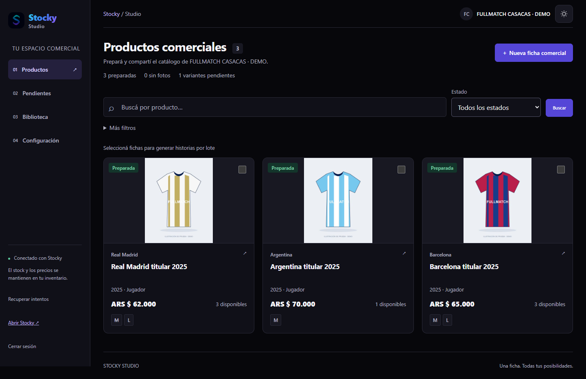
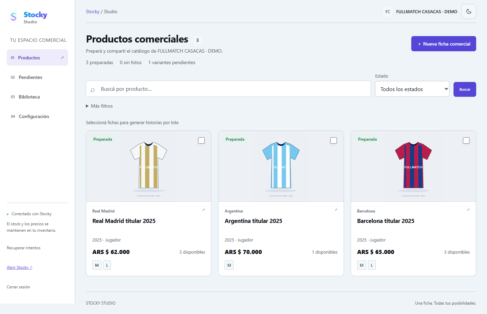
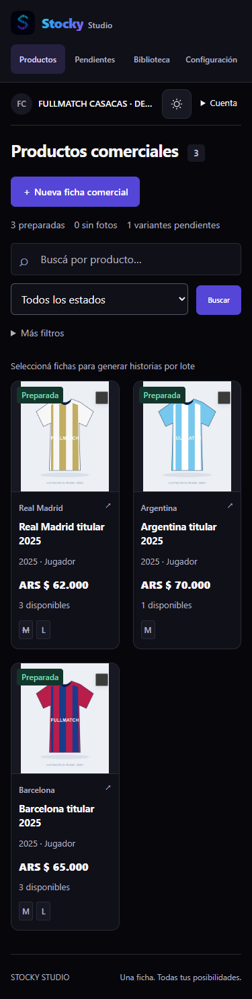
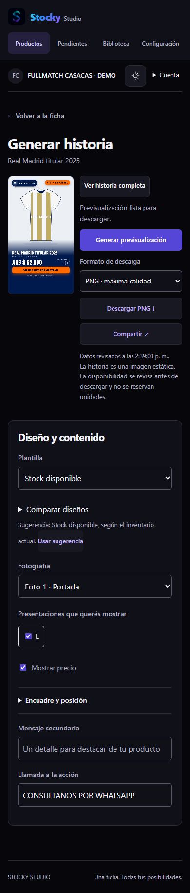

# Identidad de Stocky y tema de Studio

Studio usa el logo de Stocky y se presenta como **Stocky Studio**. El logo permite volver al inventario; el nombre y la marca del comercio siguen apareciendo en su cuenta y sus publicaciones.

El botón de sol/luna está disponible en escritorio y celular, tanto en el acceso y la preparación inicial como dentro de Studio. Reutiliza `ThemeToggle`, `StockyLogo` y `ThemeProvider` de Stocky, con sus dos variantes de logo y su paleta compartida en `src/theme.css`.

La preferencia usa la misma clave `stocky-theme`: se conserva al recargar, al navegar entre Stocky y Studio y se sincroniza entre pestañas del mismo origen. Una instalación sin preferencia sigue el valor oscuro predeterminado de Stocky.

El tema abarca productos, filtros, fichas, fotografías, historias, biblioteca, lotes, configuración, estados de acceso y recuperación. Los colores del catálogo público, las vistas previas de la tienda y los archivos exportados dependen de la identidad del comercio. Cambiar el tema administrativo no los modifica.

## Verificación

- `npm run build` y `npm run build:studio`: compilación de ambas entradas y de Studio independiente.
- `npm run test:studio:theme`: preferencia, recarga, sincronización real entre pestañas, logos cargados, contraste de textos y controles principales, acceso y configuración inicial; seis anchos (375, 390, 430, 768, 1440 y 1920 px) en ambos temas sin desbordamiento horizontal. Verifica también que el inventario, la apariencia pública y los píxeles del PNG generado sean idénticos al cambiar de tema.
- `node scripts/test-studio-deployment.mjs`: navegación del propietario Stocky → Studio → Stocky conservando sesión y tema en el build de producción, en escritorio y celular; restricciones de miembros preservadas. Cuatro escenarios aprobados.
- `npm run test:commerce:browser`: 17 verificaciones funcionales aprobadas, incluyendo catálogo público, fotografías, publicación, historias, biblioteca, lotes y consultas.
- `npm run test:studio:templates`: cinco plantillas, fotografías y exportaciones verificadas.

Las pruebas utilizan datos locales descartables. No requieren cambios en producción ni migraciones.

## Capturas

