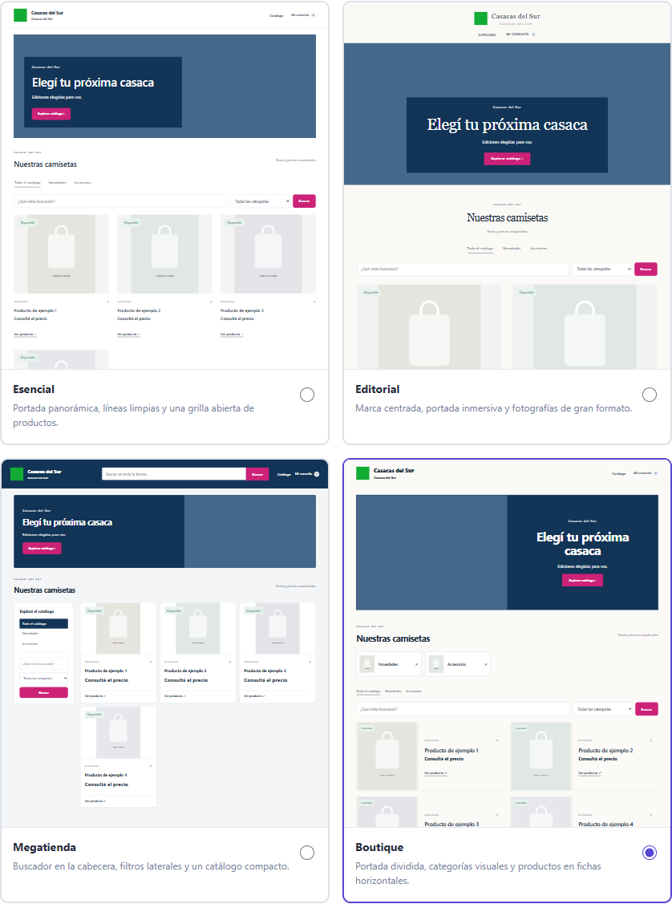

# Cuatro estándares para las tiendas

Las plantillas tienen que distinguirse por su estructura incluso usando el mismo logo, colores, portada y productos. Sus nombres no restringen el rubro del comercio.

| Estándar | Referencia visual | Composición propia | Uso sugerido |
| --- | --- | --- | --- |
| Esencial (`classic`) | [Dawn · Shopify](https://themes.shopify.com/themes/dawn/presets/dawn) | Cabecera simple, portada panorámica, navegación discreta y tres columnas de productos sin cajas. | Tiendas generales que quieren una presentación limpia. |
| Editorial (`editorial`) | [Prestige · Maestrooo](https://themes.shopify.com/themes/prestige/presets/prestige) | Marca centrada con navegación debajo, portada de borde a borde, tipografía serif y dos columnas con fotografías grandes. | Moda, accesorios y colecciones donde la fotografía define la marca. |
| Megatienda (`technical`) | [Warehouse · Maestrooo](https://themes.shopify.com/themes/warehouse/presets/warehouse) | Cabecera de marca con buscador, portada compacta, categorías y filtros en una columna lateral, grilla de tres columnas con información densa. | Catálogos amplios y productos con muchas presentaciones o especificaciones. |
| Boutique (`local`) | [Taste · Shopify](https://themes.shopify.com/themes/taste/presets/taste) | Portada dividida con imagen a la izquierda, accesos visuales a categorías y fichas horizontales en dos columnas. | Colecciones pequeñas, productos de autor y tiendas de especialidad. |

Revisión de referencias: 21 de octubre de 2026. Se toman patrones de composición, no código, fotografías ni recursos de terceros. Boutique adapta la portada dividida de Taste a una navegación por fichas horizontales.

## Comportamiento compartido

- Los identificadores guardados se mantienen para conservar la selección de tiendas existentes.
- Las vistas previas usan el mismo HTML y CSS que la tienda pública. Los productos de ejemplo están identificados como tales.
- El banner admite textos vacíos, modo solo imagen y posiciones manuales. Las posiciones manuales prevalecen sobre la portada estándar.
- Cada tienda conserva su logo, colores, fotos, textos, precios, disponibilidad y enlaces de consulta.
- Las categorías visuales usan fotografías de productos de la página cuando están disponibles; si no, muestran la inicial de la categoría.
- No se generan promociones, valoraciones, ventajas comerciales ni condiciones de envío ficticias.
- En celulares, los filtros laterales de Megatienda pasan arriba del catálogo; Boutique muestra una ficha horizontal por fila. Esencial y Editorial muestran dos columnas. Los textos con posiciones manuales vuelven a un flujo vertical legible.

## Verificación

`npm run test:studio:branding` comprueba las cuatro composiciones en escritorio y celular, selección y persistencia, banner opcional, edición de posiciones y compatibilidad con historias. Guarda capturas de las cuatro opciones en `.fullmatch-runtime/branding/`.
