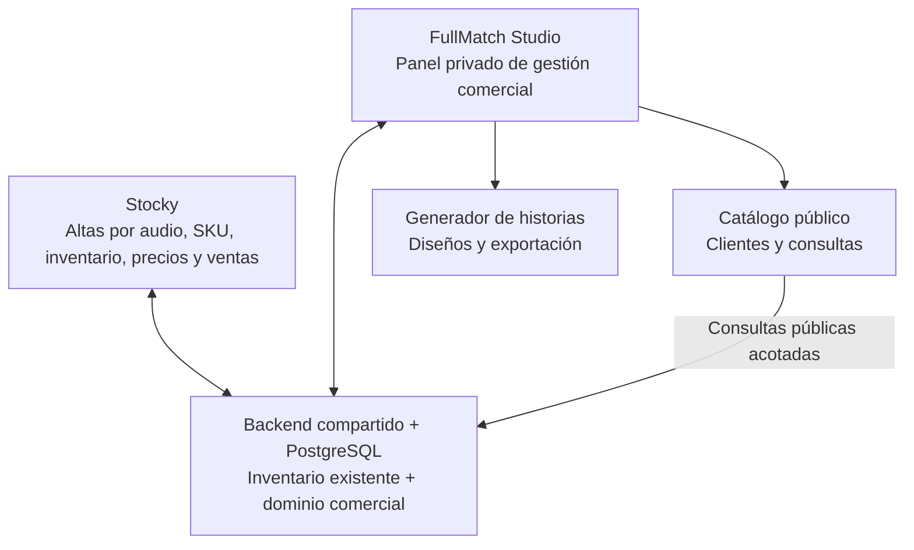

# FullMatch Studio: diseño de la ficha comercial y el generador de historias

**Proyecto:** FullMatch Casacas  
**Base de análisis:** Auditoría de Stocky (`AUDITORIA_STOCKY_FULLMATCH.md`, 20/10/2026)  
**Estado:** Propuesta funcional y técnica. **No representa una implementación.**

Mi propuesta es que construyamos **FullMatch Studio**, una plataforma comercial conectada a Stocky, pero con una interfaz propia enfocada en vender camisetas y generar contenido para Instagram.

La idea central es simple: **cargás una camiseta una vez, completás su información comercial y desde esa misma ficha podés publicarla en la tienda, generar historias y mantener actualizados sus talles y precios.**

La auditoría confirma que podemos aprovechar el backend Node/Express, PostgreSQL y el motor de inventario existente. No necesitamos otro backend ni duplicar stock.

## 1. Cómo se relacionarían los sistemas



**Decisión de diseño:** dado que queremos una web aparte de Stocky, haría una interfaz comercial propia, con una zona pública y una zona administrativa protegida. Para no sobredimensionarla, ambas podrían compartir componentes y repositorio, pero tener entradas separadas. La autenticación privada reutilizaría el backend de Stocky con permisos comerciales adecuados.

## 2. Flujo completo de una camiseta

1. **Ingreso a Stocky.** Dictás por WhatsApp: «Ingresé Barcelona titular 2025, jugador, talle L, 65 mil pesos». Stocky procesa el ingreso mediante su mecanismo actual.
2. **Pendiente de catalogar.** La plataforma comercial detecta que hay un SKU nuevo. Propone asociarlo a una ficha existente o crear una nueva, sin decidir automáticamente cuando haya ambigüedad.
3. **Preparación de la ficha.** Completás nombre comercial, fotos, temporada, versión, descripción y vínculos con los talles.
4. **Publicación del producto.** Tocás «Publicar en tienda» y la camiseta aparece en el catálogo público con sus talles disponibles.
5. **Generación de historias.** Desde esa misma ficha tocás «Generar historia», seleccionás plantilla, revisás el diseño y descargás la imagen.
6. **Actualización posterior.** Si vendés una unidad en Stocky, el catálogo utiliza el saldo actualizado. Las nuevas historias también muestran la disponibilidad vigente.

No automatizaría inicialmente la publicación de productos recién ingresados: podrían faltar fotos, haber precios incorrectos o requerirse una revisión de temporada y versión.

---

## 3. Diseño de la ficha comercial

La ficha comercial es el elemento central de toda la plataforma.

Stocky actualmente maneja SKU individuales y agrupa algunas variantes en la interfaz, pero no existe un producto comercial persistente con una identidad estable. Necesitamos agregarlo sin modificar cómo funciona el inventario.

### Ejemplo de ficha administrativa

> **FULLMATCH STUDIO / PRODUCTOS**  
> **Barcelona Titular 2025**  
> Versión jugador · **Publicado**  
> 
> **Fotografía principal:** camiseta de Barcelona (imagen cargada por el comercio).  
> **Precio ilustrativo:** $65.000  
> **Talles vinculados:** M · L · XL  
> **Disponibilidad:** según Stocky.  
> 
> **Acciones:** `Editar` · `Vista pública` · `Generar historia`

*El ejemplo muestra una propuesta de interfaz, no una consulta a datos en tiempo real.*

### Campos de la ficha

| Sección | Datos | Fuente |
|---|---|---|
| Identidad | Equipo, temporada, equipación, versión | Comercial |
| Presentación | Título, descripción, URL pública | Comercial |
| Fotografías | Portada, galería, recorte | Comercial |
| Variantes | Talles y SKU asociados | Stocky |
| Precios | Precio base de cada SKU | Stocky |
| Disponibilidad | Cantidad disponible por SKU | Stocky |
| Publicación | Borrador, publicado, oculto | Comercial |
| Marketing | Destacado, etiquetas, plantillas | Comercial |

**Regla fundamental:** desde FullMatch Studio no se modifican directamente los saldos de inventario. Si necesitás agregar stock o corregir una cantidad, la operación se hace mediante Stocky. Esto conserva su mecanismo de validaciones, transacciones e idempotencia.

### Estados de una ficha

```text
Borrador  →  Publicado  →  Oculto
```

El estado **Agotado** se calcula a partir del inventario: no debería ser un estado editorial que cambies manualmente.

Una camiseta puede estar publicada y agotada, conservando su URL y fotografías, aunque ya no tenga talles disponibles.

Para publicar, exigiría una validación mínima: una fotografía, título, categoría, al menos un SKU vinculado y precio/moneda correctos.

---

## 4. Cómo sería el panel de FullMatch Studio

No haría que tuvieras que entrar a cada producto únicamente para generar una historia. También tendría una vista general orientada a trabajar rápido.

### Maqueta conceptual del panel

```text
FULLMATCH STUDIO                                      Catálogo

PRODUCTOS

┌─────────────────┬─────────────────┬─────────────────┐
│ 24 publicados   │ 6 sin catalogar │ 3 sin fotos     │
└─────────────────┴─────────────────┴─────────────────┘

[ Buscar por equipo, temporada, versión...             ]

[Todos] [Pendientes] [Publicados] [Sin fotos]

[Foto] Inter Titular 2025
       Jugador · M, L, XL                [Publicado] >

[Foto] Argentina Titular 2025
       Jugador · M, L                   [Sin preparar] >
```

*Las cifras y los productos del ejemplo son ilustrativos.*

### Pantallas propuestas

1. **Inicio:** pendientes de catalogar, últimos ingresos de Stocky, productos sin fotos y accesos rápidos.
2. **Productos:** catálogo administrativo con búsqueda, filtros, edición y selección múltiple.
3. **Ficha comercial:** datos, fotografías, variantes, disponibilidad, estado y acciones.
4. **Generador de historias:** plantillas, edición, previsualización y exportación.
5. **Biblioteca de contenido:** historias generadas recientemente y productos que todavía no tienen contenido.
6. **Configuración:** identidad visual, logo, WhatsApp comercial y preferencias de publicación.

La biblioteca de contenido podría incorporarse después del MVP, sin convertirse inicialmente en un gestor complejo de redes sociales.

---

## 5. Generador de historias: el flujo principal

Esta sería la funcionalidad estrella.

1. **Seleccionar producto.** Desde cualquier ficha tocás «Generar historia». También podés seleccionar varios productos desde el listado.
2. **Elegir plantilla.** El sistema propone una plantilla según los datos del producto, pero podés cambiarla.
3. **Personalizar.** Elegís foto, recorte, texto destacado, información visible y llamada a la acción.
4. **Previsualizar.** Ves cómo quedaría la historia en formato vertical, respetando las zonas donde Instagram coloca elementos de su interfaz.
5. **Exportar o compartir.** Generás un archivo PNG/JPG de **1080 × 1920**, listo para subir. En celulares compatibles podríamos ofrecer el menú nativo de compartir; la descarga siempre quedaría disponible.

### Plantillas iniciales

Propongo tres plantillas de arranque, con la identidad **azul marino `#001A4D` y naranja `#FF6A00`** de FullMatch:

| Plantilla | Contenido principal | Uso previsto |
|---|---|---|
| **Nuevo ingreso** | Fotografía grande, equipo, temporada y texto «NUEVO INGRESO» | Presentar camisetas recientemente incorporadas |
| **Stock disponible** | Camiseta, versión, precio y talles disponibles | Recordar a los seguidores qué pueden comprar |
| **Última unidad** | Foto, mensaje destacado y talle concreto si corresponde | Promover artículos de stock limitado sin confusiones |

Las fotografías deben ser las propias cargadas en la ficha. Las plantillas no deben reconstruir ni alterar con IA los detalles de la camiseta.

### Personalización del diseño

| Control | Comportamiento |
|---|---|
| Plantilla | Cambiar entre diseños sin perder datos |
| Fotografía | Seleccionar una imagen de la galería |
| Encuadre | Zoom y desplazamiento de la camiseta |
| Precio | Mostrar u ocultar |
| Talles | Mostrar disponibles o elegir uno |
| Texto | Cambiar encabezado y mensaje secundario |
| CTA | «Pedila por WhatsApp», «Consultanos» o «Ver en la web» |
| Colores | Paleta de FullMatch, inicialmente fija |

No agregaría un editor libre estilo Canva desde el principio. La ventaja de las plantillas es obtener diseños consistentes sin perder tiempo ajustando textos, posiciones y colores.

### Reglas inteligentes

| Situación | Sugerencia automática |
|---|---|
| Producto recién catalogado | Nuevo ingreso |
| Varias unidades disponibles | Stock disponible |
| Una unidad total disponible | Última unidad |
| Una unidad del talle L, pero otras tallas disponibles | Última unidad talle L |
| Producto agotado | Deshabilitar mensajes de stock disponible |
| Talles con precios diferentes | Mostrar «Desde $...» o seleccionar una variante |

**Importante:** Stocky ya contempla que `stock_available` disminuye cuando se realiza una reserva. No debemos restar nuevamente `stock_reserved` al calcular la disponibilidad.

---

## 6. Que generar una historia lleve menos de un minuto

Una vez que el producto ya está preparado, el flujo debería ser:

```text
GENERAR HISTORIA

[✓] Producto y foto seleccionados
[✓] Precio y talles completados automáticamente
[✓] Plantilla sugerida

┌──────────────────────────────┐
│                              │
│      PREVISUALIZACIÓN        │
│      VERTICAL 9:16           │
│                              │
│  Logo · Producto · Precio    │
│  Talles · Llamada a acción   │
│                              │
└──────────────────────────────┘

[ Ajustar diseño ]    [ Descargar PNG/JPG ]
```

**Objetivo de experiencia:** revisar y exportar con muy pocas interacciones.

Un detalle técnico importante: antes de exportar, el sistema debe comprobar que los precios y el stock no hayan cambiado durante la edición. Si cambiaron, mostraría una advertencia y permitiría actualizar la previsualización.

Para el primer MVP seguiría la recomendación de la auditoría: **Canvas en el frontend**, con definiciones de plantillas independientes de la interfaz. Evitamos mantener un navegador o proceso adicional de renderizado en el servidor.

---

## 7. Cómo sería la estructura de datos

No modificaría la identidad actual del SKU para almacenar fotografías o etiquetas publicitarias.

Propondría estas entidades nuevas:

| Entidad | Responsabilidad |
|---|---|
| `commercial_products` | Ficha, título, temporada, versión, publicación, slug |
| `commercial_product_skus` | Relación explícita entre fichas y SKU existentes |
| `commercial_product_images` | Galería, portada, orden y recortes |
| `story_templates` | Configuración de plantillas; inicialmente puede estar definida en código |
| `story_exports` | Historial opcional de archivos generados, para una etapa posterior |

Todas las entidades persistentes deberían respetar el ámbito de negocio al que pertenecen.

### Ejemplo concreto

**Producto comercial:** Barcelona · Titular · 2025 · Jugador  
*Una ficha, una galería y una URL pública.*

| Talle | SKU ilustrativo | Estado ilustrativo |
|---|---|---|
| M | SKU 001 | Disponible |
| L | SKU 002 | Disponible |
| XL | SKU 003 | Agotado |

Definiría que **club + temporada + equipación + versión + tipo de manga** identifican inicialmente una ficha comercial. Los talles serían variantes vinculadas.

Así, por ejemplo, la Barcelona 2025 versión jugador de manga larga podría tener su propia ficha, con fotos y precio distintos.

No crearía agrupaciones permanentes usando únicamente nombres, porque la auditoría encontró que la agrupación visual actual puede cambiar cuando se modifican metadatos.

---

## 8. Dos cuestiones que tenemos que resolver antes de implementar

### 8.1 Normalización de datos

La auditoría encontró **50 SKU** asociados al perfil de FullMatch en la base configurada, pero no confirmó que sea exactamente la producción. Además, todos tienen moneda **`XXX`**.

Es imprescindible validar el origen y la escala de los precios antes de publicar.

### 8.2 Seguridad de la API

FullMatch Studio no debe consumir `/api/state` como si fuera una API pública. Necesitamos endpoints comerciales específicos, selección estricta de campos y aislamiento entre negocios.

Para las fotografías usaría almacenamiento de objetos, asociado a los productos comerciales.

También definiría el número de WhatsApp público de ventas, sin mezclar a los clientes con el flujo administrativo del bot de Stocky.

---

## 9. MVP que implementaría

### Hito 1 — Base comercial

Crear fichas comerciales, asociaciones estables con SKU, almacenamiento de fotografías, estados editoriales y contratos privados. Validar datos y moneda antes de habilitar publicación.

### Hito 2 — Generador de historias

Panel de productos, selector de plantillas, recorte, previsualización y descarga. Es la primera funcionalidad que probaría en el uso diario.

### Hito 3 — Catálogo público

Fichas compartibles, fotos, filtros, talles disponibles, precios y contacto por WhatsApp. Todo desde la misma información comercial del hito anterior.

### Hito 4 — Publicaciones por lotes

Seleccionar varias camisetas, generar múltiples historias, conservar las configuraciones y evaluar programación automática con Meta.

### Criterios para considerar terminado el primer generador

- [ ] Generar una historia desde un producto preparado sin reescribir nombre, precio ni talles.
- [ ] Exportar PNG/JPG de 1080 × 1920 con textos legibles y sin recortes incorrectos.
- [ ] Diferenciar última unidad total de última unidad de un talle.
- [ ] Detectar cambios de stock o precio antes de exportar.
- [ ] Mantener intacta la fotografía real de la camiseta.
- [ ] No permitir filtraciones de información operativa ni modificaciones accidentales del inventario.
- [ ] Funcionar correctamente desde PC y celular.

---

## 10. Decisión de producto que tomaría desde ahora

**FullMatch Studio debería ser una plataforma comercial reutilizable, no solamente un creador de historias.**

El generador sería una de sus funcionalidades, pero el centro de todo sería la ficha comercial. A partir de ella podríamos sumar un catálogo, publicaciones para el feed, promociones, etiquetas imprimibles, carruseles y eventualmente pedidos.

También evitaría que la futura posibilidad de ofrecer este módulo a otros comercios complique el primer desarrollo. Preservaría la separación por negocio que Stocky ya utiliza, sin construir todavía gestión SaaS ni facturación multiempresa.

Mi siguiente paso técnico sería convertir este diseño en un **contrato funcional y plan de implementación para Codex**, empezando por la estructura de datos y los casos de prueba. Lo importante es que cada nuevo módulo se construya encima del motor de Stocky, sin alterar los flujos de carga por voz, reservas y ventas que ya existen.

---

## Documento de referencia

- **`AUDITORIA_STOCKY_FULLMATCH.md`** — Auditoría de Stocky, repositorio ERPVoice, commit `4dc5d9b`, 20 de octubre de 2026.
- Las vistas, cantidades, SKU y composiciones ilustrativas incluidas en esta propuesta **no representan una comprobación en tiempo real del inventario**.
