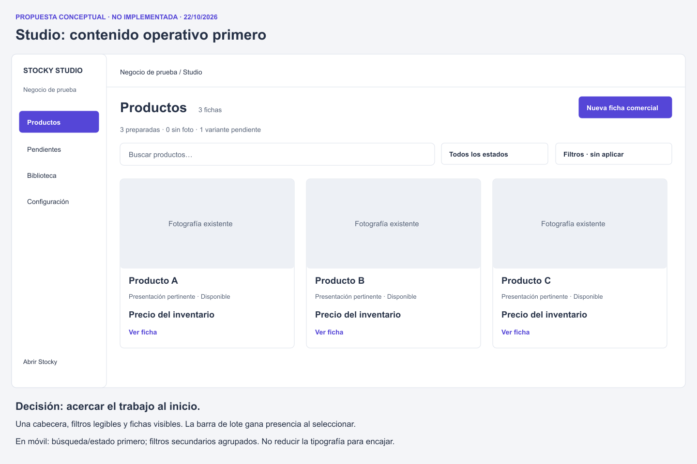
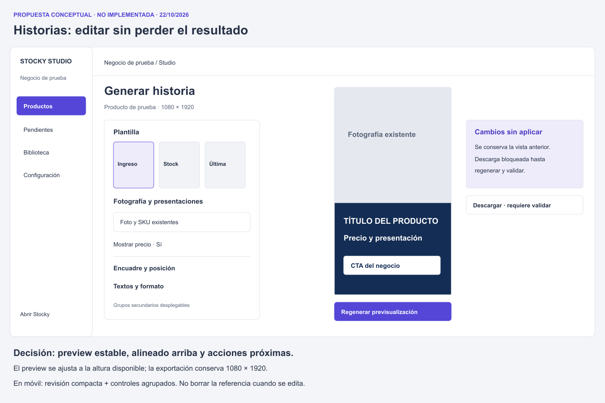
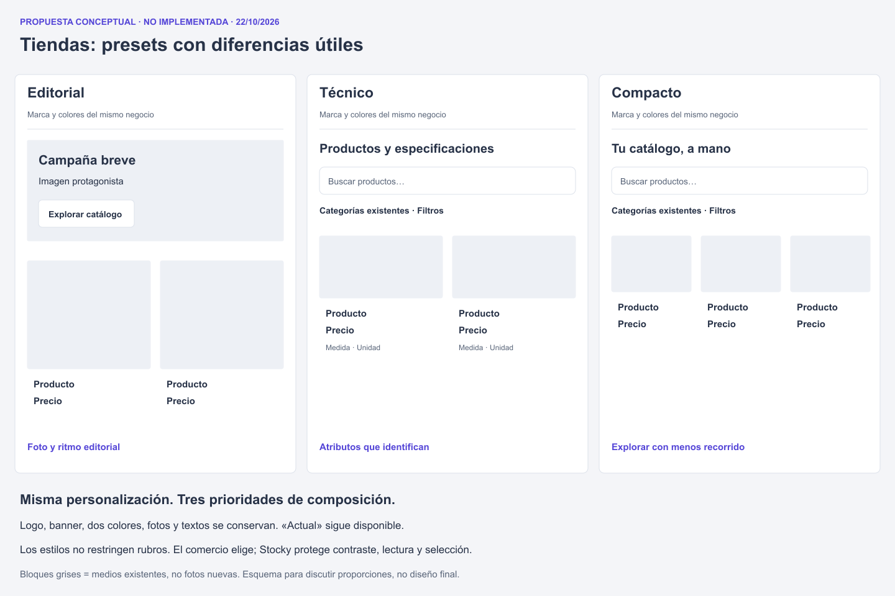

# Dirección visual propuesta

**22/10/2026 — Conceptos para revisar, no implementados.** Estos criterios evolucionan las interfaces y la configuración existentes. No se reemplazaron componentes, CSS, datos ni contratos.

## 1. Stocky Studio: claridad operativa con identidad propia

La marca del comercio aporta contexto y contenido. La herramienta conserva una identidad SaaS estable: superficies claras, violeta como acento de interacción y tipografía legible. No teñir navegación y formularios con cada color comercial. El logo del negocio sí puede aparecer como contexto; las fotos, portada y colores viven en catálogo, historias y preview.

**Composición:** reducir la cabecera a título, contador y acción contextual; búsqueda inmediatamente debajo; información y tareas sin frases repetidas. Mantener Productos, Pendientes, Biblioteca y Configuración. No crear un dashboard de tarjetas decorativas.

**Tipo:** conservar la pila del sistema, que no requiere una descarga adicional; si se decide usar Inter real, servirla y verificar su carga. Escala propuesta: título de pantalla 24–30 px, sección 18–22 px, cuerpo/campo 14–16 px, ayuda 12–14 px, metadato secundario 12 px. En móvil campos editables a 16 px cuando corresponda para evitar zoom automático en iOS, pendiente de prueba real. No convertir toda la interfaz a 12 px para ganar densidad.

**Color:** consolidar roles de acción, selección, foco, texto, texto secundario, borde, éxito y error. El violeta actual `#5546D7` puede conservarse: blanco sobre él dio 6,47:1. Corregir hover heredado naranja y ayudas pálidas. El naranja de la tienda no es un color universal de controles administrativos. Conservar etiquetas textuales en estados.

**Espacio:** ritmo de 4/8 px; grupos de 16–24 px; separación de secciones 24–32 px. Usar el espaciado para agrupar, no envolver cada dato en una tarjeta. Estos son valores iniciales de diseño, sujetos a validación con contenido real.

**Acción:** una primaria por tarea y secundarias legibles. Diferenciar guardar contenido, preparar ficha, publicar y generar historia mediante jerarquía y contexto, manteniendo sus reglas actuales. No fusionarlas en una acción que cambie su significado.

### Wireframe: listado operativo

Comparar con [estado actual 1440×900](screenshots/local-studio-products-1440x900.png) y [móvil](screenshots/local-studio-products-390x844.png). La grilla del diagrama conserva la estructura fotográfica y acerca las fichas al encabezado; no exige añadir un modo de listado nuevo. La densidad final depende de tareas y volumen, no del rubro del comercio.

## 2. Generador de historias: conservar la referencia mientras se edita

El preview ya tiene un tamaño considerable: 390×693 px en escritorio y cerca de 300×533 px en móvil. Agrandarlo sin cambiar composición empeoraría el problema. Alinear arriba, dimensionar por altura disponible y mantenerlo estable.

**Escritorio:** cabecera breve con regreso/título; editor de aproximadamente 320–380 px y preview en el resto, ambos alineados arriba. Acciones próximas al resultado y una etiqueta inequívoca cuando los cambios no estén aplicados. Controles frecuentes —plantilla, fotografía, presentación, mostrar precio— primero; encuadre/posición y copy en grupos secundarios.

**Móvil:** preview compacto con opción de verlo completo; agrupaciones claras de controles y acción de regenerar próxima. Un área fija solo si las pruebas muestran que no tapa contenido ni teclado; no imponer una barra por tendencia. Conservar la última imagen como referencia, con descarga deshabilitada hasta regenerar y revalidar.

**Plantillas:** presentar las existentes con una miniatura identificable y etiqueta, incluyendo elegibilidad de stock cuando corresponda. No duplicar el editor con otro sistema de marca. La imagen de producto permanece real y se trata con contain/cover y foco existentes; no se genera otra fotografía.

Comparar con [viewport actual](screenshots/local-story-initial-viewport-1440x900.png). El diagrama no es una nueva plantilla exportada ni una captura del producto.

## 3. Tiendas: marca reconocible y producto temprano

Conservar una única fuente de personalización: `appearance`, logo/ícono, banner, dos colores, textos, fotos y preset, incluida «Actual». Mantener cálculo automático de foreground negro/blanco que funcionó en las pruebas. Los neutrales de contenido deben proteger la legibilidad incluso si ambos colores del negocio son muy claros u oscuros.

**Portada:** tamaño proporcional a su función. Como punto de partida, 280–360 px en escritorio para campaña editorial; 120–200 px para introducción técnica/compacta, contando contenido real y padding. En móvil, evitar que la suma de texto + foto + filtros ocupe más que el contenido comercial útil. No recortar texto incrustado en banners existentes: reubicar imagen, contenerla o acordar contenido alternativo, conservando el archivo.

**Header:** logo y nombre; catálogo/categorías donde aporten; «Mi consulta» visible con área táctil suficiente. El mecanismo de consulta debe explicarse en una frase breve: selección y contacto por WhatsApp, sin cobro ni reserva online.

**Tarjeta:** imagen → título → atributo/presentación relevante → precio → disponibilidad/acción. Evitar repetir el mismo nombre como chip de SKU. No todos los rubros requieren el mismo alto de foto, pero sí un ritmo consistente dentro de cada grilla.

**Ficha:** foto y datos forman una decisión; variantes seleccionables junto a cantidad y acción, galería dentro de la ficha, descripción auténtica. Reutilizar especificaciones existentes y no inventar beneficios de confianza.

## 4. Contrato visual de cada preset

| Preset existente | Debe priorizar | Composición objetivo | Tipografía / medios | Móvil | Qué evitar |
|---|---|---|---|---|---|
| Actual (`classic`) | Continuidad y mejoras compartidas | Mantener identidad/composición elegida; corregir defectos comunes con revisión de regresión | Conservar marca y contenido | Correcciones legibles sin forzar otro estilo | Convertir Actual silenciosamente en otro preset |
| Editorial (`editorial`) | Imagen y exploración pausada | Dos columnas amplias, portada editorial medida, ritmo tranquilo | Foto vertical consistente; título expresivo opcional; precio claro | Dos columnas solo si títulos/medios siguen siendo legibles | Hero enorme por defecto, texto blanco sobre foto arbitraria |
| Técnico (`technical`) | Identificación y comparación | Búsqueda temprana, fotos menores y atributos existentes escaneables | Sans legible, nombres completos en ficha, unidades y medidas sin repetición | Filtros agrupados; presentar atributos en filas legibles | Títulos de SKU usados como chips gigantes o inventar especificaciones |
| Compacto, hoy Proximidad (`local`) | Encontrar y consultar muchos artículos | Cabecera corta, categorías rápidas y cuatro columnas razonables en escritorio | Foto cuadrada contenida; precio y presentación directos | Dos columnas con texto suficiente, o una si el contenido lo exige | Reducir todo a 10 px, inventar compra rápida o sumar controles sin variante |

«Compacto» se usa aquí como nombre conceptual; no se cambió el nombre persistido `local` ni el selector existente. Una tienda puede elegir cualquier preset sin restricción por rubro.

Comparación real del mismo contenido: [Actual](screenshots/local-same-content-preset-classic-1440x900.png), [Editorial](screenshots/local-same-content-preset-editorial-1440x900.png), [Técnico](screenshots/local-same-content-preset-technical-1440x900.png), [Proximidad](screenshots/local-same-content-preset-local-1440x900.png).

## 5. Conservar, rediseñar y reutilizar

**Conservar:** configuración única de identidad; presets opcionales; retorno a Actual; inventario como fuente de stock/precio; fotografías completas; productos sin foto permitidos; contador y revisión de Mi consulta; exportación validada; agrupación de SKU explícita; destinos de navegación existentes.

**Rediseñar su presentación:** cabecera y filtros de Productos; estados vacíos/error; layout de historias; preview de configuración; anatomía de selección pública; galería; portada excesiva y fallback sin foto. Rediseñar presentación no autoriza cambiar contratos, datos o comportamiento comercial.

**Compartir patrones:** tokens de legibilidad, estados, focus, botones/input, feedback de carga, anatomía de campo y mensajes. No compartir una identidad comercial fija entre todas las tiendas ni hacer que Studio herede cada paleta.

**Fotografía:** recomendaciones por formato, proporción y escala; tratamiento contain por defecto para no cortar productos técnicos; cover solo cuando el comercio lo elige con preview fiable. El problema de la foto pequeña de Argentina frente al acercamiento de Inter exige revisión editorial de FullMatch, no edición generativa de imágenes reales.

## 6. Qué demostrar antes de implementar/publicar

1. Misma información y personalización al alternar presets, incluyendo retorno a Actual.
2. Tres rubros con fotografías/sin fotos, títulos largos, importes extensos, agotados y variantes múltiples.
3. Cabecera/filtros/acciones legibles en las seis resoluciones; teclado y touch reales antes de cerrar aceptación.
4. Estado de cambios pendientes en historias sin permitir exportación obsoleta.
5. Preview de configuración que anticipe grilla, portada y densidad finales.
6. Revisión por el comercio de todo texto comercial real. Sin testimonios, descuentos, políticas o garantías inventadas.

Los wireframes son documentos de composición con bloques esquemáticos, no rediseños terminados, nuevas funciones implementadas ni promesas de resultados comerciales.
