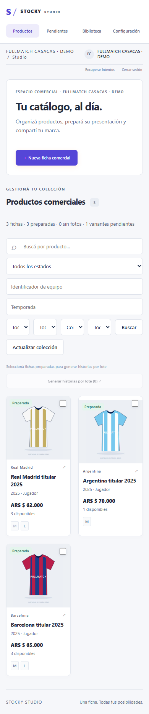
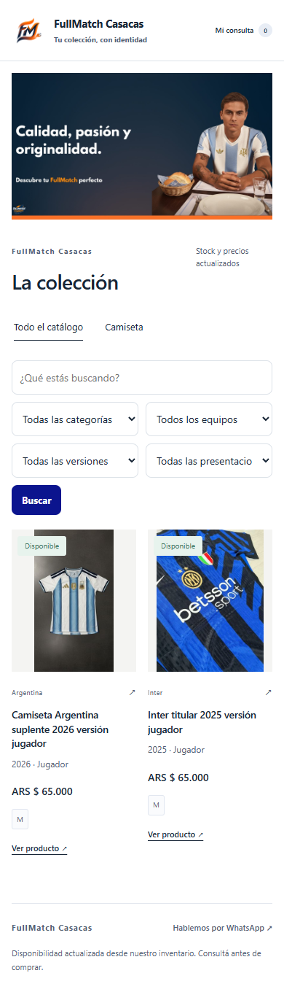

# Auditoría visual integral — Stocky Studio y tiendas públicas

**Fecha:** 22/10/2026, America/Montevideo. **Estado:** diagnóstico y propuesta; rediseño no implementado. **Código local:** `f29d076` al iniciar, árbol limpio. Producción y checkout local se evalúan por separado: su HTML de portada es diferente.

**Seguimiento posterior:** las tres tandas autorizadas después de este diagnóstico se implementaron localmente. Ver [cambios, validación y capturas nuevas](IMPLEMENTATION.md). Este informe conserva la evaluación y evidencia previas.

## 1. Resumen ejecutivo

Stocky dispone de una base comercial reconocible: marca del negocio, fotografías reales, precios legibles, disponibilidad, consultas agrupadas y personalización existente. Studio tiene navegación breve, fichas con estado y separación entre inventario y contenido comercial. **La distancia con un producto maduro está en la composición y los estados de trabajo, no en la falta de sombras, efectos o un nuevo sistema de temas.**

La tienda FullMatch transmite una identidad propia, pero en escritorio el banner consume 675 px de alto y deja ambos productos debajo del primer viewport. En móvil, banner, títulos y filtros llevan el comienzo de las tarjetas hasta y=726 px. Las fotos reales tienen escalas muy distintas; la primera descripción dice «da». Estos últimos dos problemas pertenecen al contenido de FullMatch y no prueban una limitación universal.

Studio resulta más consistente en escritorio que en celular. A 390 px cuatro filtros quedan reducidos a unos 61 px de ancho. El generador de historias concentra controles en una columna larga, centra verticalmente el preview y lo borra al editar. Hay ayudas de 10 px con contraste 2,92:1 y un hover naranja heredado que rompe el acento violeta y reduce el contraste del botón a 3,52:1.

**Orden recomendado:** corregir filtros móviles, contraste y estados vacíos/error; comprimir cabeceras operativas y portadas de catálogo; reorganizar selección de variantes y generador; después consolidar tokens y evolucionar los presets. Conservar colores, logo, banner, fotos, textos, presets y «Actual». No se justifica reescribir la plataforma.

No se detectó un bloqueo visual crítico que impida todo uso. Los hallazgos altos sí afectan tareas importantes. Las puntuaciones de diseño son aproximadamente **5–6/10**, no equivalen a una certificación ni a una medición de conversión.

## 2. Metodología y skills

1. Lectura de las dos consignas, catálogo real de skills, scripts de fixtures y rutas existentes.
2. Edge real con Playwright ya instalado, renderizado de producción y capturas PNG. Se miraron las imágenes, no solo su DOM. Se registraron texto visible, geometría y estilos computados en `evidence/*.json`.
3. Studio con sesión emitida por el fixture existente y PostgreSQL temporal en localhost. Ferretería y kiosco se crearon únicamente allí, con arte rotulado de prueba. Se usaron formularios sin guardar para otros estados. En producción se navegó, se guardó la selección en el navegador de prueba y se solicitó la previsualización de consulta; eso no crea pedidos ni reserva stock. No se envió WhatsApp ni se modificaron datos productivos.
4. Benchmark con navegación pública, documentación oficial y búsquedas actuales. Los bloqueos se conservaron como evidencia de limitación y no como inspección de interfaz.
5. Lectura de componentes para localizar responsables después de observar problemas. No hubo auditoría de backend, arquitectura o seguridad.

Skills leídas: `computer-use`, `canvas`, `visualize` y `game-ui-frontend`. Se utilizó el inventario CUA para comprobar superficies; las capturas se hicieron con Playwright, expresamente solicitado. No hay una skill general de auditoría UI/UX en el catálogo disponible. Las de juegos no corresponden a este SaaS. Canvas y visualización inline se descartaron para la entrega porque se solicitaron archivos concretos en el repositorio. Se entregan diagramas propios en SVG/PNG. Detalle y procedencia: [SKILLS_AND_TOOLS.md](SKILLS_AND_TOOLS.md).

## 3. Pantallas, rutas y resoluciones inspeccionadas

Las dimensiones en los nombres representan el **viewport CSS**; salvo los archivos que dicen `viewport` y las referencias externas, las capturas incluyen la página completa. No se simuló un teléfono físico, Safari ni el teclado virtual.

| Entorno / pantalla real | Ruta / acceso | Viewports |
|---|---|---|
| Producción: catálogo FullMatch | `/c/fullmatch-casacas` | 375×812, 390×844, 430×932, 768×1024, 1440×900, 1920×1080 |
| Producción: producto Argentina | enlace real `/c/fullmatch-casacas/p/…` | 390×844, 1440×900 |
| Producción: búsqueda vacía, filtro de Argentina, foco | query GET del catálogo | 390×844 |
| Producción: hover tarjeta | catálogo | 1440×900 |
| Producción: Mi consulta vacía y con 1 artículo | `/c/fullmatch-casacas/consulta` | 1440×900 vacía, 390×844 con contenido |
| Producción: producto inexistente | `/c/fullmatch-casacas/p/auditoria-inexistente` | 390×844 |
| Producción: rutas exploratorias de acceso | `/studio.html`, `/studio/` | 390×844; ambas devolvieron `Cannot GET` |
| Local: productos / inicio efectivo | `studio.html`, `#/products` | 390×844, 768×1024, 1440×900, 1920×1080 |
| Local: Pendientes / Biblioteca / Recuperar intentos | botones reales; comparten hash `#/products` | 1440×900; Pendientes también 390×844 |
| Local: configuración y presets | `studio.html#/settings` | 390×844, 1440×900 |
| Local: ficha existente, nueva, texto largo sin guardar | `#/products/<uuid>` / acción Nueva ficha | 1440×900 |
| Local: SKU, fotos, enfoque, galería de dos fotos | tabs de ficha | 1440×900; fotos también 390×844 |
| Local: historias antes/después, edición, plantillas | acción de ficha, sin ruta independiente | 390×844, 1440×900 |
| Local: lote vacío | `#/batch` | 1440×900 |
| Local: acceso sin sesión y carga | sesión local cerrada / respuesta demorada | 390×844 acceso, 1440×900 ambos |
| Local: error de listado | respuesta 503 interceptada solo en navegador local | 1440×900 |
| Local: tres rubros, catálogo y ficha | `/c/fullmatch-demo`, `/c/ferreteria-fixture`, `/c/kiosco-fixture` | 390×844, 1440×900 |
| Local: sin foto, agotado, precio extenso, presets sobre mismo contenido | fixtures ferretería/kiosco | 1440×900; casos largos también en catálogos 390×844 |
| Local: portada de prueba y colores extremos | tienda y preview de configuración | 1440×900; portada pública también 390×844 |

**No existe un dashboard independiente en la navegación inspeccionada.** Productos es el inicio operativo. Las rutas locales contienen puertos/UUID efímeros registrados en JSON, no enlaces permanentes de producción.

El índice completo con origen, viewport y enlace de imagen se encuentra en [SCREENSHOT_INDEX.md](SCREENSHOT_INDEX.md). Hay capturas externas de barreras de acceso: están marcadas como tales en ese índice y en el benchmark.

## 4. Evaluación de Stocky Studio

**Funciona:** sidebar de cuatro destinos; contexto del comercio; paneles neutros con acento propio; estados preparada/borrador; SKU separados de información comercial; fotografía completa; acceso a historias desde la ficha; selección por lote; feedback de carga y reintento; previsualización antes de descargar. No hace falta un dashboard de métricas decorativas.

**Falta madurez operativa:** mucha introducción antes del catálogo, filtros sin jerarquía, textos auxiliares diminutos, acento naranja sobreviviente en hover/ranges/checkboxes, configuración lineal demasiado larga y vacíos que no distinguen falta de resultados de falta de datos. Las acciones de guardar, preparar, publicar y generar son diferentes y deben seguir siéndolo, pero el orden visual debería explicar esa secuencia con menos lectura.

Pendientes comunica que agrupar SKU es una decisión explícita, lo cual conviene conservar. En fotos, portada y enfoque existen y son localizables; las acciones pequeñas necesitan mayor presencia y área táctil. Biblioteca y lotes se inspeccionaron principalmente vacíos; su calidad con cientos de exportaciones queda pendiente.

## 5. Evaluación de la tienda pública

**¿Parece una tienda real?** Sí: tiene logo propio, fotos reales, precios, variantes, disponibilidad y contacto. La confianza es parcial: el banner domina más que el catálogo, no explica el mecanismo de consulta y una descripción de dos letras parece sin terminar. El sistema debe ayudar a presentar contenido completo, sin inventar garantías ni testimonios.

El precio se identifica y las fotos completas no están recortadas por defecto. La grilla de dos artículos sobre tres columnas deja una tercera columna vacía en escritorio; no es un error de overflow, pero combinado con la portada grande hace que el inventario parezca menor. El ancho máximo de 1200 px no es por sí mismo un defecto: el problema es cómo se reparte el espacio dentro de él.

La ficha prioriza fotografía y precio, pero el primer CTA móvil queda bastante por debajo de la imagen y la información. Las tallas se muestran como chips no interactivos y se eligen de nuevo en un select. «Mi consulta» conserva la selección y explica correctamente que no hay cobro ni reserva. Hay que hacer ese modelo comprensible antes, sin presentar un carrito de checkout que Stocky no ofrece.

## 6. Sistema visual actual, dimensión por dimensión

| Dimensión | Observación basada en renderizado | Dirección de mejora |
|---|---|---|
| Jerarquía | Buenos títulos y precios; demasiada cabecera y filtros antes de productos; regeneración lejos de preview | Una cabecera útil, una acción primaria contextual y contenido operativo temprano |
| Tipografía | Stack Inter/system-ui/Segoe UI; producción no cargó webfonts (`document.fonts` vacío). Editorial usa Georgia; historias Barlow/Barlow Condensed | Mantener stack del sistema o servir fuente de forma explícita; escala legible, no encoger toda la UI |
| Color | Studio violeta; tienda usa dos colores con foreground calculado. Ayudas débiles y hover naranja en Studio | Consolidar foreground, hover, foco y estados; separar marca comercial de software |
| Composición | Contenedores razonables; banner 16:9 demasiado alto; preview de historias centrado dentro de columna larga | Alturas por función, alineación superior y preview dimensionado al viewport |
| Fotografías | `contain` conserva producto; FullMatch mezcla plano entero y acercamiento. Sin foto conserva gran bloque vacío | Reglas de encuadre y medios por preset; no generar ni reemplazar fotos reales con IA |
| Componentes | Tabs, paneles, filtros y estados ya existen; controles pequeños y vacíos ambiguos | Evolucionar componentes existentes, con una anatomía y estados compartidos |
| Microinteracciones | Hover y foco presentes; mensaje al agregar consulta funciona; editar historias borra preview | Mantener feedback útil y conservar preview anterior marcado como pendiente; reduced motion |

En las capturas principales no hubo overflow horizontal del documento ni imágenes rotas reportadas. Eso no garantiza legibilidad: los filtros comprimidos siguen siendo un fallo aunque `scrollWidth === innerWidth`.

Las pruebas claras/oscuras del catálogo conservaron texto negro/blanco contrastado. El CTA amarillo de la portada tuvo texto negro tanto en preview como en página pública: **no se reprodujo un fallo general de colores personalizados**. El preview sí representa de forma incompleta el layout final.

## 7. Hallazgos verificables

Severidades: **alta** afecta lectura, tarea clave o confianza; **media** introduce fricción o composición deficiente; **baja** refinamiento localizado. Esfuerzo relativo de diseño/frontend: bajo = componente/regla acotada; medio = varios estados/breakpoints; alto = coordinación entre superficies. No son compromisos de calendario.

### A01 — La portada posterga todo el catálogo en escritorio

**Pantalla:** catálogo FullMatch, inicio. **Severidad:** alta.

**Problema observado:** banner de 1200×675 px; primera tarjeta en y=1074,5 tanto a 1440 como a 1920. En 390, el catálogo empieza en y=726,4 por la combinación de bloques superiores.

**Evidencia:** [producción 1440×900](screenshots/prod-fullmatch-home-1440x900.png), [1920×1080](screenshots/prod-fullmatch-home-1920x1080.png), [390×844](screenshots/prod-fullmatch-home-390x844.png), `evidence/production.json`.

**Por qué importa:** ni un producto visible en el primer viewport de escritorio con un catálogo de solo dos artículos.

**Mejora propuesta:** portada de aproximadamente 280–360 px en escritorio, CTA de exploración accesible, sección comercial compacta; preservar el banner completo mediante un modo de encuadre que no corte su texto, por ejemplo imagen contenida en composición dividida. En móvil limitar la suma de portada y controles.

**Resultado esperado:** fotos y nombre/precio de al menos la primera fila empiezan dentro del viewport de referencia. **Esfuerzo:** medio. **Alcance:** tienda. **Componentes:** `renderCatalogList`, `.catalog-hero`, `.catalog-cover`, `.collection`. La variante `image-only` de producción no está en el renderizador local: localizar su fuente antes de implementar.

### A02 — El mensaje principal del banner solo existe como píxeles

**Pantalla:** portada FullMatch. **Severidad:** alta.

**Problema observado:** el bloque real es `section.catalog-hero.has-cover.image-only.text-on-image` con una imagen `alt=""`; no hay h1 ni texto equivalente. El título de campaña solo está dibujado en la foto.

**Evidencia:** [390×844](screenshots/prod-fullmatch-home-390x844.png), `production-hero-structure` en `evidence/measurements.json`.

**Por qué importa:** el mensaje no se adapta como texto y no se comunica mediante esa imagen a lectores de pantalla.

**Mejora propuesta:** reutilizar los textos comerciales existentes para un título visible y un enlace de exploración, o aportar una alternativa accesible si la imagen es deliberadamente la campaña. Evitar duplicación verbal/visual de todo el banner.

**Resultado esperado:** mensaje y destino comprensibles con imagen deshabilitada y a zoom. **Esfuerzo:** bajo/medio según variante desplegada. **Alcance:** tienda, caso de portada de producción. **Componentes:** variante desplegada de `renderCatalogList`; no asumir equivalencia con local.

### A03 — Cuatro filtros de Studio se comprimen hasta 61 px

**Pantalla:** Productos, móvil. **Severidad:** alta.

**Problema observado:** versión, manga, fotografías y publicación comparten una línea con Buscar; cada select mide aproximadamente 61,3×43 px y solo muestra fragmentos como «To…».

**Evidencia:** [390×844](screenshots/local-studio-products-390x844.png), `studio-type-samples` en `evidence/measurements.json`.

**Por qué importa:** no se puede identificar el filtro ni su valor seleccionado.

**Mejora propuesta:** búsqueda y estado visibles; resto bajo «Filtros» con campos de ancho completo y resumen de selección. Si se mantiene todo expandido, usar una columna o dos con mínimo real por campo.

**Resultado esperado:** etiquetas y valores legibles sin abrir cada select. **Esfuerzo:** bajo/medio. **Alcance:** Studio. **Componentes:** `ProductList`, `.filters` en `studio.css` y `universal.css`.

### A04 — Filtros públicos extensos sin resumen ni limpieza contextual

**Pantalla:** listado público y filtro activo. **Severidad:** media.

**Problema observado:** cuatro selects ocupan dos filas en FullMatch móvil, con «Todas las presentacio…» truncado; después de filtrar Argentina se repite la portada y no aparece un resumen independiente con «Quitar filtros».

**Evidencia:** [filtro activo 390×844](screenshots/prod-public-filter-active-390x844.png), [listado inicial](screenshots/prod-fullmatch-home-390x844.png).

**Por qué importa:** se gasta altura en controles poco informativos y no se reconoce rápidamente cómo volver a los dos productos.

**Mejora propuesta:** conservar filtros derivados de datos; agrupar los secundarios en móvil y mostrar selección activa con acción de limpiar. En búsqueda, llevar el foco visual a resultados conservando contexto.

**Resultado esperado:** búsqueda, cantidad de resultados y selección activos se comprenden juntos. **Esfuerzo:** medio. **Alcance:** tienda. **Componentes:** `renderCatalogList`, `.catalog-filters`, `.category-nav`.

### A05 — La cabecera operativa empuja las fichas debajo de 1000 px en móvil

**Pantalla:** inicio de Studio. **Severidad:** alta.

**Problema observado:** navegación, doble contexto comercial, sesión, bloque «Tu catálogo, al día», nueva ficha, título, estadísticas, filtros y lote preceden las primeras fotos; en la captura móvil aparecen cerca de y=1034.

**Evidencia:** [390×844](screenshots/local-studio-products-390x844.png), [1440×900](screenshots/local-studio-products-1440x900.png).

**Por qué importa:** una tarea recurrente exige atravesar contenido introductorio que no cambia.

**Mejora propuesta:** integrar título, contador y Nueva ficha en una sola cabecera; contexto del negocio una vez; estadísticas resumidas; barra de lote más prominente solo al seleccionar.

**Resultado esperado:** primer producto visible con filtros esenciales en el viewport móvil y varias fichas útiles en escritorio. **Esfuerzo:** medio. **Alcance:** Studio. **Componentes:** `Studio`, `ProductList`, `.topbar`, `.collection-hero`, `.selection-toolbar`.

### A06 — El preview de historias se centra verticalmente y sale del primer viewport

**Pantalla:** Generar historia, escritorio. **Severidad:** alta.

**Problema observado:** el panel de controles empieza en y≈295; el preview de 390×693 px empieza alrededor de y=460. Su parte inferior y descarga quedan fuera de 900 px. No le falta tamaño; le falta alineación y ajuste a la altura disponible.

**Evidencia:** [viewport 1440×900](screenshots/local-story-initial-viewport-1440x900.png), [página completa](screenshots/local-ferreteria-story-1440x900.png).

**Por qué importa:** controles y resultado no se leen como una sola herramienta.

**Mejora propuesta:** alinear ambas columnas arriba, reservar una zona estable de preview con tamaño proporcional a altura disponible y agrupar controles avanzados. Mantener resolución exportada 1080×1920.

**Resultado esperado:** preview completo y acción principal visibles juntos a 1440×900, sin reducir textos de formulario. **Esfuerzo:** medio. **Alcance:** Studio. **Componentes:** `StoryEditor`, `.story-layout`, `.story-preview`, `.canvas-frame` en `stories.css`.

### A07 — Editar destruye la referencia visual de la historia

**Pantalla:** historia generada → editar mensaje. **Severidad:** alta.

**Problema observado:** al cambiar un campo desaparece la imagen y vuelve el placeholder. En móvil el preview va arriba y Generar abajo: se pierde la comparación y aumenta el recorrido. Cambiar formato también invalida la vista.

**Evidencia:** [antes 390×844](screenshots/local-studio-story-ready-390x844.png), [después de editar](screenshots/local-story-edited-invalidated-390x844.png). Plantillas `arrival`, `last_unit` y `promo` se inspeccionaron como controles/estado invalidado, no como tres exportaciones finalizadas.

**Por qué importa:** el editor pierde su principal feedback durante el ajuste.

**Mejora propuesta:** mantener el último preview con etiqueta «Cambios sin aplicar», conservar deshabilitada la descarga hasta regenerar y acercar Regenerar a preview/controles. No eliminar revalidaciones de inventario.

**Resultado esperado:** iterar sin perder la referencia y sin descargar una imagen desactualizada. **Esfuerzo:** medio. **Alcance:** Studio. **Componentes:** estado `blob`/`snapshot`, efecto de invalidación de `StoryEditor`.

### A08 — Las plantillas se descubren por nombre, sin comparación visual

**Pantalla:** selector Plantilla. **Severidad:** media.

**Problema observado:** un select enumera diseños; para conocer su aspecto hay que elegir y generar. «Usar sugerencia» ocupa una acción adicional y texto explicativo.

**Evidencia:** [editor inicial](screenshots/local-studio-story-before-1440x900.png), [Promoción y sus controles](screenshots/local-studio-story-template-promo-1440x900.png).

**Por qué importa:** probar estilos exige más pasos y lectura de lo necesario.

**Mejora propuesta:** pequeños previews de las plantillas actuales con nombre/selección y estado de elegibilidad; sugerencia integrada. No agregar plantillas ni prometer promociones inexistentes.

**Resultado esperado:** reconocer una opción antes de generar. **Esfuerzo:** medio. **Alcance:** Studio. **Componentes:** `StoryEditor`, `PromotionFields`, renderizadores existentes.

### A09 — Las ayudas del editor no alcanzan contraste de texto normal

**Pantalla:** ayudas de historias. **Severidad:** alta.

**Problema observado:** `.control-help` computa 10 px y `#8B98AD` sobre blanco: **2,92:1**.

**Evidencia:** [historia ferretería 1440×900](screenshots/local-ferreteria-story-1440x900.png), `studio-help-and-action-colors` en `evidence/branding.json`.

**Por qué importa:** esas ayudas explican selección y validez de contenido. El mínimo AA para este texto es 4,5:1; ver [W3C, contraste](https://www.w3.org/WAI/WCAG22/Understanding/contrast-minimum).

**Mejora propuesta:** texto secundario de 12–14 px con token contrastado; reservar menor tamaño para metadatos prescindibles.

**Resultado esperado:** lectura cómoda y ratio ≥4,5:1. **Esfuerzo:** bajo. **Alcance:** Studio. **Componentes:** `.control-help` en `stories.css`; revisar ayudas equivalentes en `automation.css` y `refinements.css` sin presumir fallos no medidos.

### A10 — El hover de una acción violeta vuelve naranja

**Pantalla:** botón Generar previsualización. **Severidad:** media.

**Problema observado:** normal `#5546D7` con blanco, 6,47:1; tras 300 ms de hover `#E65E00` con blanco, **3,52:1** a 13 px. La regla heredada usa `!important`.

**Evidencia:** [hover 1440×900](screenshots/local-story-action-hover-1440x900.png), `evidence/branding.json`.

**Por qué importa:** cambia la identidad del software y empeora la lectura precisamente al interactuar.

**Mejora propuesta:** hover del mismo acento SaaS con contraste verificado y variantes explícitas, evitando competir mediante overrides.

**Resultado esperado:** identidad y contraste estables en normal/hover/foco. **Esfuerzo:** bajo. **Alcance:** Studio. **Componentes:** `.primary:hover:not(:disabled)` en `studio.css` y `universal.css`.

### A11 — Acciones móviles importantes tienen áreas táctiles pequeñas

**Pantalla:** navegación Studio, Mi consulta y sesión móvil. **Severidad:** media.

**Problema observado:** tabs de navegación de Studio de 35 px de alto, Mi consulta de aproximadamente 78×19 px; recuperación/cierre de sesión se presentan en texto de 9 px y altura 16 px.

**Evidencia:** [foco Studio 390×844](screenshots/local-studio-search-focus-390x844.png), [tienda 390×844](screenshots/prod-public-search-focus-390x844.png); medidas en JSON.

**Por qué importa:** reduce comodidad con una mano. Medir menos de 44 px no prueba automáticamente incumplimiento AA: WCAG 2.5.8 exige 24 px o excepciones de espaciado. [W3C, tamaño mínimo](https://www.w3.org/WAI/WCAG22/Understanding/target-size-minimum).

**Mejora propuesta:** área efectiva cercana a 44×44 px en acciones frecuentes y etiqueta legible, sin inflar las tarjetas. Comprobar labels completos de checkboxes, no solo el cuadrado de 17 px.

**Resultado esperado:** blancos táctiles claros y separados. **Esfuerzo:** bajo/medio. **Alcance:** ambos. **Componentes:** `.mobile-session`, sidebar responsive, `.shop-cart`.

### A12 — Las variantes se muestran dos veces, pero solo una permite elegir

**Pantalla:** ficha pública. **Severidad:** alta.

**Problema observado:** bajo «Talle» se ve M como chip estático; más abajo hay otro select «Talle para tu consulta». Consultar por WhatsApp aparece antes que esa selección, mientras agregar exige elegirla.

**Evidencia:** [ficha 390×844](screenshots/prod-fullmatch-product-390x844.png), [agregada](screenshots/prod-public-product-added-390x844.png).

**Por qué importa:** existen dos recorridos comerciales con distinta relación entre presentación y acción; la apariencia de chip sugiere selección sin ofrecerla.

**Mejora propuesta:** un único control de presentación, chips realmente seleccionables si son pocos o select si sus etiquetas son extensas; cantidad al lado; explicar consulta individual y agrupada con jerarquía clara. En móvil probar título/precio antes de la galería o un resumen próximo a la acción. Mantener enlaces y contratos actuales.

**Resultado esperado:** se entiende qué presentación se agrega y cómo continuar, sin falsa compra online. **Esfuerzo:** medio. **Alcance:** tienda. **Componentes:** `renderCatalogProduct`, `.catalog-sizes.large`, `.add-inquiry`, `cart.js`.

### A13 — Las miniaturas abandonan la galería y abren la imagen suelta

**Pantalla:** galería de producto con dos fotos en fixture. **Severidad:** media.

**Problema observado:** pulsar la segunda miniatura abre una pestaña con el archivo, sin sustituir la foto principal en la ficha.

**Evidencia:** [galería 1440×900](screenshots/local-public-gallery-two-images-1440x900.png), evento `public-thumbnail-interaction` en `evidence/states-extra.json`.

**Por qué importa:** comparar vistas interrumpe la lectura y el contexto comercial.

**Mejora propuesta:** miniaturas que actualicen imagen principal, foco/selección identificables y ampliación opcional accesible.

**Resultado esperado:** explorar todas las fotos dentro de la ficha, con navegación de teclado. **Esfuerzo:** medio. **Alcance:** tienda. **Componentes:** `renderCatalogProduct`, `.public-gallery`, `.public-thumbnails`. Solo validado en local; FullMatch inspeccionado tenía una imagen en esa ficha.

### A14 — Una presentación de SKU larga repite entero el título del producto

**Pantalla:** ferretería, tarjeta, ficha e historia. **Severidad:** alta.

**Problema observado:** el taladro largo repite su nombre como chip de presentación; la tarjeta móvil crece mucho y la historia dedica un bloque tipográfico adicional al mismo texto.

**Evidencia:** [catálogo técnico 390×844](screenshots/local-ferreteria-technical-catalog-390x844.png), [historia 1440×900](screenshots/local-ferreteria-story-1440x900.png).

**Por qué importa:** atributos que deberían facilitar la comparación compiten con título y precio. El precio de estrés UYU 123.456.789 se mantuvo contenido: no se detectó desbordamiento de precio.

**Mejora propuesta:** no mostrar una presentación redundante si solo existe una y coincide con el nombre; presentar características existentes como atributos breves, manteniendo el texto íntegro en selección/detalle cuando sea necesario. No inventar atributos ni transformar identidades del SKU.

**Resultado esperado:** información única, alturas controladas y mejor jerarquía multirrubro. **Esfuerzo:** medio. **Alcance:** ambos. **Componentes:** `ProductList`, `renderCatalogList/Product`, presentación en `storyRenderer.ts`/`stories.css`.

### A15 — La configuración no permite juzgar el resultado completo del preset

**Pantalla:** Configuración → identidad visual. **Severidad:** media.

**Problema observado:** preview al final de una sección extensa; contiene header, hero y título, sin tarjetas ni filtros. La portada se trata como fondo mientras la tienda local técnica usa dos columnas en escritorio y dos bloques en móvil.

**Evidencia:** [preview con portada](screenshots/local-branding-cover-preview-1440x900.png), [página pública misma portada](screenshots/local-branding-cover-public-1440x900.png), [Editorial sin guardar](screenshots/local-preset-preview-editorial-unsaved-1440x900.png).

**Por qué importa:** lo que más diferencia los presets —densidad, imagen y tarjetas— no se puede evaluar allí.

**Mejora propuesta:** mantener los mismos campos de marca, agruparlos por identidad/portada/presentación y mostrar preview representativo con productos reales disponibles y selector de ancho. Si no hay productos, avisar qué parte del preview es esquemática.

**Resultado esperado:** elegir diseño con confianza antes de guardar, sin segunda configuración de marca. **Esfuerzo:** medio/alto. **Alcance:** Studio. **Componentes:** `Settings`, `AppearanceFields`, `.brand-preview`.

### A16 — Una búsqueda vacía invita a crear la primera ficha de un catálogo existente

**Pantalla:** Productos → búsqueda sin coincidencias. **Severidad:** media.

**Problema observado:** con tres fichas existentes y consulta sin resultados aparece «EMPEZÁ TU COLECCIÓN», «Crear primera ficha».

**Evidencia:** [1440×900](screenshots/local-studio-search-empty-1440x900.png).

**Por qué importa:** contradice las estadísticas y hace pensar que se perdieron datos.

**Mejora propuesta:** vacío de búsqueda con consulta/filtros activos y limpiar; reservar onboarding para catálogo realmente vacío.

**Resultado esperado:** causa y siguiente acción correctas. **Esfuerzo:** bajo. **Alcance:** Studio. **Componentes:** condicional vacío de `ProductList`.

### A17 — El error de carga y el onboarding vacío aparecen juntos

**Pantalla:** Productos con respuesta 503 simulada en fixture. **Severidad:** alta.

**Problema observado:** se muestra reintento y simultáneamente el bloque de crear primera ficha.

**Evidencia:** [1440×900, error local interceptado](screenshots/local-studio-error-simulated-1440x900.png). No es una caída observada de producción.

**Por qué importa:** un error de lectura parece ausencia de catálogo y ofrece una acción improcedente.

**Mejora propuesta:** estados mutuamente excluyentes: cargando, error, vacío real, vacío filtrado y contenido. Conservar contenido anterior cuando resulte seguro.

**Resultado esperado:** error con contexto y Reintentar, sin inducir creación. **Esfuerzo:** bajo/medio. **Alcance:** Studio. **Componentes:** `ProductList`, `Notice`.

### A18 — El contenido «da» resta confianza a una ficha real

**Pantalla:** FullMatch, producto Argentina → Sobre este producto. **Severidad:** alta para ese comercio.

**Problema observado:** descripción comercial de dos letras: «da».

**Evidencia:** [producción 390×844](screenshots/prod-fullmatch-product-390x844.png).

**Por qué importa:** parece contenido provisional en una página de venta.

**Mejora propuesta:** revisión editorial por el comercio usando la descripción existente. Advertencia orientativa de contenido incompleto en Studio; no bloquear todos los rubros por una longitud arbitraria ni inventar materiales/garantías.

**Resultado esperado:** descripción auténtica y útil, o tratamiento discreto cuando no existe. **Esfuerzo:** bajo para contenido, medio para guía de interfaz. **Alcance:** caso FullMatch; guía reutilizable en Studio. **Componentes:** `Fields`, `.product-description`.

### A19 — Escalas fotográficas y alturas informativas no facilitan comparar

**Pantalla:** grilla FullMatch. **Severidad:** media.

**Problema observado:** una foto muestra camiseta completa pequeña y otra un acercamiento grande; el título largo desplaza metadatos y precio. Dos productos ocupan dos de tres columnas en escritorio.

**Evidencia:** [1440×900](screenshots/prod-fullmatch-home-1440x900.png), [390×844](screenshots/prod-fullmatch-home-390x844.png).

**Por qué importa:** precio y producto no siguen un ritmo de comparación estable.

**Mejora propuesta:** guía fotográfica por comercio; área de imagen/proporción por preset y zona informativa alineada. Para pocos artículos, evaluar dos columnas con ancho máximo razonable; no estirar fotos indiscriminadamente. Reservar espacio para título de dos/tres líneas sin ocultar identificadores técnicos esenciales.

**Resultado esperado:** imágenes comparables y precios alineados. **Esfuerzo:** medio. **Alcance:** tienda; diferencia de fotos específica de FullMatch. **Componentes:** `.catalog-grid`, `.catalog-card-photo`, `.catalog-card-body`.

### A20 — Sin fotografía se conserva un gran bloque sin información

**Pantalla:** producto sin foto de ferretería/kiosco. **Severidad:** media.

**Problema observado:** la ficha dedica la galería grande a «Sin fotografía»; no hay imagen rota, pero sí vacío dominante.

**Evidencia:** [ferretería 1440×900](screenshots/local-ferreteria-no-photo-product-1440x900.png), [kiosco](screenshots/local-kiosco-no-photo-product-1440x900.png).

**Por qué importa:** en catálogos técnicos o de consumo la ausencia de foto no debería ocultar especificaciones útiles debajo del viewport.

**Mejora propuesta:** fallback gráfico neutro más compacto y redistribución de información, sin fabricar fotos. Mantener publicación sin foto cuando el negocio la decide.

**Resultado esperado:** ficha completa y proporcionada aun sin medios. **Esfuerzo:** medio. **Alcance:** tienda. **Componentes:** `.main-photo`, `.no-photo`, `renderCatalogProduct`.

### A21 — Persisten señales deportivas en la administración universal

**Pantalla:** ficha e historias de ferretería/kiosco. **Severidad:** media.

**Problema observado:** aparece el acordeón «Detalles de indumentaria deportiva · opcionales» y el placeholder «La pasión se lleva puesta» también en la historia del taladro. El resultado mantiene la misma tipografía condensada y composición promocional de indumentaria.

**Evidencia:** [editor ferretería](screenshots/local-ferreteria-editor-1440x900.png), [historia](screenshots/local-ferreteria-story-1440x900.png).

**Por qué importa:** el software parece adaptado desde fútbol, pese a aceptar otros productos.

**Mejora propuesta:** texto genérico y sección contextual cuando los datos deportivos sean pertinentes; conservar edición de fichas deportivas existentes. Ajustar jerarquía de historias largas y técnicas dentro de los controles actuales, sin crear un segundo tema.

**Resultado esperado:** administración universal; lenguaje deportivo solo donde corresponde. **Esfuerzo:** bajo en copy, medio en composición. **Alcance:** Studio/historias. **Componentes:** `Fields`, `StoryEditor`, `storyRenderer`, `stories.css`.

### A22 — El error público válido no ofrece salida de navegación

**Pantalla:** producto inexistente en ruta real `/p/…`. **Severidad:** media.

**Problema observado:** mensaje correcto «Este enlace no está disponible», pero sin enlace al catálogo ni contacto.

**Evidencia:** [390×844](screenshots/prod-public-product-error404-390x844.png). El `Cannot GET` de una ruta arbitraria fuera de `/p/` no se usa para generalizar este hallazgo.

**Por qué importa:** una persona que llega desde un enlace viejo tiene que reconstruir cómo volver.

**Mejora propuesta:** conservar la pantalla de error y añadir regreso al catálogo conocido; contacto solo si disponible en ese contexto.

**Resultado esperado:** recuperación en una acción. **Esfuerzo:** bajo. **Alcance:** tienda. **Componentes:** `renderCatalogError`, contexto visual de ruta.

## 8. Comparación multirrubro y presets existentes

| Escenario aislado | Se verificó que funciona | Fricción observada | Prioridad visual |
|---|---|---|---|
| Indumentaria, Editorial | Fotos de 420 px, dos columnas, Georgia en títulos de portada, tallas M/L, agotado de una variante | En móvil el beneficio de foto editorial se reduce; selección y visualización de tallas separadas | Fotografía consistente, galería dentro de ficha y selector único |
| Ferretería, Técnico | Categoría Herramientas; sin filtros Equipo/Versión; especificación y título largo; precio de estrés contenido | Hero genérico todavía grande; nombre repetido como presentación; historia congestionada | Buscar antes, especificaciones breves y no repetidas, medios compactos |
| Kiosco, Proximidad | Cuatro columnas en escritorio, dos en móvil; packs/unidades; sin foto y agotado diferenciados | Hero y separaciones dejan primera fila en y≈625 en escritorio; demasiadas repeticiones de presentación | Acceso rápido a categorías y compactación real de cabecera/tarjeta |

Los datos incluyen precios deliberadamente irreales para forzar formatos y atributos de prueba. No se evalúa exactitud comercial ni calidad fotográfica de las ilustraciones. No extrapolar un pack ficticio o una potencia repetida del fixture como defecto de producción.

Con el **mismo contenido de ferretería a 1440×900**, se midió:

| Preset existente | Columnas | Foto de tarjeta | Alto de hero observado | Inicio de grilla |
|---|---:|---:|---:|---:|
| Actual / classic | 3 | 310 px | 297 px | 685 px |
| Editorial | 2 | 420 px | 340 px | 728 px |
| Técnico | 3 | 190 px | 249 px | 675 px |
| Proximidad / local | 4 | 170 px | 229 px | 625 px |

Las diferencias son reales, no solo cosméticas. Los mínimos CSS de hero no son sus alturas finales, porque contenido y padding los hacen crecer. Evidencias: `local-same-content-preset-*.png`. Cualquier rubro pudo usar cualquiera de las cuatro opciones: no hay motivo visual para restringirlas por categoría de negocio.

## 9. Benchmark verificable

Conclusiones y matriz detallada: [ecommerce](BENCHMARK_ECOMMERCE.md) y [administradores](BENCHMARK_ADMIN.md).

- **Nike, directo:** grilla de categoría con foto homogénea, filtros laterales y precio próximo al nombre; ficha con miniaturas y tallas en la misma columna comercial. Aplicar estructura, no identidad ni fotografías.
- **Carrefour, directo:** búsqueda dominante, navegación por categorías y contexto de entrega. Su gran cantidad de promoción no es un patrón apropiado para copiar en Stocky pequeño.
- **Asket, directo con aviso de cookies:** referencia adicional de indumentaria; no se evaluó su checkout ni se le atribuyen patrones ocultos por ese aviso.
- **Shopify, documentación oficial:** filtros/vistas operativas, edición de información y medios. No hubo sesión privada de Admin. La documentación distingue experiencias de búsqueda; no asumir que todos sus usuarios ven la misma sidebar.
- **Tiendanube, documentación oficial:** editor con preview y diseños elegibles independientemente del rubro del ejemplo. Su guía pública se inspeccionó; no se navegó un administrador autenticado.
- **WooCommerce y Wix, documentación pública:** grupos de producto y gestión de opciones; no se probó un comercio privado.
- **Zara, Adidas, Home Depot, Leroy Merlin, Bauhaus, RS, Screwfix y Uniqlo:** bloqueos/retos de acceso en navegador. Para técnico se usaron también páginas oficiales indexadas como evidencia documental; no se calificó su estética renderizada como observada.
- **Linear:** landing pública capturada; no su aplicación privada. No se usa su marketing como prueba de productividad interna.

## 10. Matriz de puntuación

Evaluación experta de diseño, subjetiva y explicada. **Studio = checkout local con fixture; tienda = FullMatch en producción.** No son dos superficies de un mismo despliegue confirmado. No se promedian métricas para fingir objetividad.

| Dimensión | Studio | Tienda pública | Fundamento |
|---|---:|---:|---|
| Calidad estética | 6 | 6 | Base limpia; editor auxiliar débil y campaña demasiado dominante |
| Jerarquía visual | 5 | 5 | Productos demasiado abajo; preview y CTA mal relacionados |
| Tipografía | 5 | 6 | Studio mezcla 9–10 px con grandes títulos; tienda más legible, banner como imagen |
| Uso de colores | 6 | 7 | Violeta estable salvo estados heredados; foreground comercial funciona en muestras |
| Espaciado y composición | 5 | 4 | Preambulos y paneles largos; banner 675 px con solo dos artículos |
| Calidad de tarjetas | 6 | 6 | Estado/precio claros; tamaños, repeticiones y alineación aún irregulares |
| Navegación | 6 | 6 | Destinos breves y Mi consulta funcionan; filtros/selección duplicada confunden |
| Responsive | 4 | 6 | Filtros Studio de 61 px; tienda sin overflow pero jerarquía móvil mejorable |
| Consistencia | 5 | 6 | Cascada de estados antiguos; presets coherentes en datos, preview incompleto |
| Profesionalismo percibido | 6 | 5 | Herramienta reconocible; detalle «da», fotografía dispar y estructura de campaña |

No se puntúa calidad final de las fotos ficticias. No se da nota a flujos privados de producción inaccesibles ni a benchmarks bloqueados.

## 11. Lista priorizada de mejoras

**Quick wins:** A03 ancho de filtros; A09 ayudas legibles; A10 hover violeta contrastado; A16/A17 distinguir estados; A21 copy genérico; A18 revisión editorial por FullMatch; A22 salida de error. Corregir los estados completos, no solo la captura inicial.

**Mejoras importantes:** A01 portada y colección; A05 listado operativo; A06/A07/A08 generador; A12 selector único y acciones; A13 galería; A14 presentaciones largas; A15 preview útil; A19/A20 medios y tarjetas.

**Evolución estratégica:** tokens semánticos comunes de interacción/legibilidad; anatomías por preset; tratamiento coherente de fotografía; pruebas visuales representativas por viewport y estado. Reutilizar personalización existente; no agregar otra marca, contratos ni motor de temas.

Backlog con impacto, complejidad, dependencias y criterios: [IMPROVEMENT_BACKLOG.md](IMPROVEMENT_BACKLOG.md).

## 12. Dirección artística

**Studio:** software universal sobrio, preciso y operativo. Fondo neutro, acento violeta reservado a selección/acción, tipografía del sistema, encabezados breves, datos que se puedan escanear y acciones agrupadas según tarea. Las fotos aportan personalidad; los controles no deberían competir con ellas. Historia como herramienta de composición con feedback visible.

**Tienda:** producto y marca del comercio primero. Mantener dos colores y sus foreground calculados; banner proporcionado y legible, fotografía coherente, información comercial auténtica. Editorial amplifica medios; Técnico amplifica atributos; Compacto amplifica exploración. Ninguno requiere estilos deportivos por defecto.

Propuesta completa y wireframes **no implementados**: [DESIGN_DIRECTION.md](DESIGN_DIRECTION.md).

## 13. Componentes involucrados

| Superficie | Componentes / fuentes existentes | Decisión |
|---|---|---|
| Navegación y lista | `src/studio/Studio.tsx`: `Studio`, `ProductList`, `Notice` | Conservar destinos y acciones; reorganizar jerarquía/estados |
| Ficha / SKU / fotos | `Studio.tsx`: `ProductEditor`, `Fields`, `PrivatePhoto`, `PhotoDetails`; `PendingInventory.tsx` | Conservar contratos, vínculos y controles; refinar lectura y agrupación |
| Historias | `StoryEditor.tsx`, `PromotionFields.tsx`, `storyRenderer.ts`, `stories.css` | Conservar plantillas/exportadores; mejorar layout y feedback |
| Biblioteca/lotes | `ContentLibrary.tsx`, `BatchStudio.tsx`, `automation.css` | Conservar; validar más datos antes de rediseño profundo |
| Marca y presets | `Branding.tsx`: `AppearanceFields`; `Settings`; `universal.css` | Una sola configuración, preview más fiel |
| Catálogo / ficha / error | `server/catalog/render.js`, `assets/catalog.css` | Evolucionar anatomías; confirmar versión desplegada de portada |
| Consulta | `renderInquiryPage`, `assets/cart.js` | Conservar selección, revisión, aviso sin cobro/reserva |
| Color | `server/commerce/appearance.js`: `textOnColor`; tema dinámico de catálogo | Conservar foreground; consolidar estados de interacción |

No se propone cambiar consultas de inventario, precios, autenticación o esquemas. Los archivos se citan para el futuro trabajo visual.

## 14. Roadmap de rediseño propuesto

1. **Baseline y alcance aprobado:** identificar bundle/origen real de Studio, explicar diferencia de portada live/local y elegir capturas objetivo. Sin deploys en esta auditoría.
2. **Correcciones acotadas:** contraste, hover, filtros, estados y copy universal. Revisar las seis resoluciones sin aumentar densidad a costa de lectura.
3. **Productividad de Studio:** cabecera/lista, jerarquía guardar/preparar/publicar, editor de historias con preview estable, configuración agrupada.
4. **Conversión por consulta:** portada corta, tarjetas coherentes, selector único y galería en contexto, recuperación de errores.
5. **Presets y sistema:** contratos visuales Editorial/Técnico/Compacto sobre mismos campos, preview representativo y regresión visual en fixtures.
6. **Validación con comercios:** FullMatch más una ferretería y un comercio de consumo autorizados; confirmar tareas y contenido real antes de publicar.

## 15. Criterios de aceptación visual

- En las seis resoluciones solicitadas, sin scroll horizontal de página, campos ilegibles, solapamientos ni acciones dependientes de hover.
- En Studio 390×844, filtros identificables y primera ficha dentro del flujo inicial acotado; en 1440×900, varias fichas con información útil visibles. Objetivo orientativo: inicio de grilla ≤600 px móvil y ≤420 px escritorio, a validar con contenido real.
- En catálogo 1440×900, primera fila y nombre/precio empiezan dentro del viewport; en móvil, filtros no consumen la mayor parte de la pantalla. Evitar recortar texto incrustado de los banners existentes.
- Texto normal ≥4,5:1 y texto grande ≥3:1; foco visible, estados no basados solo en color y acciones táctiles cercanas a 44 px. Separar este objetivo de una certificación WCAG completa.
- Preview de historia y acción principal visibles a 1440×900; editar conserva una referencia marcada como pendiente y no habilita exportación obsoleta. PNG/JPG siguen siendo 1080×1920.
- Una única selección de variante gobierna el agregado a consulta, con agotados diferenciados y precio inequívoco; sin afirmar cobro ni reserva.
- Miniaturas permanecen en la galería y se operan con teclado; foto sin recorte por defecto, ausencia de foto sin gran vacío dominante.
- Estados cargando/error/vacío/filtrado/existente inequívocos; no mostrar onboarding durante error de lectura.
- Colores, logo, portada, fotos, textos y «Actual» se conservan al cambiar de preset. Confirmar mismo contenido antes/después y retorno a Actual.
- En indumentaria, ferretería y kiosco, títulos largos, importes extensos, múltiples presentaciones, sin fotos y agotados conservan composición; ninguna etiqueta deportiva se filtra donde no corresponde.

## 16. Limitaciones y verificaciones pendientes

- No hubo sesión de producción autorizada disponible. `/studio.html` y `/studio/` en el dominio de API devolvieron `Cannot GET`; no demuestra que Studio no esté publicado en otro origen. No se inspeccionó un login privado remoto ni se eludió acceso.
- La portada de producción es solo imagen y difiere de `render.js` local. Los hallazgos locales no prueban que el bundle remoto tenga esos mismos defectos.
- La inicialización de fixtures existentes prepara **su esquema temporal descartable**. No se aplicaron migraciones a bases existentes ni a producción. Se usaron dependencias instaladas; no se instalaron plugins, extensiones ni paquetes.
- Se probaron 3–4 productos por negocio y hasta dos fotos por ficha, no cientos/miles ni ocho fotos. Biblioteca fue inspeccionada principalmente vacía. No se completaron publicación real, retiros de fotos ni cambios de inventario.
- El error 503 y el retardo son de navegador local, no incidentes reales. No se provocaron fallos de red en producción.
- Las capturas de plantillas alternativas muestran selección/invalidación; no se generó cada diseño final, promoción válida ni última unidad elegible. Sí se generaron previews reales de indumentaria, ferretería y kiosco.
- La navegación móvil es viewport de Edge con puntero de escritorio. Pendientes: Safari/iOS, Android real, teclado virtual, zoom 200–400%, lector de pantalla, navegación completa solo con teclado, touch y rendimiento percibido en redes lentas.
- Contraste medido en pares concretos; no hay barrido exhaustivo, axe ni certificación de accesibilidad. Se comprobó el foco en búsqueda, no todos los posibles dropdowns nativos o modales.
- No se midieron tasas de conversión, tiempos de tarea ni Core Web Vitals. Los beneficios esperados son hipótesis de diseño verificables, no mejoras porcentuales prometidas.
- Benchmarks con barreras se documentan sin evadirlas. Admins ajenos se comparan por fuentes públicas y ejemplos oficiales, nunca como sesiones privadas inspeccionadas.

**Decisión recomendada para la siguiente etapa:** aprobar primero el paquete de filtros/contraste/estados y los wireframes de composición. La implementación requiere una tarea posterior; esta entrega no modifica la aplicación.
